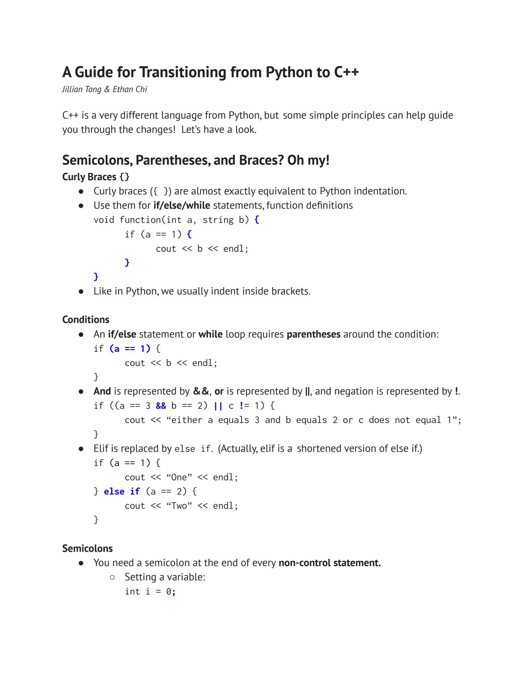
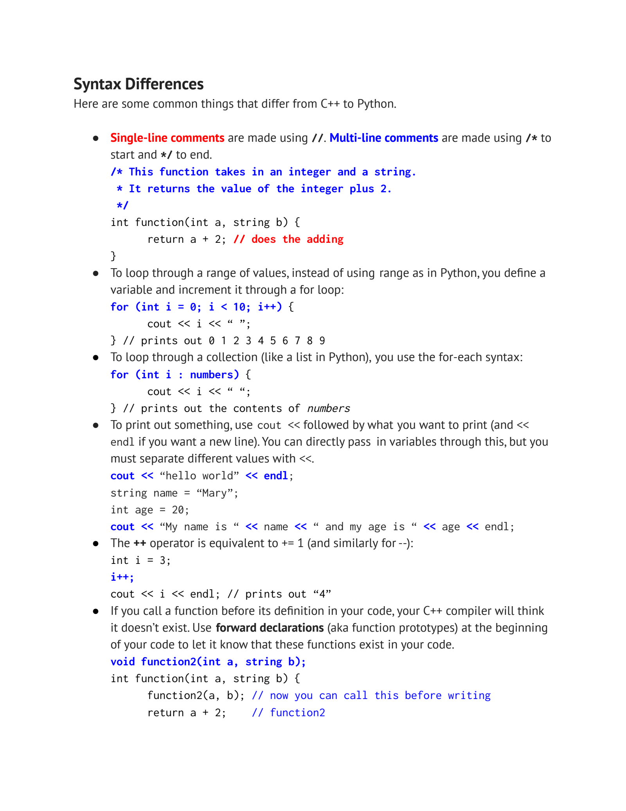

- 从 Python 过渡到 C++：先适应表达方式
	- [入门指南第1–2页](../Slides/Welcome%20to%20C%2B%2B%21.pdf#page=1)
	- 本篇对应未编号的 **Welcome to C++!** 指南，作为 Lecture0 热身；正式课程仍按原课件的 Lecture1–16 排列。
	- C++ 用 `{}` 确定代码块，而不是靠缩进；条件写成 `if (...)` / `while (...)`，逻辑与、或、非分别为 `&&`、`||`、`!`。
	- 普通表达式/声明常以 `;` 结束；不要在 `if (...)` 或 `for (...)` 后误加分号，否则可能生成空语句。类/struct 定义末尾则需要 `;`。
	- 

- 静态类型：变量和函数都有确定的类型
	- [入门指南第2页](../Slides/Welcome%20to%20C%2B%2B%21.pdf#page=2)
	- 常见类型包括 `int`、`double`、`bool`、`char`、`std::string`；声明时确定类型，之后不能像 Python 名称那样随意绑定不同类型的值。
	- 函数写返回类型、参数类型；不返回值用 `void`。调用时只传值，不再重复写类型。
	- `auto` 可以让编译器推导类型，但**不是动态类型**；`'a'` 是字符，`"a"` 是字符串字面量，二者不同。

- 循环与输出：语法改变，基本控制流相同
	- [入门指南第3页](../Slides/Welcome%20to%20C%2B%2B%21.pdf#page=3)
	- 计数循环常写 `for (int i = 0; i < n; ++i)`；范围循环写 `for (const auto& x : xs)`，避免不必要的元素拷贝。
	- 输出使用 `std::cout << value`；`'\n'` 只换行，`std::endl` 还会刷新缓冲区。单行注释用 `//`，块注释用 `/* ... */`。
	- 最小标准库示例：
		```cpp
		#include <iostream>
		#include <vector>
		int main() {
		    std::vector<int> numbers{1, 2, 3};
		    for (int x : numbers) std::cout << x << ' ';
		    std::cout << '\n';
		}
		```
	- 

- 编译与声明：先让编译器知道名字是什么
	- [入门指南第3–4页](../Slides/Welcome%20to%20C%2B%2B%21.pdf#page=3)
	- 函数在被使用前通常需要可见声明；定义在后面时，可先写 prototype，例如 `int square(int x);`。
	- `#include <iostream>`、`<string>`、`<vector>` 提供标准库声明；`std::` 指向标准库命名空间。
	- 编译时显式选标准，例如 `clang++ -std=c++17 main.cpp -o main`；结构化绑定等语法需要相应语言版本。

- 别把 Stanford 教学库当成标准 C++
	- [入门指南第4页](../Slides/Welcome%20to%20C%2B%2B%21.pdf#page=4)
	- 指南中的 `Vector`、`stringSplit`、`getLine`、`getInteger`、`randomInteger` 来自 Stanford 库，不是装好任意 C++ 编译器就自带。
	- 标准库用 `std::vector`、`std::getline` 等接口，大小写、头文件和语义都要核对，不能机械替换名字。
	- `s.find(...)` 找不到时返回 `std::string::npos`，不是 Python 的 `-1`；C++ 的复制、引用和生命周期也与 Python 不同，见 [Lecture3](Lecture3%20Initialization%20and%20References.md)。
