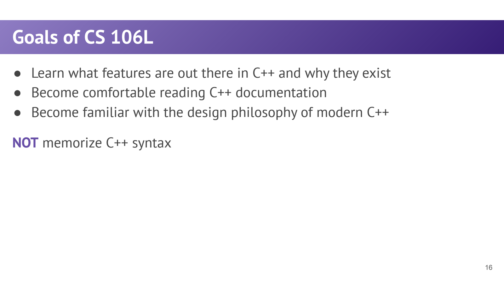
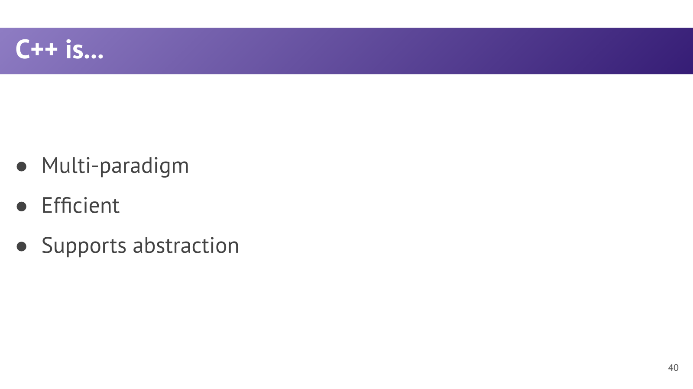

- 为什么学 CS106L：理解现代 C++ 的设计，而不只是背语法
	- [Slides 5–18](../Slides/WLecture1_intro.pdf#page=5)
	- C++ 同时提供高层抽象与底层控制，适合对性能、资源与可预测性有要求的系统；课程用这些需求解释语言特性为什么存在。
	- 三个目标：认识重要语言/库特性、学会读 C++ 文档、理解现代 C++ 的设计哲学；不是记住所有语法细节。
	- 与偏算法和教学封装库的学习方式相比，这里更关注标准库、泛型、对象语义与资源管理。
	- 

- 课程地图：从使用类型到设计类型
	- [Slides 17–18](../Slides/WLecture1_intro.pdf#page=17)
	- **基础**：类型、struct、初始化、引用和 streams。
	- **STL / 泛型**：containers 保存数据，iterators 描述区间，templates 与 lambdas 让 algorithms 复用逻辑。
	- **类设计**：模板类、const correctness、运算符、特殊成员函数、移动语义、RAII 与智能指针。
	- 学习顺序贯穿两条线：**怎样表达通用算法**，以及**怎样安全高效地拥有和转移资源**。

- 历史脉络：抽象不断增加，但不放弃效率
	- [Slides 24–35](../Slides/WLecture1_intro.pdf#page=24)
	- 从机器/汇编层的指令组织，到 C 的可移植过程抽象，再到 C++ 的类、泛型和标准库，逐步把复杂性放到更合适的接口里。
	- C++ 是持续演化的语言；本地讲义讨论 C++11/14/17 与部分 C++20。阅读旧代码时，要同时看语言版本和编译器选项。
	- 课件的历史应用案例用于说明背景，不代表当前产品实现或课程安排的实时清单。

- 三条设计哲学：能力与责任成对出现
	- [Slides 36–40](../Slides/WLecture1_intro.pdf#page=36)
	- **给程序员选择**：可控制内存、布局与性能，但也承担越界、悬空引用等风险；“编译通过”不等于程序没有未定义行为。
	- **尽量编译期查错**：静态类型、模板实例化和 const 将部分错误提前暴露；代价是声明和错误信息可能更复杂。
	- **封装复杂构造**：把指针、锁、文件等包装进清晰的类型，使客户端不必反复手写危险操作；RAII 是后半程的重要答案。
	- 

- 怎样读文档、看懂一个接口？
	- [Slides 16–18、42–43](../Slides/WLecture1_intro.pdf#page=16)
	- 先看类型与模板参数，再看参数传值/引用、返回值和 const，最后查前置条件、复杂度、失效规则与异常行为。
	- 比如 `vector<int> nums;` 不只是“建一个列表”：涉及模板实例化、默认构造、元素类型与对象生命周期。
	- 实践时用最小代码验证疑问；将“为什么能编译”“是否复制”“谁拥有资源”“操作多贵”作为固定检查问题。
