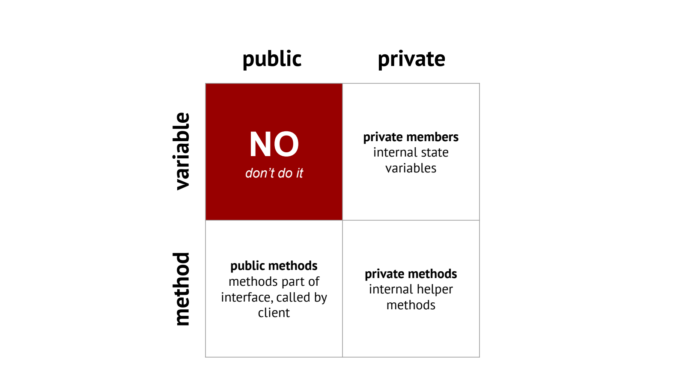
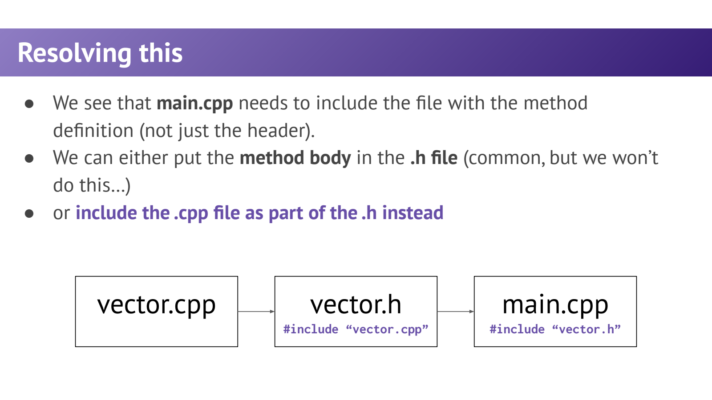
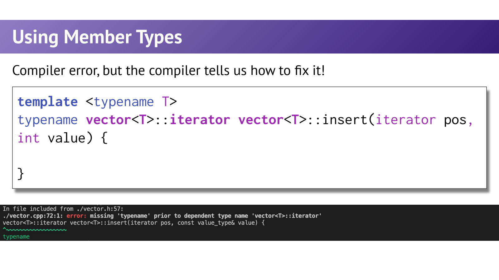

- Class Design：从“会用 vector”到“能设计一个类型”
	- [Slides 3–14](../Slides/WL10_Temp_classes.pdf#page=3)
	- 对象把状态与操作组合，public 暴露使用接口，private 保存需要维护约束的实现；例如年龄不能随意设为负数。
	- struct / class 的能力大体相同，主要语言区别是默认成员访问与默认继承权限分别为 public / private；“struct 只装数据、class 才有方法”是错误理解。
	- 数据类型简单且所有状态都有效时，public struct 可以很合理；课件的封装建议不是禁止所有公开字段。
	- 

- `.h`、`.cpp` 与作用域：声明不等于定义
	- [Slides 12–14、19–23](../Slides/WL10_Temp_classes.pdf#page=12)
	- 常规非模板代码可在头文件声明、源文件定义，分别编译后链接；类外定义用 `ClassName::method` 说明所属作用域。
	- `#include` 使内容在当前翻译单元可见，不是运行时导入模块；头文件应有 include guard 或合适的防重复包含机制。
	- namespace 解决名字组织，class 自己也形成作用域；二者不是完全相同的语言构造。

- 类模板：把元素类型参数化
	- [Slides 15–18、24](../Slides/WL10_Temp_classes.pdf#page=15)
	- `template<typename T> class Box { ... };` 是类模板，`Box<int>` 和 `Box<std::string>` 是不同类型；每个实例化有自己的成员类型和操作要求。
	- 类外定义成员时再次写 template 声明，并使用 `Box<T>::`；primary template 声明应写 `class Box`，不是课件部分简写中的 `class Box<T>`。
	- 泛型容器不只把 int 替换成 T：构造、比较、复制与析构都会对 T 提出要求，后面几讲继续补全。

- 为什么模板定义通常放在头文件？
	- [Slides 19–24](../Slides/WL10_Temp_classes.pdf#page=19)
	- 实例化所需的定义通常必须在使用处可见；只有类声明，却把成员模板定义藏在单独编译的 cpp 中，可能造成链接失败。
	- 可以直接把定义放 `.h`，或放 `.tpp / .ipp` 再由头文件包含；课件用“头文件包含 cpp”演示同一原则。
	- 这不代表普通工程都应该 include cpp；显式实例化也可以支持特定类型集合，但属于另一种组织方案。
	- 

- Member Types：给泛型客户端稳定的类型名
	- [Slides 26–34](../Slides/WL10_Temp_classes.pdf#page=26)
	- `using value_type = T;`、`using iterator = ...;` 公开与类型相关的别名；客户端不必猜实现细节。
	- map 的 value_type 是 `pair<const K,V>`，并非直接等于 K 或 V，这说明成员别名不只是“重复写一次 T”。
	- 在 C++17 模板语境中，`typename Container<T>::iterator` 告诉编译器这是依赖类型；类外函数返回类型出现在类作用域限定之前时尤其常见。
	- 

- 最小模板类：接口与定义共同可见
	- [Slides 15–24、27–34](../Slides/WL10_Temp_classes.pdf#page=15)
	- 简化示例可整体放入头文件：
		```cpp
		template <typename T>
		class Box {
		public:
		    using value_type = T;
		    explicit Box(const T& value) : value_(value) {}
		    const T& get() const { return value_; }
		private:
		    T value_;
		};
		```
	- 下一步的问题不再只是能否存 T，还包括只读对象能调用什么、复制是否安全、谁释放资源，分别连接到 Lecture11–15。
