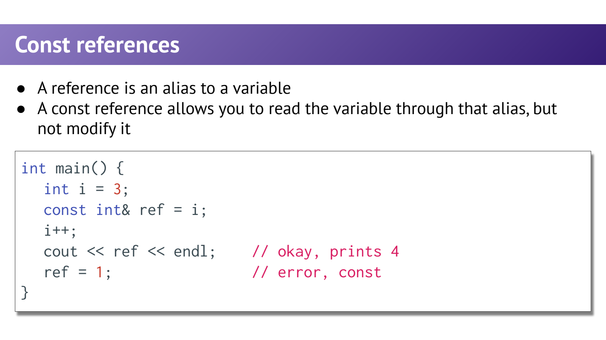
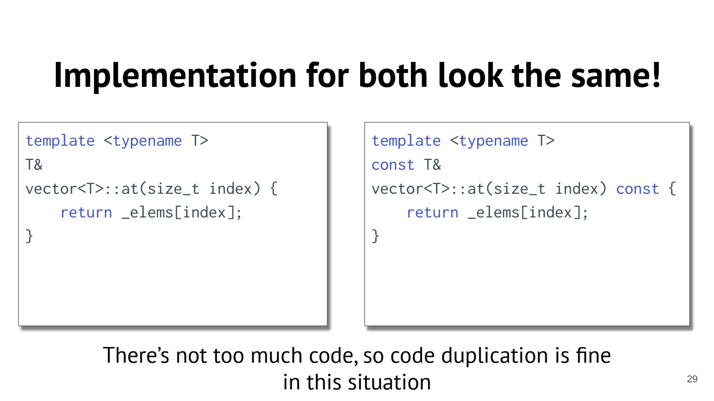
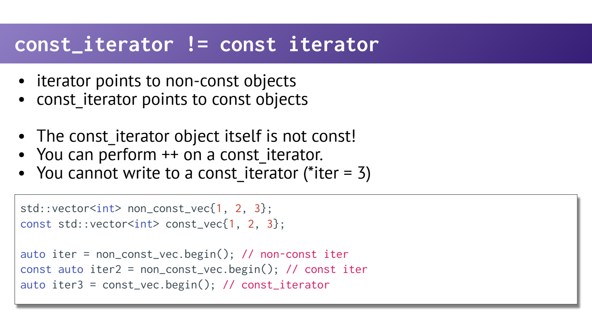

- Const Correctness：在接口里表达“只读使用”
	- [Slides 6–17](../Slides/WL11_Const.pdf#page=6)
	- const 对象不能随意修改；`const T&` 不能通过这个别名修改对象，但非 const 原对象仍可从其他通道改变。
	- const 是编译器参与检查的接口约束，不只是注释；例如函数拿到 `const vector&`，就应仍能查询 size，而不能 push_back。
	- 

- Const Member Function：const 放在参数列表后面
	- [Slides 8–19](../Slides/WL11_Const.pdf#page=8)
	- 写 `std::size_t size() const;`，类外定义也要保留末尾 const；它描述对当前对象的访问约束，不是返回值的 const。
	- 在 const 成员函数中，this 指向 const 当前对象，不能直接修改其非 mutable、非静态数据成员；对当前对象通常只能调用 const 成员接口。
	- 非 const 对象也可调用 const 方法。“不能修改任何 private 成员”不够准确：public/private 是访问权限，与 const 是不同轴；mutable、静态成员、指针指向的外部对象还需分别分析。

- 只加 const 不够：别通过返回值泄露可写引用
	- [Slides 20–29](../Slides/WL11_Const.pdf#page=20)
	- 为自定义 vector 写 `T& at(i) const` 可能让调用者绕过逻辑只读约束；只写 `const T& at(i) const` 又会阻止非 const 容器通过 at 修改元素。
	- 正确设计通常提供两组重载：
		```cpp
		T& at(std::size_t i);
		const T& at(std::size_t i) const;
		```
	- 非 const 对象优先使用可写版本，const 对象使用只读版本；内部代码相似，但公开权限不同。
	- 这是针对拥有元素的容器所设计的“逻辑 const”，不是 C++ 自动递归冻结所有间接指向的数据。
	- 

- Const Iterator 与 Const-iterator：位置固定和元素只读是两件事
	- [Slides 34–38](../Slides/WL11_Const.pdf#page=34)
	- `const auto it = v.begin();` 是一个不可修改的 iterator 对象：不能 ++ 或重新赋值；若指向可变元素，仍可能 `*it = value`。
	- `auto it = v.cbegin();` 是 const_iterator：可以移动位置，但不能经它修改元素；const 容器的 begin 也返回相应只读迭代器。
	- 两个限制还能叠加：`const auto it = v.cbegin();` 同时固定位置并禁止经该迭代器改元素。
	- 

- 接口检查清单
	- [Slides 14–29、34–38](../Slides/WL11_Const.pdf#page=14)
	- 查询方法是否应标 const？声明和定义是否一致？返回引用是否匹配对象的只读性？迭代入口是否提供 const / non-const 版本？
	- 不要为了“让编译通过”随意复制大对象或去掉 const；编译错误常是在暴露接口缺失。
	- 也别把 const 当成线程安全、数据永远不变或生命周期延长的保证；这些是需要另外设计的性质。
