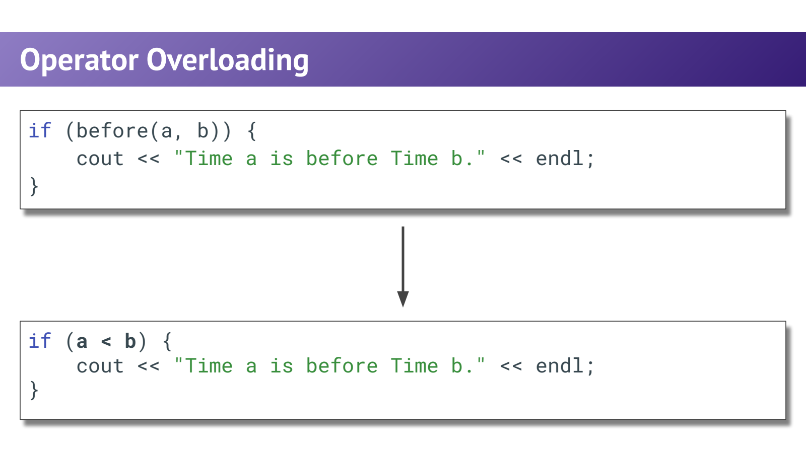
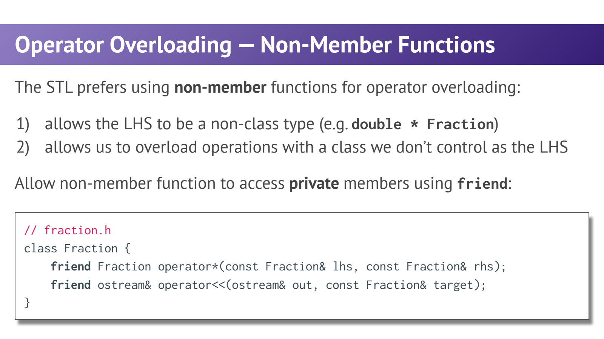
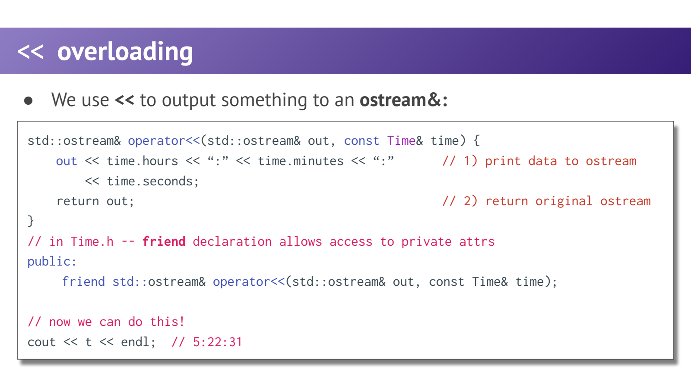

- Operator Overloading：让自定义类型像一个自然的值
	- [Slides 3–15](../Slides/WL12_Operators.pdf#page=3)
	- 将 `before(a,b)` 表达为 `a < b`，可使 Time 等类型更贴近直觉；运算符重载本质上仍是函数调用与重载解析。
	- 不能发明新的运算符、改变优先级或元数，也不能把纯内置类型的加法随意重新定义；至少要符合语言对用户定义操作数的要求。
	- 代码能写得像算术，不代表语义可以任意设计。
	- 

- Member 与 Non-member：左操作数在哪里？
	- [Slides 15–27](../Slides/WL12_Operators.pdf#page=15)
	- 成员形式 `bool Time::operator<(const Time& rhs) const`：左侧是当前对象 this，显式参数只写右侧。
	- 非成员形式 `bool operator<(const Time& lhs,const Time& rhs)`：两侧都显式传入，更适合左右对称的操作与转换。
	- `friend` 允许特定非成员函数访问私有状态，但不会让它变成成员函数；能通过公开接口完成时，也不一定需要 friend。
	- 输出运算符左侧是 `std::ostream`，通常用非成员定义，而不是修改标准库 ostream 类。
	- 

- 返回值：修改型返回引用，产生新值的操作通常返回值
	- [Slides 18–23、29](../Slides/WL12_Operators.pdf#page=18)
	- `operator+=` 通常修改左侧并返回 `T&`，便于链式调用；`operator+` 通常返回独立的新值，而不是局部对象的引用。
	- 只读比较应支持 const 对象，例如比较函数参数用 `const T&`，成员版本末尾也标 const。
	- 可用复合赋值复用普通加法逻辑：
		```cpp
		struct Counter {
		    int value{};
		    Counter& operator+=(int n) { value += n; return *this; }
		    friend Counter operator+(Counter lhs, int n) {
		        lhs += n;
		        return lhs;
		    }
		};
		```

- Stream Insertion：为什么要返回原 ostream？
	- [Slides 28–30](../Slides/WL12_Operators.pdf#page=28)
	- 常见接口是 `std::ostream& operator<<(std::ostream& out,const T& value)`；输出到传入的 out，而不是内部硬编码 cout。
	- 返回 out 本身，才能继续 `out << a << b`，并保留同一流的状态与目的地；不能按值复制一个流返回。
	- 保持对象只读、避免强制加换行/刷新，让调用者控制整体排版。
	- 

- 语义约定比语法技巧重要
	- [Slides 32–34](../Slides/WL12_Operators.pdf#page=32)
	- `+` 应接近加法/组合，`==` 应表示一致的等价关系；不要让字符串相乘偷偷代表“共同字符”等不明显操作。
	- 自定义排序关系要满足算法/容器需要的严格弱序，不能只测试一两个例子就假设可用于 set 或 sort。
	- C++17 中不要指望定义 `<` 就自动得到所有其他比较符；C++20 的 `<=>` 是另一套规则，见 [[CS106L/Lectures/Lecture16 Wrap-up.md|Lecture16]]。
