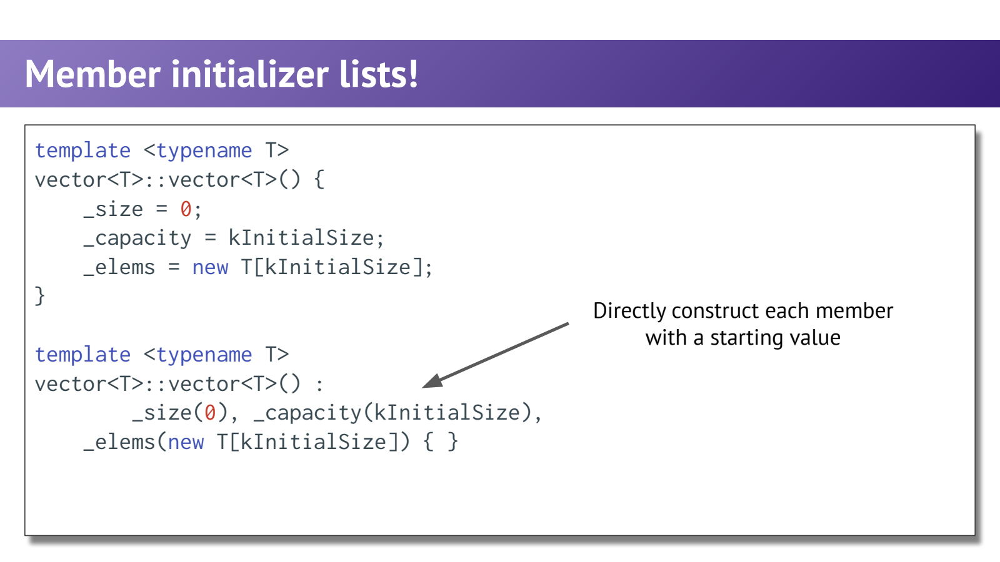
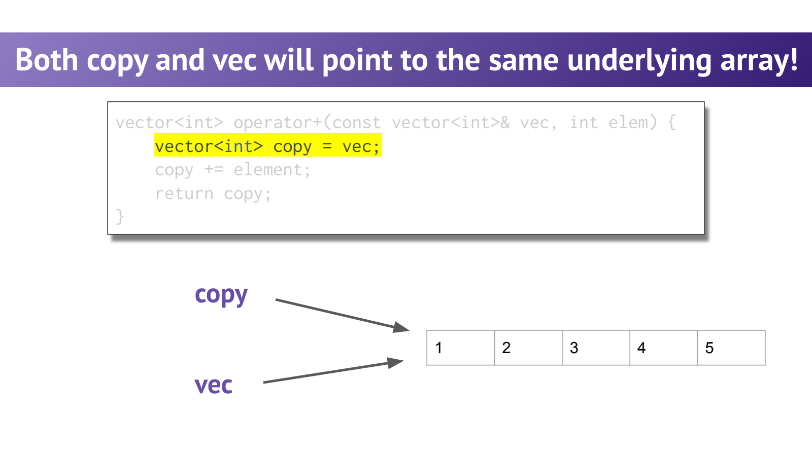
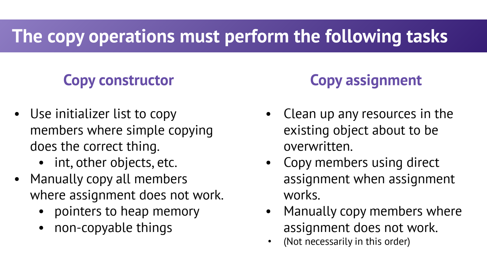

- Special Member Functions：对象的一生需要哪些操作？
	- [Slides 7–24、40](../Slides/WL13_SMF.pdf#page=7)
	- **默认构造**创建无显式实参的对象；**拷贝构造**用已有对象创建新对象；**拷贝赋值**给已有对象替换内容；**析构**结束生命周期并清理资源。
	- 移动构造与移动赋值也是特殊成员函数，下一讲展开。编译器只在特定规则下隐式声明/定义它们，不是无条件把六个都生成。
	- `T b = a;` 中 b 是新对象，通常是拷贝初始化；`b = a;` 才是赋值。返回值还可能涉及 copy elision，不能只看 `=` 或 return 就机械数复制次数。
	- `T x();` 会被解析为函数声明；想默认构造对象用 `T x;` 或 `T x{};`。

- Member Initializer List：直接构造成员，而不是先构造再赋值
	- [Slides 25–28](../Slides/WL13_SMF.pdf#page=25)
	- `C(...) : member(value) { ... }` 在进入构造函数体前初始化成员，适用于普通构造函数，不限特殊成员函数。
	- const 成员、引用成员，以及没有默认构造函数的成员通常需要在这里或通过适用的成员初始值初始化。
	- 初始化顺序由基类/成员**声明顺序**决定，不是列表书写顺序；要避免读取尚未初始化的成员。
	- 

- 默认成员级拷贝不一定符合所有权语义
	- [Slides 29–37](../Slides/WL13_SMF.pdf#page=29)
	- 复制 int、string、vector 成员通常有合理值语义；复制一个裸指针只复制地址，不会复制其指向的堆数组。
	- 若两个对象因此都认为自己拥有同一数组，会出现相互修改、悬空访问和 double delete；这才是“浅拷贝危险”的具体前提。
	- 借用指针可以故意共享，拥有型指针则要明确深拷贝、转移或禁止复制，不能一概说“所有指针都必须深拷贝”。
	- 

- 拷贝构造与拷贝赋值：后者还背着旧资源
	- [Slides 39–51](../Slides/WL13_SMF.pdf#page=39)
	- 深拷贝构造需要申请独立存储，再复制元素；若复制过程会抛异常，已申请资源也必须由临时 RAII 对象等正确清理。
	- 拷贝赋值还要处理旧资源、自赋值，并返回 `*this` 的引用；只给 `_elems` 换新地址会泄漏旧数组。
	- **课件边界**：先 delete 旧数组再 new 的简化实现，不具备充分异常安全性；new/元素复制失败后可能破坏对象状态。
	- 可采用“先准备新状态，成功后交换提交”的思路，如条件合适的 Copy-and-swap；保证等级仍取决于复制和 swap 能否抛异常。
	- 

- `= delete`、`= default` 与 Rule of Three / Zero
	- [Slides 53–61](../Slides/WL13_SMF.pdf#page=53)
	- `C(const C&) = delete;` 与 `C& operator=(const C&) = delete;` 可以禁止复制，避免悄悄做错误的所有权共享。
	- Rule of Three：若为资源管理自定义了析构、拷贝构造或拷贝赋值，通常要一起检查三者；现代 C++ 还应连同移动操作审视，即 Rule of Five。
	- **Rule of Zero**：优先让 vector、string、智能指针等成员管理资源，让编译器组合其正确语义；不为炫技而手写全套特殊成员函数。

- 更常用的最终设计：组合一个正确的资源类型
	- [Slides 57–60](../Slides/WL13_SMF.pdf#page=57)
	- 示例把数组所有权交给 vector，无需亲自实现析构与深拷贝：
		```cpp
		class Buffer {
		public:
		    explicit Buffer(std::size_t n) : data_(n) {}
		private:
		    std::vector<int> data_;
		};
		```
	- “不写自定义函数”不意味着所有操作都可用：若成员是 unique_ptr，默认复制会被禁用，但移动可能正是需要的语义。
