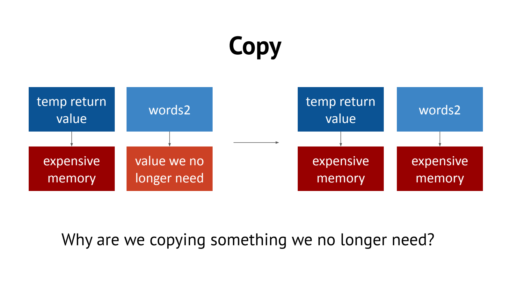
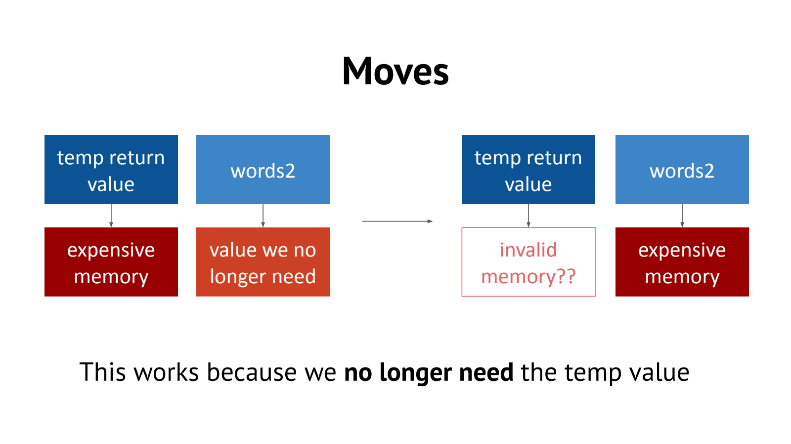

- 为什么需要 Move：不用复制马上就要被丢弃的资源
	- [Slides 3–15](../Slides/WL14-Move.pdf#page=3)
	- 拷贝拥有型容器通常要分配并复制元素；如果源对象的资源不再需要，可以转移所有权，避免重复搬运大数组。
	- 不能把每次赋值都变成 move：`b = a` 后调用者可能还要原来的 a，因此必须区分复制意图与允许转移的情形。
	- 返回值优化 / copy elision 也会消除一些复制；课件为说明问题暂时忽略它，不代表实际每个 return 都会先复制再移动。
	- 

- Value Category：这是表达式分类，不是对象寿命分类
	- [Slides 16–28、37](../Slides/WL14-Move.pdf#page=16)
	- 入门可把 lvalue 理解为标识已有对象身份的表达式，rvalue 包含常用于结果/可转移场景的 prvalue 与 xvalue；不能简单等同于“有名字/没名字”。
	- **纠正课件简化**：左值不一定到作用域末才失效，右值也不一定“活到行尾”；值类别与对象生命周期是不同问题，临时对象还涉及特定的延寿规则。
	- `T&` 通常绑定可变左值，`const T&` 可绑定左值及许多右值，普通非推导的 `T&&` 常用于接收右值。
	- 名为 other 的 `T&& other` 在函数体内，表达式 `other` **仍是左值**；这正是成员转移时常需 std::move 的原因。

- `std::move` 本身不搬数据
	- [Slides 29–36](../Slides/WL14-Move.pdf#page=29)
	- 它把表达式转换成可参与移动重载解析的 xvalue；真正资源转移由被选中的移动构造/赋值等操作实现。
	- 不保证一定移动：类型没有可用移动操作时可能回退复制；对 const 对象 std::move 通常仍保留 const，常无法匹配需要修改源的 `T&&`。
	- `std::move` 一个裸指针并不会自动把源指针设成 nullptr，也不会转移某种隐形的所有权标志。
	- 

- Move Constructor / Assignment：源和目标都要有合法状态
	- [Slides 29–35](../Slides/WL14-Move.pdf#page=29)
	- 常见接口为 `T(T&& other)`、`T& operator=(T&& other)`；移动拥有型数组时，目标接管资源，源解除所有权并保留可析构状态。
	- **移动赋值还必须妥善释放目标原来的资源、处理自移动并返回 `*this`**；课件第34页不能作为完整实现直接照抄。
	- 若自定义容器以 size / capacity / pointer 表达约束，移动后这些字段必须彼此一致，不能只置空指针却留下不可用的状态。
	- 标准库被移动对象通常处于“有效但未指定”状态；可析构、重新赋值，不应猜测其内容一定为空，调用有前置条件的方法前仍需检查。
	- 

- 容器接口与 noexcept：移动快不等于永不抛异常
	- [Slides 38–39](../Slides/WL14-Move.pdf#page=38)
	- `push_back(const T&)` 可复制，`push_back(T&&)` 可移动；右值引用重载内部仍需正确使用 std::move，才能把具名参数当可转移值。
	- 若移动确实不抛异常，可标 noexcept；vector 等容器在扩容时会据此选择更合适的复制/移动路径。
	- 不要给任意类型的移动或 swap 无条件写 noexcept：若内部操作实际抛出，程序会终止。

- 使用准则：最后一次使用时再表达转移意图
	- [Slides 35–39](../Slides/WL14-Move.pdf#page=35)
	- 简短例子：
		```cpp
		std::vector<std::string> source{"C++", "STL"};
		auto target = std::move(source);
		source.clear();            // 有效操作，不依赖原内容
		source.push_back("reuse"); // 可以重新使用
		```
	- 不要为了“优化”到处加 move，尤其 `return std::move(local);` 可能妨碍 NRVO；默认先写清楚所有权，再做有根据的性能改进。
