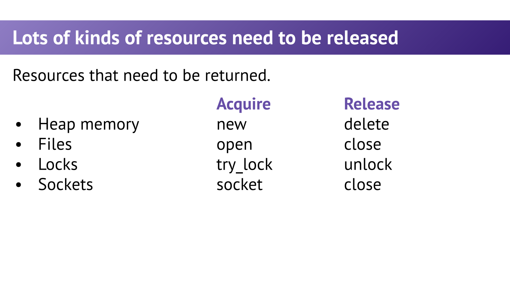
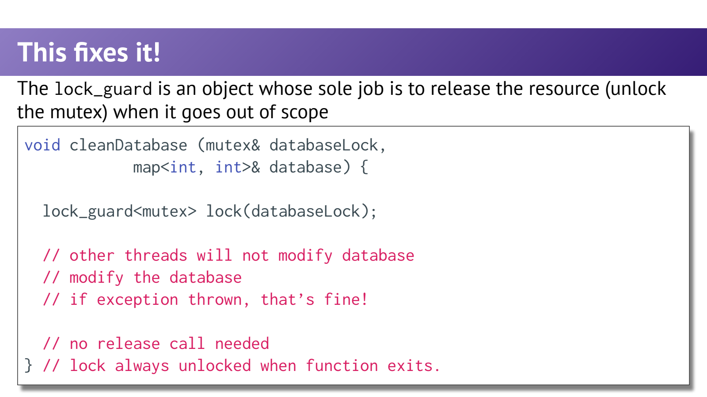
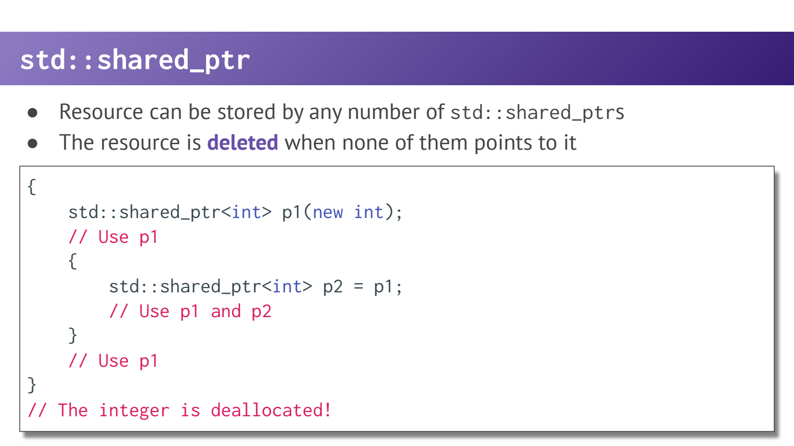

- 异常带来隐藏控制流：最后写一个 delete 不够
	- [Slides 3–24](../Slides/WL15_RAII.pdf#page=3)
	- 看似简单的字符串拼接、函数调用、对象复制都可能抛异常；函数不一定沿着显式 if/return 路径走到结尾。
	- `new → 操作 → delete` 中间一旦抛出并离开作用域，手写 delete 可能被跳过；资源不只有内存，也有文件、锁与 socket。
	- 核心问题是**谁拥有资源，以及所有离开路径上谁负责释放**，不是在每一处人工补更多清理语句。
	- 

- RAII：把资源所有权绑定到对象生命周期
	- [Slides 25–39](../Slides/WL15_RAII.pdf#page=25)
	- **Resource Acquisition Is Initialization**：用对象表示资源所有权，构造/获取时建立有效状态，析构时释放；正常离开作用域和异常栈展开都利用同一套清理机制。
	- 若构造中抛异常，完整对象的析构不会执行，但已构造的成员/基类会清理；因此应尽早让资源进入 RAII 成员，而不是先攥着一堆裸资源。
	- “析构永远会调用”过于绝对：进程异常终止等不保证局部对象按正常栈展开析构；析构通常也不应再向外抛异常。

- 文件与锁：RAII 不只是智能指针
	- [Slides 31–38](../Slides/WL15_RAII.pdf#page=31)
	- `std::ifstream in{"file.txt"};` 让对象持有文件，离开作用域自动关闭；仍需检查打开/读取是否成功。
	- **课件辨析**：默认构造 ifstream 后调用 open，文件缓冲对象析构时同样会关闭文件，并非因此就完全没有 RAII；构造时打开更利于局部表达意图。[标准草案：filebuf 析构](https://eel.is/c++draft/filebuf.cons)
	- 手动 `lock → 操作 → unlock` 会被异常打断；`std::lock_guard<std::mutex> guard(mutex);` 用守卫析构统一解锁，避免漏掉退出路径。
	- 

- Unique_ptr：默认优先表达唯一所有权
	- [Slides 43–60、65–70](../Slides/WL15_RAII.pdf#page=43)
	- `std::unique_ptr<T>` 唯一拥有对象，析构释放；禁止复制，但可移动以转移所有权。
	- C++14 起常写 `std::make_unique<T>(args...)`，减少直接 new 与裸所有权暴露；自定义 deleter 等特殊情况需按接口选择构造方式，不是绝对禁止显式构造。
	- `get()` 只借用裸指针，不转移所有权；不要手动 delete 它，也不要拿同一裸指针分别创建两个互不知情的拥有者。
	- 示例：
		```cpp
		auto owner = std::make_unique<std::string>("CS106L");
		auto next = std::move(owner); // 转移所有权
		if (next) std::cout << *next << '\n';
		```

- Shared_ptr / Weak_ptr：共享与观察不是同一件事
	- [Slides 62–70](../Slides/WL15_RAII.pdf#page=62)
	- `shared_ptr` 通过共享控制块管理所有权，最后一个强拥有者消失时销毁对象；复制 shared_ptr 会共享对象，而不是深拷贝对象。
	- 共享有引用计数和控制块成本，也会让释放时机依赖其他拥有者；引用计数安全不代表被指向对象的并发访问自动安全。
	- `weak_ptr` 不增加强引用计数，通过 `lock()` 尝试取得仍存活的 shared_ptr，适合观察与打破循环拥有；强引用环可能让对象永不释放。
	- 

- 一套更清晰的所有权选择顺序
	- [Slides 39、50–70](../Slides/WL15_RAII.pdf#page=39)
	- 能直接按值放就按值放；需要动态独占时用 unique_ptr；确实共享生命周期才用 shared_ptr；非拥有访问用适当的引用/指针或 weak_ptr。
	- 资源包装器自己解决释放，业务类组合这些成员，便能实践 [[CS106L/Lectures/Lecture13 Special Member Functions.md|Rule of Zero]]。
	- RAII 的目标不是“所有东西放在栈上”，而是让**拥有资源的对象**有可靠生命周期；它管理的资源完全可以位于堆上。
