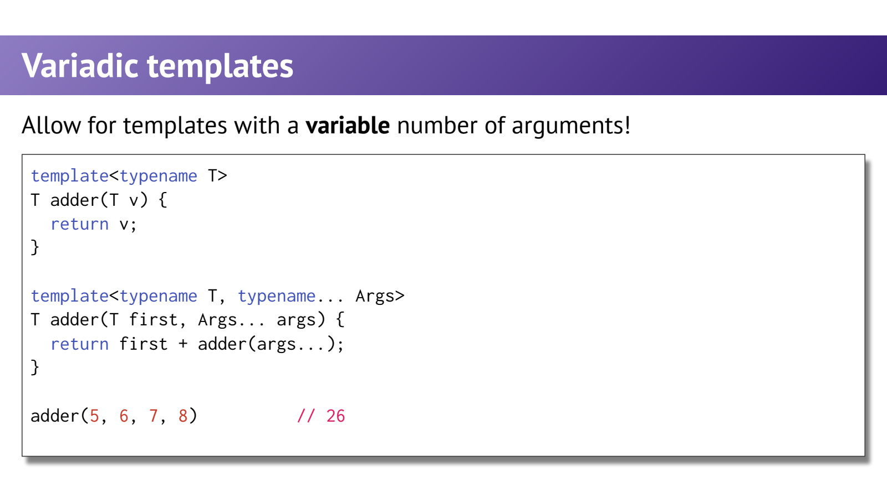
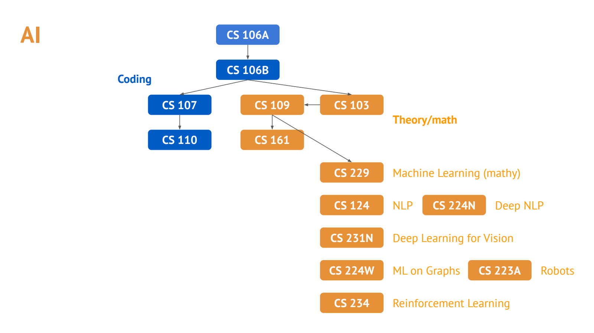

- 回到自定义 HashMap：前面各讲共同构成一个完整类型
	- [Slides 3–10](../Slides/WL16-Wrapup.pdf#page=3)
	- const 查询、iterator、`operator[] / == / <<`、复制与移动不是孤立技巧，而是客户端是否能把 HashMap 当作自然值使用的条件。
	- `operator[]` 对不存在 key 通常要插入默认 mapped value，再返回其引用；`==` 比较映射内容，不应要求相同 bucket 布局或遍历顺序。
	- 输出需处理分隔符与空容器，移动赋值还要清理目标旧资源；不要把回顾页省略的步骤当成完整实现。
	- 课件第7页 `ostringstream("a") << "bcdef"` 不保证追加得到 `"abcdef"`；默认写位置从前部开始，本地验证结果为 `"bcdef"`。需要追加可明确使用 app 模式或重新定位。

- Variadic Templates：参数数量也可以泛化
	- [Slides 11–13](../Slides/WL16-Wrapup.pdf#page=11)
	- C++11 的 `typename... Args` 表示类型参数包，`Args... args` 表示函数参数包，`args...` 展开它们。
	- 递归示例通过“一参数基例 + 多参数重载”缩小问题；参数包不是运行时数组，操作在模板实例化时展开。
	- C++17 还能用 fold expression 简化累计，例如 `(0 + ... + xs)`；空包也可由初始值 0 处理，结果类型仍受运算规则影响。
	- 

- Spaceship `<=>`：是 C++20，不是 C++17
	- [Slides 14–17](../Slides/WL16-Wrapup.pdf#page=14)
	- **纠正课件版本标注与简写代码**：三路比较属于 C++20，结果通常是 ordering category，而不是随便返回 -1/0/1 就具有全部标准比较语义。[Clang 官方特性表](https://clang.llvm.org/cxx_status.html#cxx20)
	- 可默认比较的类型常写：
		```cpp
		#include <compare>
		struct IntWrapper {
		    int value;
		    auto operator<=>(const IntWrapper&) const = default;
		};
		```
	- 符合规则时，默认化 `<=>` 还会隐式声明匹配的 `==`；自定义函数体的 `<=>` 不代表自动生成相等比较。关系运算则涉及重写候选规则。[标准草案：默认比较](https://eel.is/c++draft/class.compare.default)
	- 浮点 NaN 还可能导致 unordered，因此不能把所有三路比较都理解成整数的全序。

- Designated Initializers 与分支属性：简洁不等于没有限制
	- [Slides 18–22](../Slides/WL16-Wrapup.pdf#page=18)
	- C++20 聚合可写 `A a{.x=1,.z=2};`，但成员指定顺序要符合声明顺序，不能照搬 C 的任意顺序写法。
	- 被省略成员优先使用默认成员初始值，否则按聚合初始化规则处理；例如省略的 int 可得到 0，不应笼统写成“总是默认初始化”。
	- `if (condition) [[likely]] { ... }` 是概率优化提示，不改变正确性或保证提速；它不是运行时概率检查，也不应替代测量。

- Future Directions：把已有能力迁移到不同领域
	- [Slides 23–36](../Slides/WL16-Wrapup.pdf#page=23)
	- 课件将后续方向分为系统、理论/数学、AI 与交叉应用；系统重资源和底层行为，算法/理论重抽象，AI 同时需要数值计算与高效实现。
	- 图中的课程编号和选课信息属于历史材料，仅作知识结构参考，不作为当前开课或先修条件依据。
	- 

- 全课复盘：每次写 C++ 都可以问的四个问题
	- [Slides 5–13、23–36；结合前面各讲](../Slides/WL16-Wrapup.pdf#page=5)
	- **类型与约束**：编译期能检查什么？const / 模板接口是否表达清楚？
	- **算法与成本**：容器和 iterator 能力是否匹配？是否有不必要复制、扩容或重复遍历？
	- **所有权与生命周期**：谁释放资源？借用是否悬空？move 后源对象是否仍有效？
	- **失败与可维护性**：异常/边界路径安全吗？能否用标准算法、RAII 与 Rule of Zero 减少手写复杂性？
