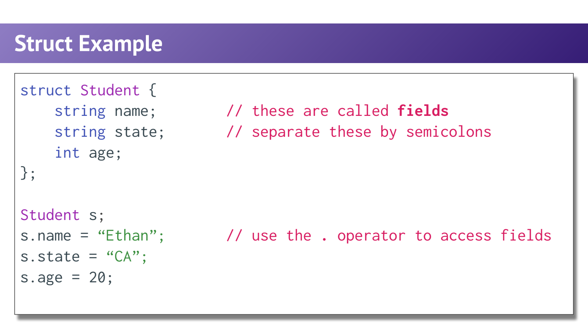
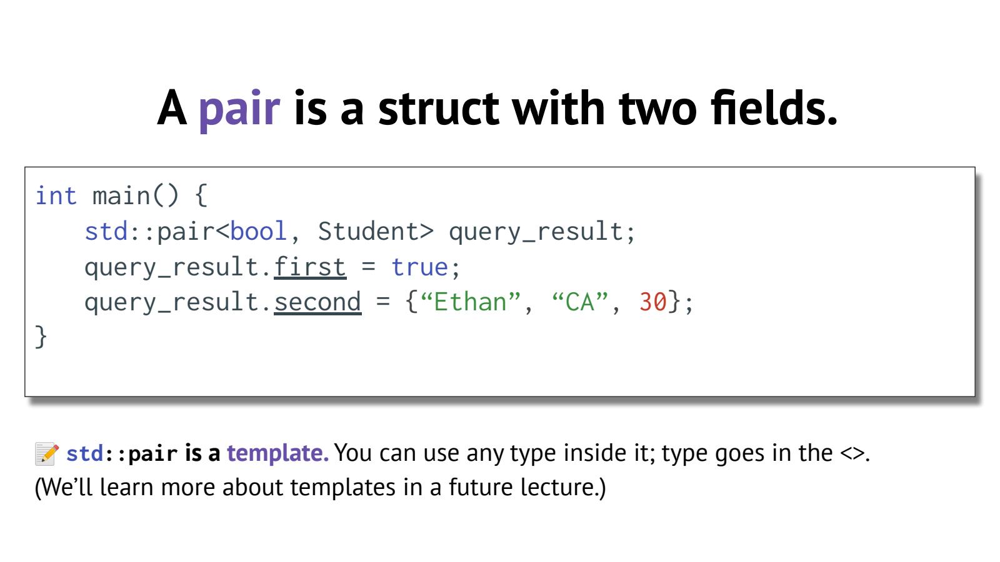
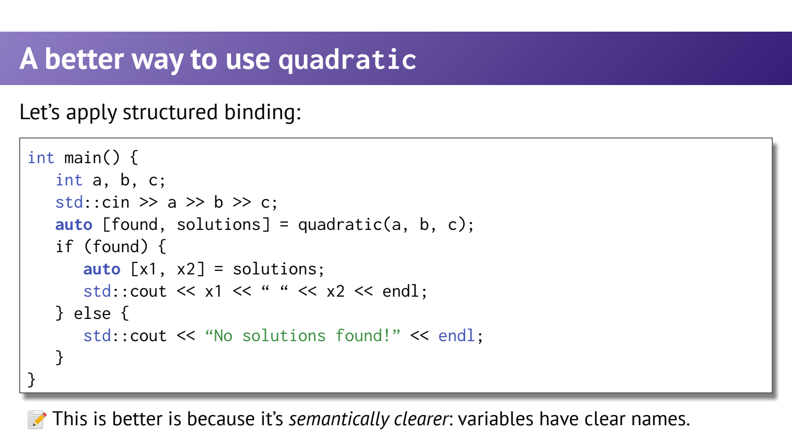

- 类型与命名空间：让接口的含义更明确
	- [Slides 3–14](../Slides/WL2-Structures.pdf#page=3)
	- 类型限定值与操作的含义，编译器在运行前检查许多不匹配；`auto` 也会得到固定类型。
	- `std::string`、`std::pair` 等位于 `std` 命名空间。显式写限定名有助于避免冲突，尤其不要在公共头文件随意 `using namespace std;`。
	- **重载**通过参数列表区分同名函数，如 `f(int)` 与 `f(double)`；不能只靠返回类型区分重载。

- Struct：把属于同一实体的信息放到一起
	- [Slides 16–25](../Slides/WL2-Structures.pdf#page=16)
	- 与其传递松散的 `name / state / age`，不如定义 `Student`；字段有名字与类型，参数和返回值也能直接表达“一个学生”。
	- `Student s{"Ethan", "CA", 20};` 按成员声明顺序初始化；通过 `s.name` 访问成员，struct 定义末尾要有分号。
	- 未初始化的内置类型成员可能有不确定值；可写 `int age{};` 或整体使用合适的初始化，不要把声明自动当成置零。
	- 

- Pair 与 Tuple：快速组合多个返回值
	- [Slides 29–37](../Slides/WL2-Structures.pdf#page=29)
	- `std::pair<A,B>` 有 `.first / .second`；`std::tuple<...>` 用 `std::get<I>` 访问。需要语义化字段名时，自定义 struct 往往更清楚。
	- `pair<bool, Result>` 可表达成功标记与结果；失败时不能不检查 bool 就使用结果。C++17 的 `std::optional<Result>` 也是可选设计。
	- 嵌套 pair 能表示多层结果，但类型冗长且含义不直观，应避免为“少写一个 struct”牺牲可读性。
	- 

- Auto：省略重复类型，不省略类型思考
	- [Slides 38–44](../Slides/WL2-Structures.pdf#page=38)
	- `auto n = 3;` 为 `int`，`auto x = 4.3;` 为 `double`，`auto c = 'X';` 为 `char`。
	- **纠正课件简写**：`auto s = "Hello";` 推导为 `const char*`，不是 `std::string` 或可写 `char*`；需要字符串对象时写 `std::string s = "Hello";`。
	- 普通 `auto` 常丢弃顶层 const 与引用；想保留引用要显式写 `auto&` / `const auto&`，下一讲会专门讨论。
	- 课件第40页对 `auto` 返回类型的限制表述过时：C++14 起普通函数可推导返回类型；它仍要满足定义可见、返回类型一致等规则。

- Structured Binding：给复合结果起有意义的名字
	- [Slides 45–47](../Slides/WL2-Structures.pdf#page=45)
	- C++17 可写 `auto [ok, result] = lookup();`，用变量名代替一串 `.first.second`；pair、tuple 和满足要求的聚合类型都可使用。
	- `auto [a,b] = p` 会建立用于分解的副本；要修改原对象可用 `auto& [a,b] = p`，只读访问可用 `const auto&`。
	- 

- 例子与边界：结构清楚不代表计算自动正确
	- [Slides 35、47](../Slides/WL2-Structures.pdf#page=35)
	- 课件用一元二次方程演示复合返回值；实际根公式分母应为 **$2a$**，还需区分 $a=0$、判别式小于零和浮点误差，不能照抄简写公式。
	- 常见结果拆分写法：
		```cpp
		std::pair<bool, double> result{true, 3.5};
		auto [ok, value] = result;       // 副本
		auto& [flag, stored] = result;   // 引用原 pair
		stored = 4.0;
		```
