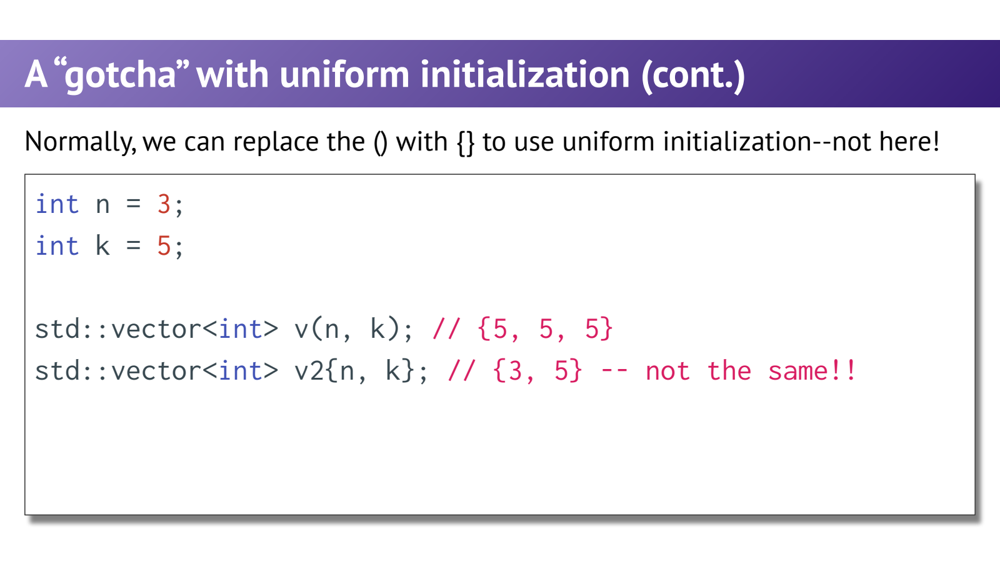
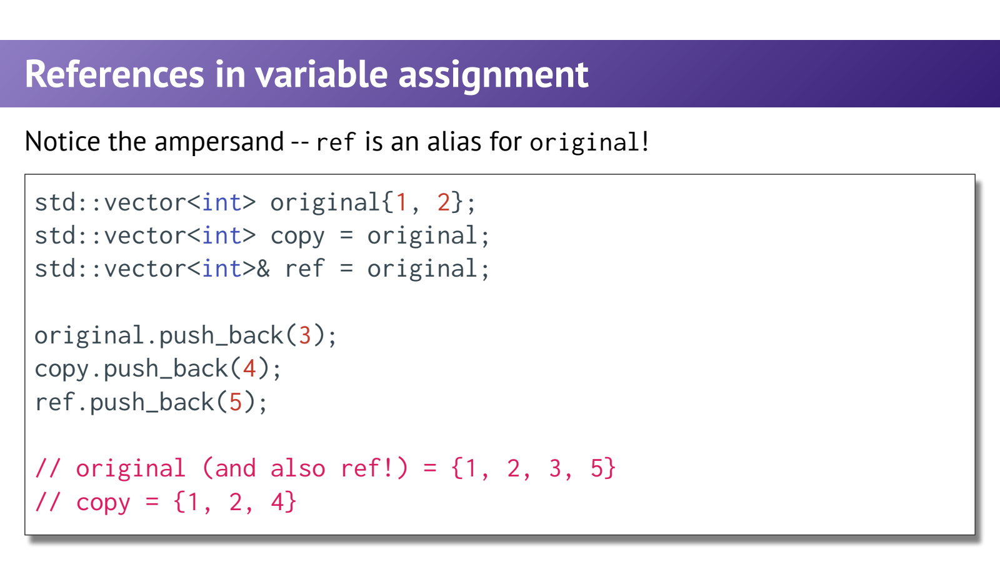
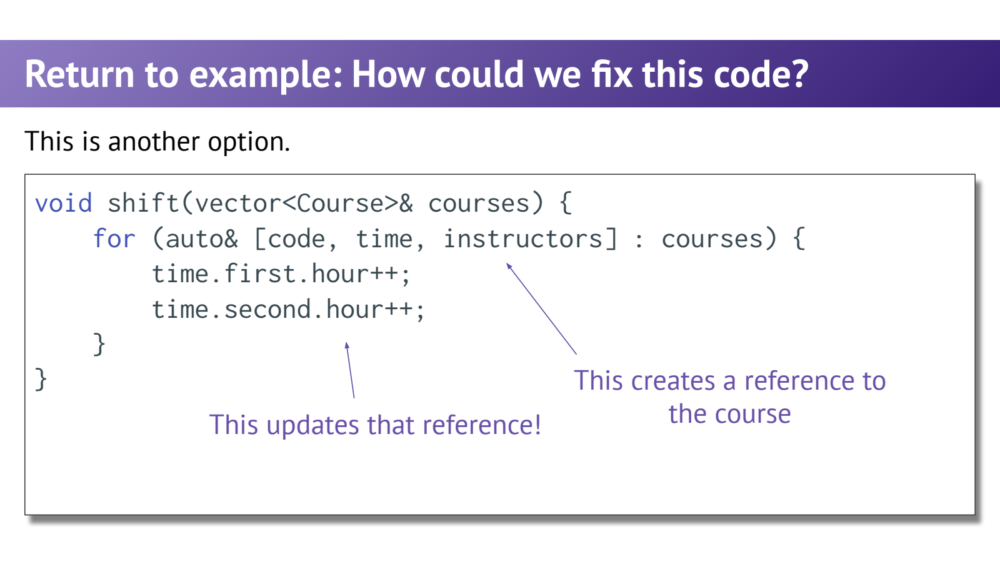

- 初始化不是赋值：对象是否已经存在？
	- [Slides 9–21](../Slides/WLecture_3_Init_and_Ref.pdf#page=9)
	- `int x = 5;` 在声明时初始化；`int y; y = 6;` 中第二句是赋值，不是“延迟初始化”。类对象的构造与赋值可能有不同成本和语义。
	- `{}` 提供统一的列表初始化语法，也会限制窄化转换，但**不能把所有 `()` 无脑替换成 `{}`**。
	- 从教学 `Vector` 过渡到 `std::vector` 时，要同时核对构造函数和方法名，而不是只改大小写。

- Initializer-list 的优先级：`(3,5)` 与 `{3,5}` 不同
	- [Slides 22–29](../Slides/WLecture_3_Init_and_Ref.pdf#page=22)
	- `std::vector<int> a(3,5);` 是三个 5；`std::vector<int> b{3,5};` 是两个元素 3、5，因为列表构造函数参与并通常优先匹配。
	- 课件第25页的 `auto list_init{3,5};` 不是有效的直接列表 auto 声明；想得到列表应写 `auto list_init = {3,5};`，类型为 `std::initializer_list<int>`。
	- 

- 引用：同一对象的别名，不是另一个容器
	- [Slides 30–42](../Slides/WLecture_3_Init_and_Ref.pdf#page=30)
	- `auto copy = original;` 通常复制；`auto& ref = original;` 引用原对象，经 ref 修改会影响 original。
	- 引用建立后不能重新绑定：`ref = other;` 是给原对象赋值，不是把 ref 改成 other 的别名。
	- 非 const 左值引用如 `int&` 不能直接绑定字面量 `5`；`const int&` 可绑定某些临时值，因此“所有引用只能绑定变量”过于绝对。
	- 

- Const Reference：避免复制，同时限制修改通道
	- [Slides 43–49、58](../Slides/WLecture_3_Init_and_Ref.pdf#page=43)
	- `const T&` 表示不能通过这个引用修改对象；若原对象不是 const，其他别名仍可能修改它。
	- 小型标量通常按值传；只读大对象常用 `const T&`；确实需要修改调用者对象时用 `T&`。
	- `auto copy = const_ref;` 仍是可修改副本；`const auto& view = object;` 才是只读引用。const 与 `&` 要分别思考。

- Range-for 与结构化绑定：别修改了副本却以为修改了原值
	- [Slides 33–34、55–57](../Slides/WLecture_3_Init_and_Ref.pdf#page=33)
	- `for (auto item : xs)` 和 `for (auto [a,b] : xs)` 通常使用副本；需要改变原内容时分别写 `auto& item`、`auto& [a,b]`。
	- 只读遍历常写 `const auto&`。引用能节省复制，但不能让失效的元素地址恢复有效。
	- 

- 返回引用前先检查生命周期
	- [Slides 51–54](../Slides/WLecture_3_Init_and_Ref.pdf#page=51)
	- 返回调用者 vector 元素的引用可以有意义，但需要容器非空，且之后不发生让引用失效的操作。
	- **不要返回局部变量或局部容器元素的引用**：函数结束对象已销毁，留下 dangling reference，使用会造成未定义行为。
	- 核心区别：返回值让结果成为独立对象；返回引用只是借用已有对象。借用是否有效，取决于被借用对象的存活与稳定性。
