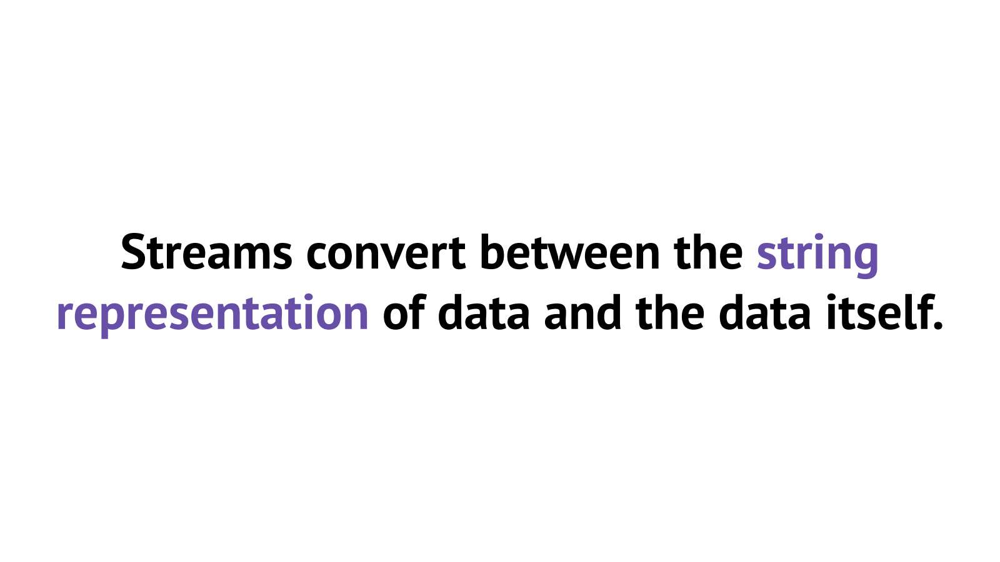
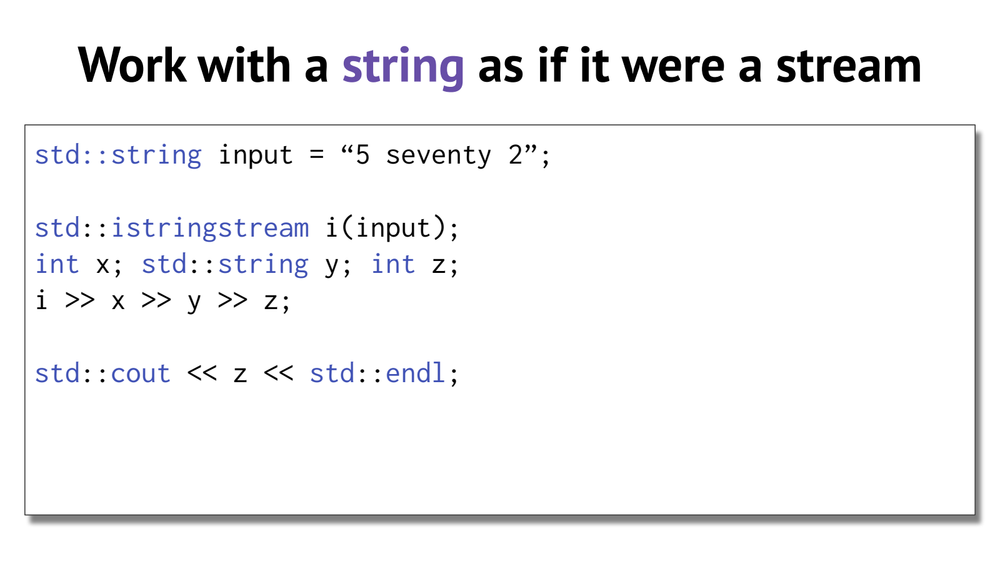
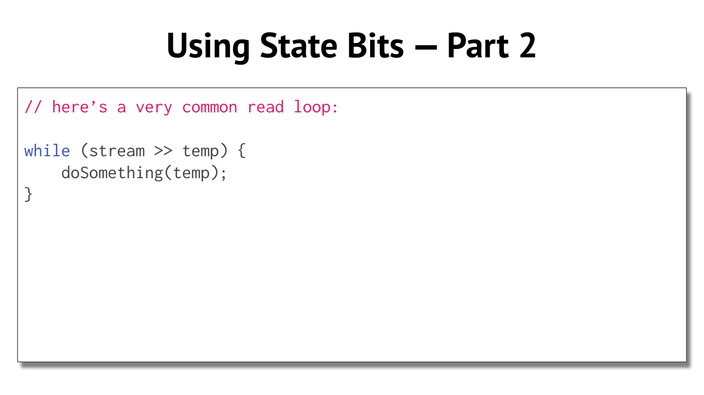

- Stream：统一表示数据的输入与输出
	- [Slides 7–19](../Slides/WL4_Streams.pdf#page=7)
	- Streams 在字符表示与程序中的值之间转换，让控制台、文件、内存字符串使用相近接口。
	- `std::ostream` 用 `<<` 输出，`std::istream` 用 `>>` 提取；`cout / cin` 对应标准输出/输入，`ofstream / ifstream` 对应文件。
	- 

- Formatted Input：按目标类型解析，不只是“读到空格”
	- [Slides 18–29](../Slides/WL4_Streams.pdf#page=18)
	- 默认格式化提取通常先跳过前导空白。读 `std::string` 常得到一个空白分隔词；读整数则按整数格式解析。
	- 例如对 `"42ab 4"` 连续提取 `int / string / int` 可得到 `42 / "ab" / 4`；不能将整数提取概括为一定吞掉整个非空白片段。
	- `std::getline(in,line)` 读到分隔符并移除它；`>>` 后遗留的换行可能让下一次 getline 得到空行。
	- 可以统一使用“getline 后再解析”；也可明确丢弃剩余行，或用 `getline(in >> std::ws,line)` 跳过空白，但后者会同时丢掉有意义的前导空格/空行。

- Stringstream：把一行文本变成可解析的数据源
	- [Slides 32–34](../Slides/WL4_Streams.pdf#page=32)
	- `std::istringstream` 读字符串，`std::ostringstream` 拼接格式化输出，`std::stringstream` 可同时读写，来自 `<sstream>`。
	- 适合分离“读取一整行”和“解析字段”：错误只影响这一行的解析器，不会把主输入流状态搞混。
	- 

- Buffering：为什么不总用 endl？
	- [Slides 35–41](../Slides/WL4_Streams.pdf#page=35)
	- 缓冲区把很多小读写合并，减少昂贵的设备/文件交互；`std::flush` 刷新，`std::endl` 等于换行再刷新。
	- 普通逐行输出常用 `'\n'`；需要及时显示提示或调试信息时再考虑刷新，不能假设每个字符都立即抵达终端。
	- 课件将 `cerr` 简写成“无缓冲”；更准确地说，它默认启用 `unitbuf`，会频繁刷新，不应据此推断完全没有 stream buffer。

- 状态与读取循环：先确认成功，再用结果
	- [Slides 42–50](../Slides/WL4_Streams.pdf#page=42)
	- `failbit` 表示格式化操作等失败，`badbit` 表示较严重的底层错误，`eofbit` 表示操作遇到输入结尾；**goodbit 是值 0，不是第四个独立置位标志**。[标准草案：iostate](https://eel.is/c++draft/ios.types)
	- 流转 bool 主要检查 fail/bad；只设置 eof 不一定代表刚才的提取失败。不要使用 `while (!in.eof())` 预测下一次读取。
	- 常用模式：
		```cpp
		std::istringstream in{"5 seventy 2"};
		int x{}, z{};
		std::string word;
		if (in >> x >> word >> z) {
		    std::cout << x + z << '\n';
		}
		```
	- `clear()` 重置状态，不会自动移除坏字符或倒带；恢复输入时还可能需要 `ignore()`、`seekg()` 等，具体取决于错误来源。
	- 

- 链式操作的原因：运算符返回原流的引用
	- [Slides 46–48](../Slides/WL4_Streams.pdf#page=46)
	- `out << a << b` 按左结合执行，前一次输出返回 `std::ostream&`，下一次继续写同一个流；输入类似。
	- 它不是流被逐次复制，也不是所有 `<<` 都一定调用同一种函数形式；成员与非成员重载会共同参与解析。
