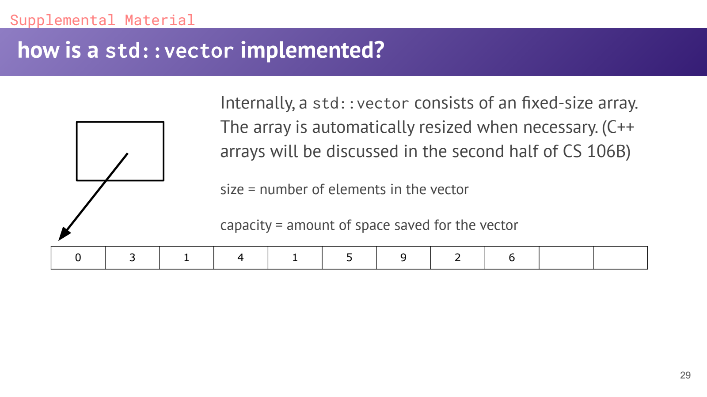
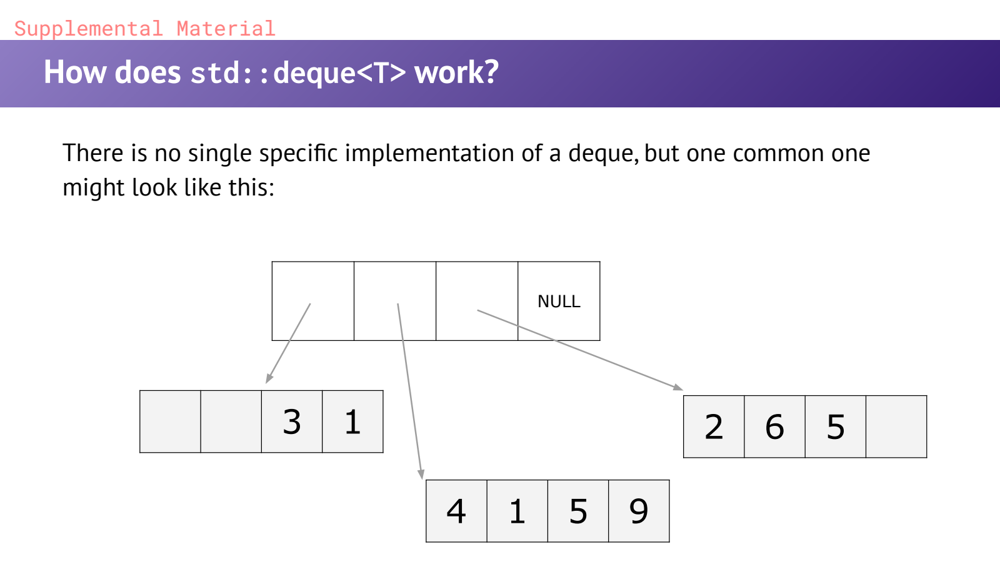
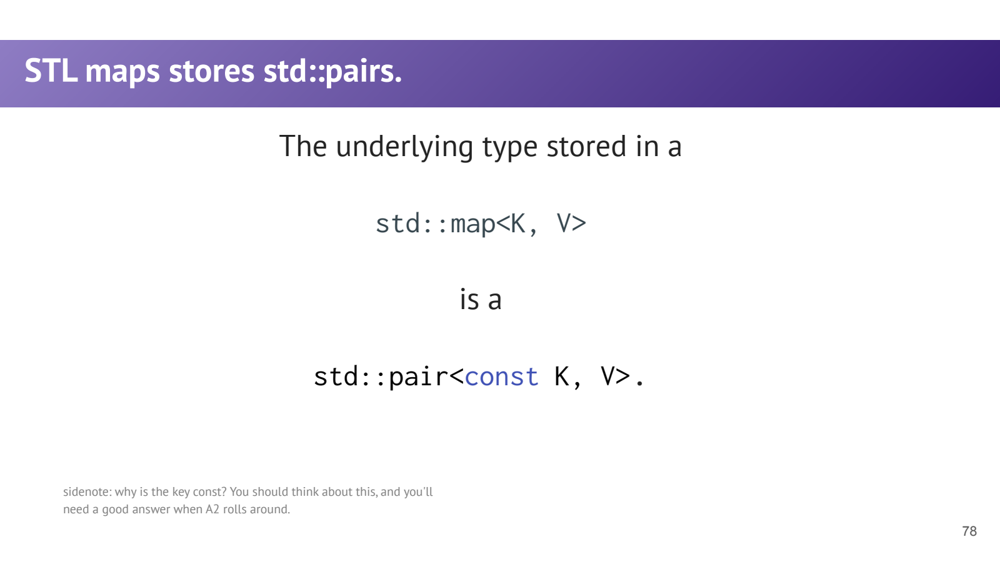

- STL：数据结构与算法之间靠统一接口连接
	- [Slides 8–18](../Slides/WL5_Containers.pdf#page=8)
	- **Containers** 管理数据，**Iterators** 描述访问位置，**Algorithms** 操作迭代器区间，**Adaptors** 调整既有接口。
	- 选容器先问操作模式：是否要随机访问、有序遍历、两端插入、按 key 查找，以及修改后引用/迭代器是否要稳定。
	- 教学 `Vector / Map / Set` 与 `std::vector / map / set` 不完全相同，尤其注意越界行为与不存在的 key。

- Vector：连续存储，默认优先考虑
	- [Slides 17–29、51–55](../Slides/WL5_Containers.pdf#page=17)
	- 支持 $O(1)$ 随机访问、摊还 $O(1)$ 的 `push_back`；头部/中间插入删除通常要移动元素，为 $O(n)$。
	- `size()` 是已存在元素数，`capacity()` 是分配容量。`reserve(n)` 预留空间，**不创建 n 个元素**；`resize(n)` 才改变大小。
	- `v[i]` 要求索引有效，不主动做与 `at(i)` 相同的异常式边界检查；越界不是“自动补长”。
	- 扩容重分配会使指向旧存储的迭代器、指针与引用失效；不能缓存 `begin()` 后无条件继续 push。
	- 

- Deque / List：快的是哪些位置？
	- [Slides 25–51](../Slides/WL5_Containers.pdf#page=25)
	- **Deque** 支持两端常数时间单元素插入删除，也支持 $O(1)$ 索引；常见实现是分块存储，不保证像 vector 那样整体连续。
	- **课件辨析**：第26页的“fast insertion anywhere”过于宽泛；deque 中间插入仍随到较近端的距离线性增长。[标准草案：deque modifiers](https://eel.is/c++draft/deque.modifiers)
	- **List** 不支持随机索引；已有目标迭代器时，单节点插入删除通常为 $O(1)$，但寻找位置仍可能 $O(n)$，节点分配与缓存局部性也有成本。
	- 默认常用 vector；频繁操作两端可考虑 deque；需要特定节点稳定性/拼接时再考虑 list，而不是看到“插入快”就总选链表。
	- 

- Container Adaptors：限制操作，表达用途
	- [Slides 56–72](../Slides/WL5_Containers.pdf#page=56)
	- `std::stack` 提供 LIFO，`std::queue` 提供 FIFO，`std::priority_queue` 提供按优先级访问；它们复用底层容器，但不暴露全部接口。
	- stack 常用 `push / pop / top`，queue 用 `push / pop / front`；**pop 通常不返回被删除元素**，先读取再弹出。
	- stack / queue 默认底层是 deque；priority_queue 常用 vector 管理堆，默认 `top()` 是最大元素，不等于完整排序。

- Set / Map：有序键与键值对
	- [Slides 73–81](../Slides/WL5_Containers.pdf#page=73)
	- `set<T>` 保存唯一元素，`map<K,V>` 保存唯一 key 到 value 的映射；按比较器排序，常用操作复杂度为 $O(\log n)$。
	- map 的元素类型是 **`std::pair<const K,V>`**；key 不可直接修改，以免破坏组织结构，mapped value 通常可以修改。
	- `m[k]` 在 key 不存在时会插入默认构造的 value；只想查询用 `find`，需要已存在且做检查可用 `at`，不要让“读”意外改变容器。
	- 

- Unordered / Multi：没有一个容器总是更快
	- [Slides 82–84](../Slides/WL5_Containers.pdf#page=82)
	- `unordered_map / unordered_set` 使用 hash 与相等判定，典型查找平均 $O(1)$、最坏可到 $O(n)$；不保证按 key 排序。
	- 相等的 key 必须具有一致 hash，rehash 还可能使迭代器失效；“unordered 一定更快”忽略了 key、hash、数据量和访问模式。
	- `multimap / multiset` 允许等价 key / 元素，多值查询常需要区间接口，而非假设只找到一个。
	- 修改容器时核对具体失效规则；“遍历中不能修改任何东西”也太绝对，例如修改 map 的 mapped value 与插入导致失效是不同问题。
