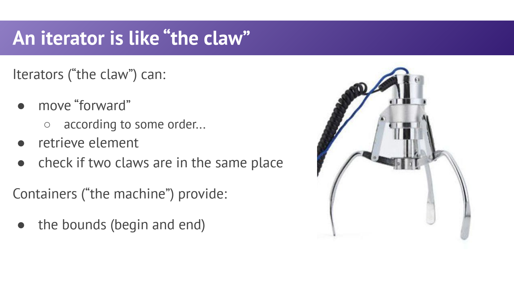
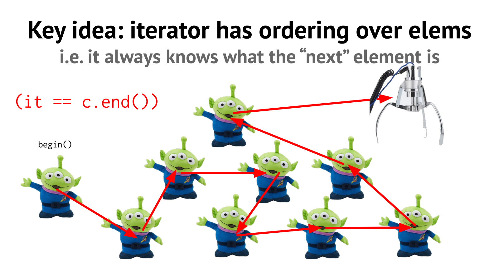
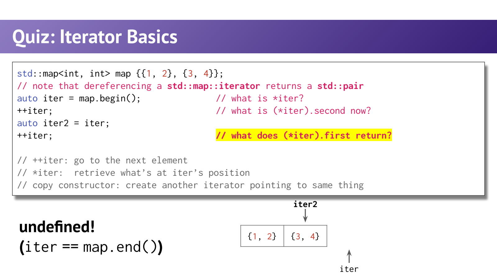

- Iterator：把“怎样访问”与“怎样存储”分离
	- [Slides 14–18](../Slides/WL6_Iterators.pdf#page=14)
	- 不同容器的存储结构不同，但可用迭代器描述当前位置、读取元素、向后推进与判断是否到终点。
	- 课件用夹娃娃机比喻：容器像机器，iterator 像夹爪；算法只关心怎样移动和取值，不必知道底层数组/节点布局。
	- 迭代顺序不必等于数值排序：vector 按序列位置，set 按比较器顺序，unordered 容器的遍历顺序不稳定。
	- 

- 半开区间 `[begin,end)`：end 不是最后一个元素
	- [Slides 18–32](../Slides/WL6_Iterators.pdf#page=18)
	- `begin()` 指向第一个元素，`end()` 指向尾后位置；空容器满足二者相等。可以比较 end，**不可以解引用 end**。
	- `*it` 访问元素，`++it` 前进；`it->member` 是常见的成员访问写法，类似 `(*it).member`。
	- 不需要旧值时通常使用 `++it`；后置 `it++` 要保留旧位置的语义，但不应据此断言所有类型与优化级别下前置都可测地更快。
	- 

- Map 的 iterator 解引用得到 pair
	- [Slides 33–48](../Slides/WL6_Iterators.pdf#page=33)
	- 对 `std::map<int,int>{{1,2},{3,4}}`，begin 的元素是 `{1,2}`，推进一次得到 `{3,4}`，再推进就到 end。
	- `auto saved = it;` 复制的是迭代器位置；之后移动 it，不会同步移动 saved，也不会复制容器中的元素。
	- 课件第34页的 `map.first()` 应为 `map.begin()`；标准 map 的模板参数也要包含 key 与 mapped 类型。
	- 

- Range-for：语法更短，但复制/引用选择仍在
	- [Slides 44–48](../Slides/WL6_Iterators.pdf#page=44)
	- 范围循环使用 begin/end 等机制，不能因此忘记元素访问的值语义。
	- 只读 map 的常见写法：
		```cpp
		std::map<int, int> scores{{1, 2}, {3, 4}};
		for (const auto& [key, value] : scores) {
		    std::cout << key << ':' << value << '\n';
		}
		```
	- `auto [k,v]` 通常复制元素；`auto& [k,v]` 引用元素，但 map 的 k 仍是只读，不能靠引用绕过 key 的约束。

- 迭代器类别与失效：算法不能超出接口能力
	- [Slides 49–51](../Slides/WL6_Iterators.pdf#page=49)
	- **Input / Output** 分别关注读与写；**Forward** 支持多遍遍历；**Bidirectional** 增加后退；**Random Access** 支持常数时间跳转与距离运算。
	- vector / deque 有随机访问迭代器；list / set / map 不支持任意 `it+5`。`std::advance` 可写统一代码，但底层成本可能是逐步前进。
	- `std::sort` 要求随机访问，不能直接用于 list 迭代器；list 有自己的成员 `sort()`。
	- **失效不等于变成 end**：vector 重分配后旧 iterator 是不能继续使用的悬空位置，连比较/解引用都不能想当然；应检查每个容器操作的具体保证。
