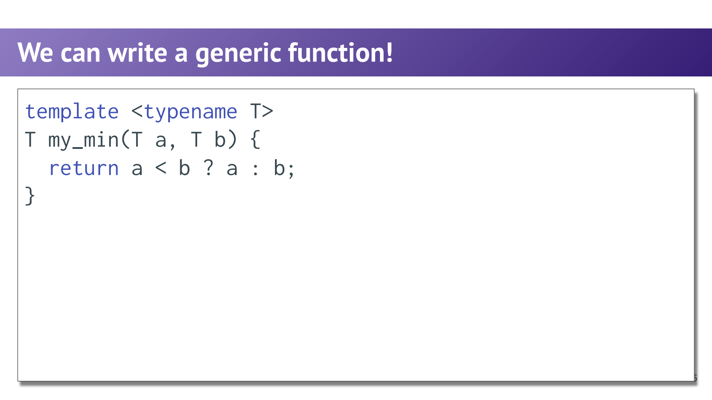
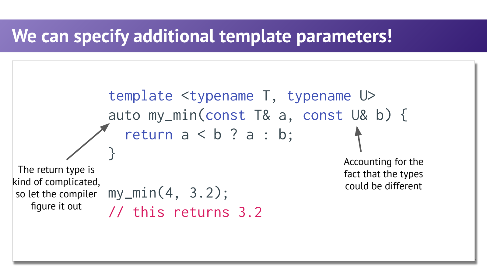
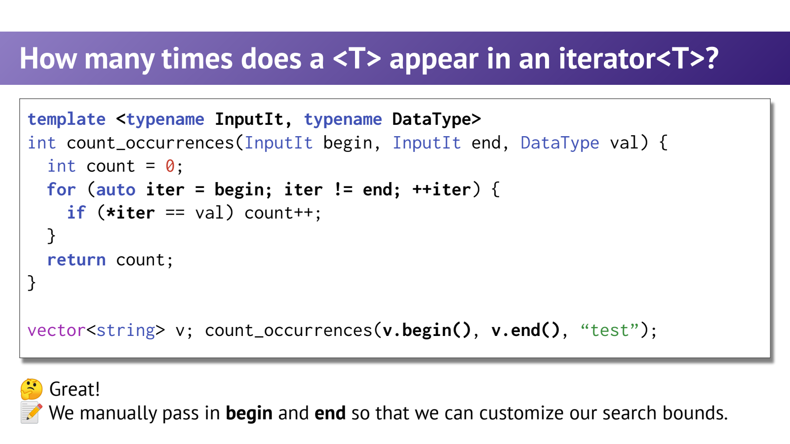

- 为什么要模板：重复的是算法，变化的是类型
	- [Slides 10–17](../Slides/WL7_Templates.pdf#page=10)
	- 为 int、string 各写一份 `my_min` 会复制同样逻辑；函数模板把类型变成编译期参数，为不同类型生成合适的函数。
	- `template <typename T>` 中 T 是类型参数；在这里 `typename` 与 `class` 都可以用，不意味着 T 一定是某个类。
	- 模板并非无类型代码：例如使用 `<` 就要求实例化的类型支持有意义的比较。
	- 

- 显式模板实参与自动推导：不能“读懂你的意图”
	- [Slides 19–26](../Slides/WL7_Templates.pdf#page=19)
	- `my_min<int>(3,4)` 指定 T；`my_min(3,4)` 从实参推导。严格说，显式写模板实参的函数调用，不等于语言中的独立“显式实例化声明/定义”。
	- 对 `my_min(const T&,const T&)`，`my_min(4,3.2)` 会推导出冲突的 T，**不是自动选 int 并返回 3**；课件第23页的结果说明有误。
	- 字符串字面量也不自动变 `std::string`；保留数组引用与数组退化还会影响推导，指针 `<` 不是文本字典序比较。需要文本比较时显式使用 string。

- 多个类型参数：通用性提高，但语义仍需检查
	- [Slides 17、24–26](../Slides/WL7_Templates.pdf#page=17)
	- `template<class T,class U> auto min_value(const T& a,const U& b)` 可接受不同类型；条件表达式 `a < b ? a : b` 仍要形成合法的共同结果类型。
	- 引用传参能减少入参复制，但返回 `T` 仍是返回值，不能说“用了 const T& 就完全不拷贝”；返回引用则需额外考虑生命周期。
	- 模板实例化发生在编译过程中；不同类型可能生成多份代码，也可能产生长错误信息，不能把泛型当成没有代价的万能替换。
	- 

- Concept Lifting：逐步去掉不必要的假设
	- [Slides 30–39](../Slides/WL7_Templates.pdf#page=30)
	- 从“统计 vector<int> 中某整数出现次数”开始，先泛化元素类型，再泛化容器，最后改成 iterator 区间。
	- 只把容器改成 Collection 但保留 `arr[i]`，仍要求随机访问；改用 `++it / *it / !=` 后，链表、字符串和子区间都能复用逻辑。
	- 目标不是取消所有约束，而是只保留算法真正需要的最小操作。
	- 

- 用一小段代码记住泛型算法的形状
	- [Slides 38–43](../Slides/WL7_Templates.pdf#page=38)
	- 示例用独立名字，避免与标准库 `std::count` 混淆：
		```cpp
		template <typename InputIt, typename T>
		std::size_t count_equal(InputIt first, InputIt last, const T& value) {
		    std::size_t n = 0;
		    for (; first != last; ++first)
		        if (*first == value) ++n;
		    return n;
		}
		```
	- 前置条件是 `[first,last)` 合法且可读取，并且元素能与 value 做相等比较。若要统计“奇数/元音/低于阈值”，下一讲把固定比较进一步提升为 predicate。
