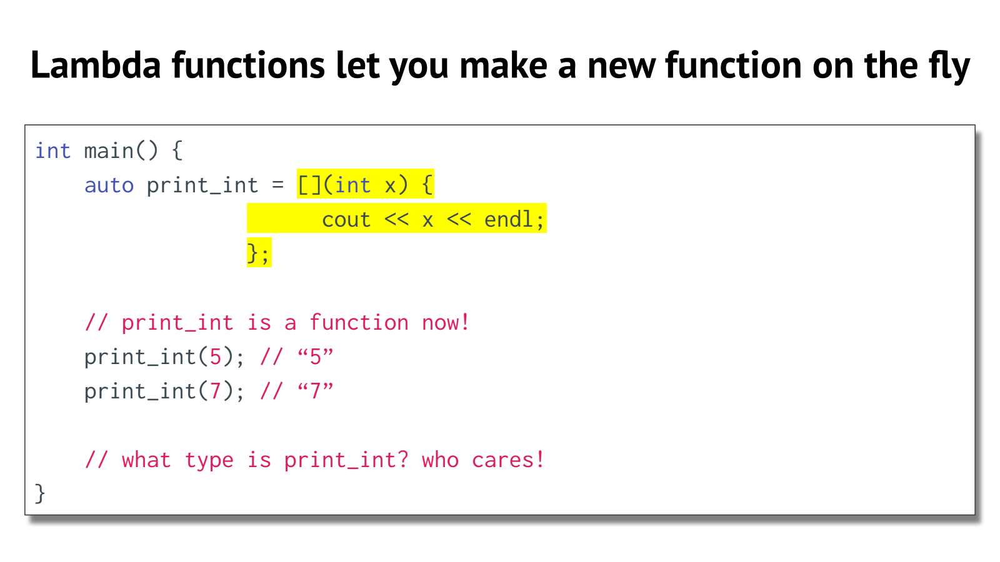
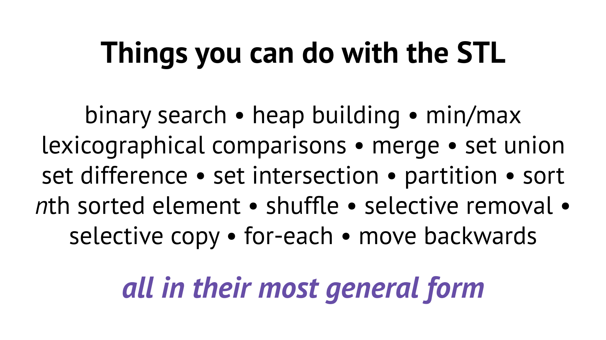
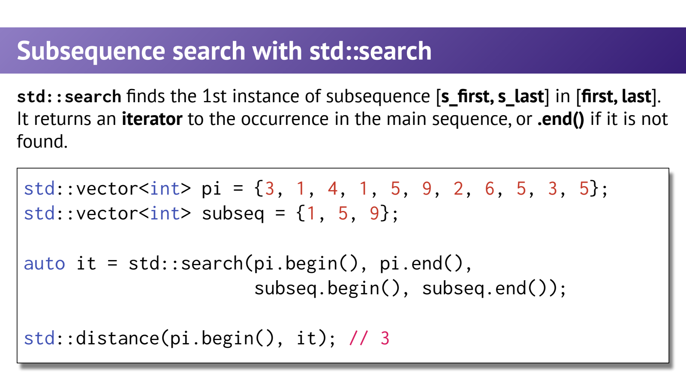

- Predicate：把“满足什么条件”也参数化
	- [Slides 13–22](../Slides/WL8_Functions.pdf#page=13)
	- 上一讲的 count 只能统计“等于某值”；改成接收返回 bool 的 **Predicate**，同一个遍历框架就能统计偶数、元音或小于阈值的元素。
	- 算法与判断条件解耦：算法负责遍历，callable 负责业务规则；普通函数、函数对象、lambda 都可成为 callable。
	- 课件第20/26页保留了旧变量 `val` 与多余模板参数；正确条件应是 **`if (pred(*it))`**，不是 `pred(*it) == val`。

- Lambda：带状态的局部可调用对象
	- [Slides 23–27](../Slides/WL8_Functions.pdf#page=23)
	- 基本语法是 `[captures] (parameters) { body; }`；编译器产生闭包类型，lambda 表达式创建闭包对象。
	- 它不是“运行时重新编译一段函数代码”；运行时可创建带不同捕获值的对象，调用逻辑早已编译。
	- `auto` 保存具体闭包类型；C++14 的 generic lambda 可以在参数中用 auto，内部相当于模板化调用接口。
	- 

- Capture：复制状态还是借用状态？
	- [Slides 25–28](../Slides/WL8_Functions.pdf#page=25)
	- `[limit]` 按值捕获，是创建闭包时的快照；`[&limit]` 引用原变量，后续修改可被观察，但必须保证原变量仍活着。
	- `[=]` / `[&]` 是默认按值/引用捕获规则，不是一定复制作用域里所有变量；可显式混合，如 `[&,limit]`。
	- **课件拼写修正**：引用捕获为 `[&x]`，不是 `[x&]`。[标准草案：lambda captures](https://eel.is/c++draft/expr.prim.lambda.capture)
	- 把捕获局部引用的 lambda 返回或异步保存，可能造成悬空；默认按值捕获的成员也不允许随意修改，必要时需理解 `mutable` 的含义。

- Algorithms：不要再手写每一种遍历
	- [Slides 29–37](../Slides/WL8_Functions.pdf#page=29)
	- `<algorithm>` 提供 `find / find_if / count_if / sort / search / all_of / copy` 等；它们基于区间工作，不需要知道容器类名。
	- `find(first,last,value)` 按值找；**`find_if(first,last,pred)`** 按条件找。课件中把 predicate 版本也写成 find 的地方应改正。
	- 不同算法的 iterator 要求不同；`sort` 需要随机访问，`minmax_element` 返回一对迭代器，不是元素副本或任意 tuple。
	- 

- 查找与量词：返回值和边界同样重要
	- [Slides 38–42](../Slides/WL8_Functions.pdf#page=38)
	- 查找失败返回 last，要先比较再解引用；`search` 查完整子序列，`find` 只查单元素。
	- `all_of` 判断全部满足，`any_of` 判断至少一个，`none_of` 判断一个也没有；对空区间 all_of 为 true，不能把它当成“至少有一个满足”。
	- 

- 把外部参数与通用算法接起来
	- [Slides 25–28、34](../Slides/WL8_Functions.pdf#page=25)
	- 一个阈值统计可以直接写成：
		```cpp
		std::vector<int> values{1, 4, 7, 9};
		int limit = 6;
		auto n = std::count_if(values.begin(), values.end(),
		                       [limit] (int x) { return x < limit; });
		```
	- 读代码时按“容器数据 → iterator 区间 → algorithm → predicate / capture”拆解；比单独背每个函数名更容易迁移。
