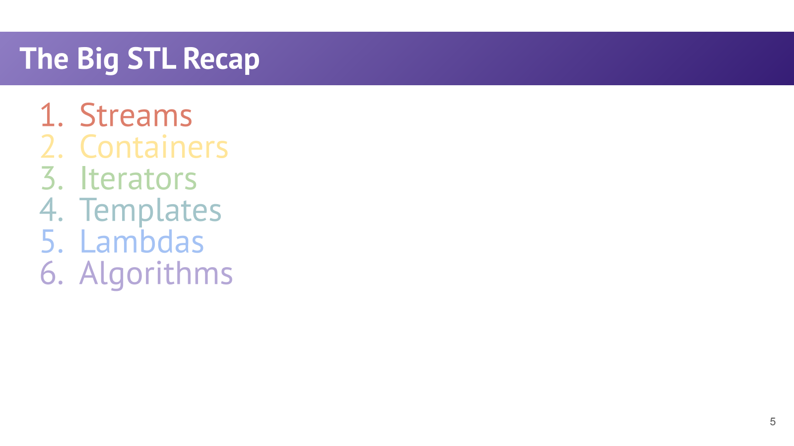
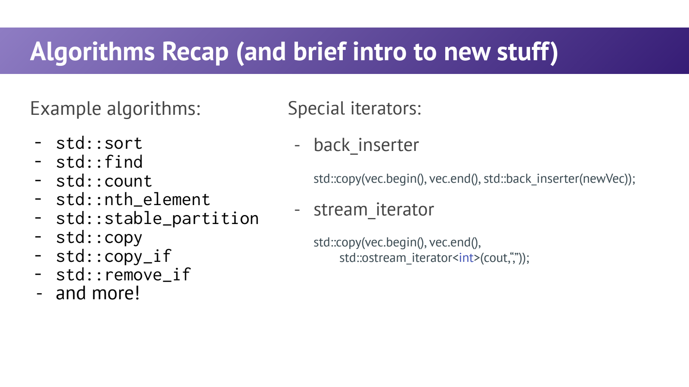
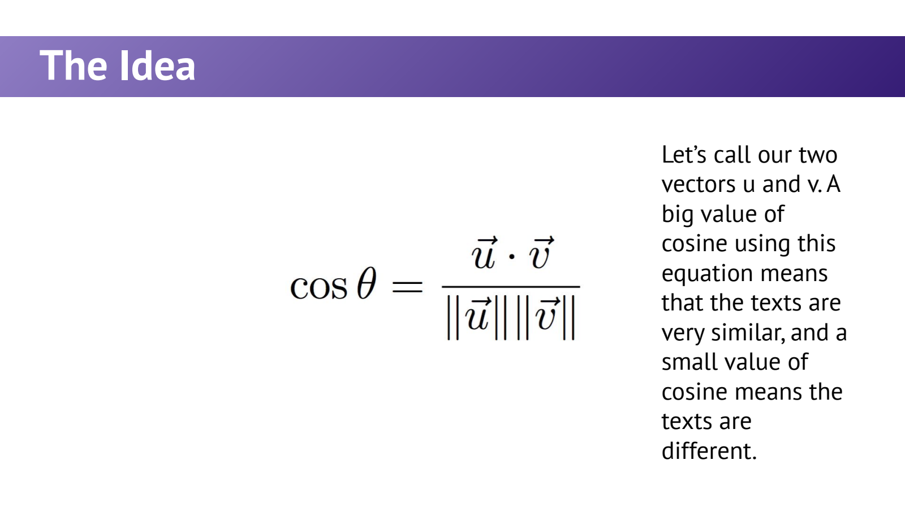

- 把 STL 连成一套工作流，而不是六个独立章节
	- [Slides 3–18、25–37](../Slides/WL9-STL-Summary.pdf#page=3)
	- Streams 读入文本，containers 保存数据，iterators 描述区间，templates 抽象类型，lambdas 携带局部规则，algorithms 复用计算。
	- 核心分工：**容器关心存储，算法关心操作，迭代器连接两者**；模板参数与 callable 进一步消除不必要的假设。
	- 

- 回顾时重点检查“隐藏的约束”
	- [Slides 6–34](../Slides/WL9-STL-Summary.pdf#page=6)
	- 读取后是否检查流状态？`map[k]` 是否意外插入？iterator 是否到 end 或已经失效？模板是否要求元素支持比较？
	- lambda 的 capture 是快照还是借用，是否可能比被引用变量活得更久？课件“运行时创建函数”应理解为创建闭包对象，而不是运行时编译源码。
	- 返回 iterator 不等于返回元素；传值不等于传引用；这些类型层面的区别会决定性能和正确性。

- Special Iterators：让算法输出到不同目的地
	- [Slides 35–38](../Slides/WL9-STL-Summary.pdf#page=35)
	- `std::back_inserter(dst)` 把赋值变成 push_back，可在空 vector 上追加；直接向空容器的 begin 写入则没有合法元素空间。
	- `std::ostream_iterator<T>(out, delimiter)` 把写元素变成流输出；算法可以复用同一段数据搬运逻辑。
	- 

- Remove / Copy / Partition：算法名字不能代替语义
	- [Slides 35–38](../Slides/WL9-STL-Summary.pdf#page=35)
	- `copy / copy_if` 要有合法输出位置，或使用插入迭代器；目标空间不会凭算法名字自动出现。
	- `remove_if` 把保留元素移到区间前部并返回新的逻辑 end，**不会改变容器 size**。C++17 常用 erase-remove：
		```cpp
		std::vector<int> values{1, 2, 3, 4};
		values.erase(std::remove_if(values.begin(), values.end(),
		                            [] (int x) { return x % 2 == 0; }),
		             values.end());
		```
	- `stable_partition` 按 predicate 分两组并保留组内相对顺序；`nth_element` 确定第 n 个排序位置，不保证全区间有序。

- Stylometry：用词频向量刻画作者风格
	- [Slides 39–67](../Slides/WL9-STL-Summary.pdf#page=39)
	- 课件以《联邦党人文集》的作者归属为例：固定一组功能词，对每篇文本统计出现次数，形成相同维度的向量。
	- 对非零向量，**余弦相似度**为 $\cos\theta=\frac{u\cdot v}{\|u\|\|v\|}$；更看重频率模式的方向，而不只比较文章总长度。
	- 点积是对应坐标乘积求和，范数为平方和开根号；要防止整数除法、长度不匹配与零向量分母。
	- 

- 将项目拆成可复用的小步骤
	- [Slides 19、30、34、38、67–68](../Slides/WL9-STL-Summary.pdf#page=19)
	- 可按讲义思路组织：读文件 → 统一分词/大小写策略 → 提取固定词表频率 → 算点积/范数 → 与候选作者比较。
	- 每一步先单独测试，再接成管线；不同词表或预处理会改变结果，不能把一个相似度数值当成确定的作者证明。
	- 此处是 STL 的综合练习，不只是学习一个分类公式；把遍历、比较和输出复用到标准算法，才是前半程的共同主题。
