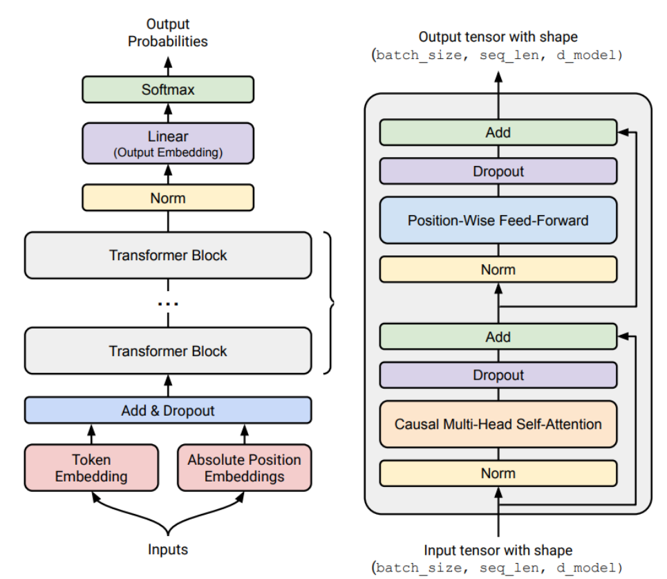
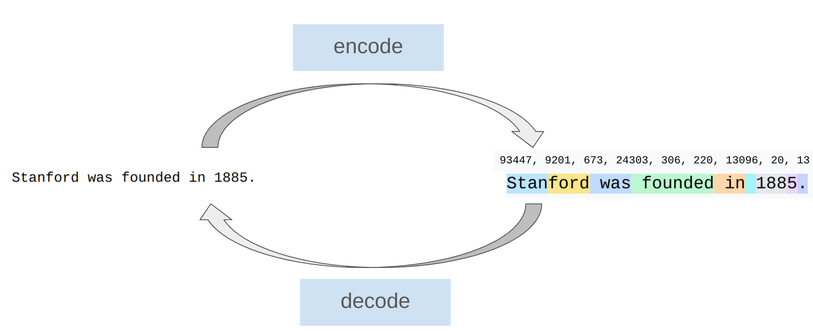
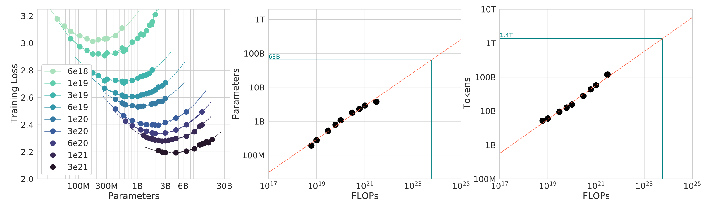

- CS336：通过亲手搭建，理解语言模型
	- [讲义：`why_this_course_exists()`、`course_syllabus()`](../Slides/lecture_01.py)
	- 核心问题不是“怎样调用一个模型”，而是：**在固定数据、算力和显存预算下，怎样训练出最好的模型？**
	- **Mechanics**：Transformer、训练与并行的工作原理；**Mindset**：资源核算、减少数据搬运、认真考虑规模；**Intuitions**：架构和数据的经验选择，但小模型上的经验不一定能迁移到大模型。
	- “Bitter Lesson”不等于算法不重要，而是**能随计算资源扩展的算法更重要**。效率决定同样预算能做到什么。

- 整门课的地图：模型之外还有系统与数据
	- [讲义：`basics()`、`systems()`、`scaling_laws()`、`data()`、`alignment()`](../Slides/lecture_01.py)
	- **Basics**：Tokenizer → Transformer → Loss / Optimizer / Training Loop。
	- **Systems**：GPU kernel、分布式训练、推理；大多数优化都在减少或隐藏数据搬运。
	- **Scaling Laws**：用小规模实验预测大规模配置；**Data**：评估目标决定数据的收集、清洗与混合；**Alignment**：SFT、偏好优化与可验证奖励 RL。
	- 课件用约束框架理解架构：**表达能力、训练稳定性、硬件效率**之间做取舍，而不是找一个永远最优的组件。
	- 

- Tokenizer：字符串与 token ID 之间的桥梁
	- [讲义：`intro_to_tokenization()`、`tokenization_examples()`](../Slides/lecture_01.py)
	- 模型处理的是整数序列；Tokenizer 提供 `encode(text)` 与 `decode(ids)`。基本测试是合法输入的 **round-trip**：`decode(encode(text)) == text`。
	- 同一个词在句首、带前导空格、不同大小写时可能切成不同 token；数字、中文、emoji 的切分也不能直接按“一个词一个 token”理解。
	- **压缩率 = UTF-8 字节数 / token 数**：越大，序列通常越短；但扩大词表会增大 embedding / 输出层，并让罕见 token 更难学。
	- 

- 为什么不用字符、字节或者完整单词？
	- [讲义：`character_tokenizer()`、`byte_tokenizer()`、`word_tokenizer()`](../Slides/lecture_01.py)
	- **字符级**：Unicode 码点空间大，长尾字符多，序列仍不够短；码点也不总等于人眼看到的一个字符。
	- **字节级**：词表只有 256，覆盖 UTF-8 文本、不需要 UNK；但中文和 emoji 常占多个字节，序列长，计算成本高。
	- **词级**：常见词压缩率高，但词表难以控制，新词与拼写变体产生 OOV / UNK。
	- 需要一种折中：**常见片段合成一个 token，罕见片段拆开表示**。

- BPE（Byte-Pair Encoding）：从数据里学习切分单位
	- [讲义：`train_bpe()`、`BPETokenizer.encode()`、`merge()`](../Slides/lecture_01.py)
	- **训练**：从 256 个单字节 token 开始 → 统计相邻 token pair → 合并频次最高的一对 → 为新片段分配 ID → 重复到目标词表大小。
	- **编码**：对新文本先取 UTF-8 字节，再按训练得到的 merge 优先级应用规则；**不是对每篇新文本重新统计并训练 BPE**。
	- **解码**：查 ID 对应的字节串，拼接后再做 UTF-8 解码；单个 token 的字节不一定能独立解码成完整字符。
	- 工程重点：增量维护 pair 计数、只检查相关合并；用 **Pre-tokenization** 限制合并边界，并单独识别 `<|endoftext|>` 等 special token。
	- Tokenizer 会改变序列长度、长尾表示与资源开销，不只是无关紧要的预处理。

- 从第一讲连接到实践
	- [讲义：`basics()`、`scaling_laws()`](../Slides/lecture_01.py)
	- 作业 1 的主线是实现 BPE、Transformer、交叉熵、AdamW 与训练循环，再在给定预算下优化验证集 perplexity。
	- 训练计算量常粗估为 $C\approx6ND$，$N$ 是参数量、$D$ 是训练 token 数；这个近似的适用条件见 [[CS336/Lectures/Lecture2 Resource Accounting.md|Lecture2]]。
	- 后续不是只把 $N$ 变大，而是同时选择模型、训练长度、数据与系统方案；[[CS336/Lectures/Lecture9 Scaling Laws.md|Lecture9]] 会讨论 IsoFLOPs 曲线如何指导选择。
	- 
