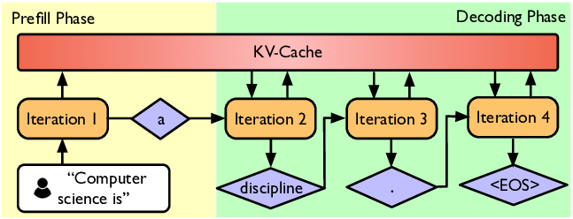
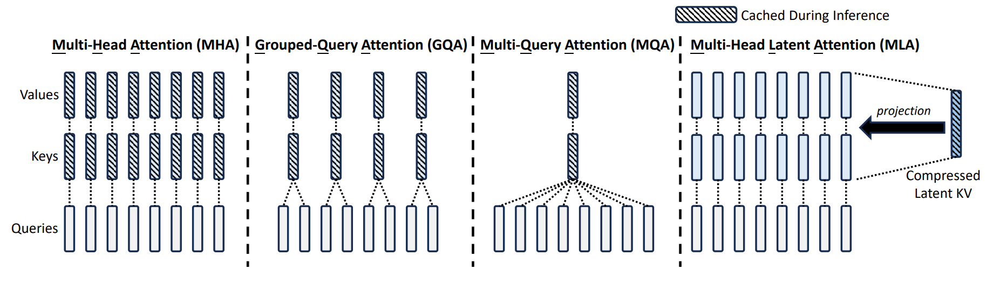
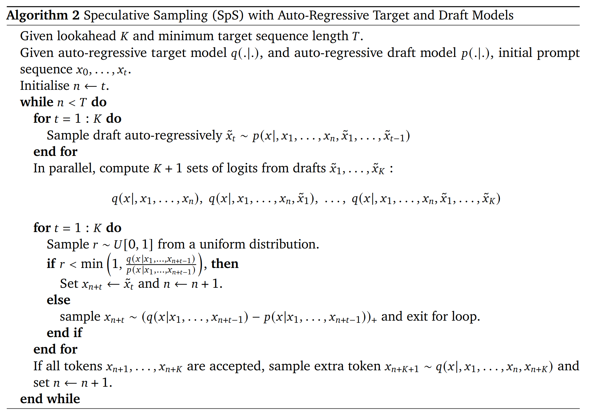
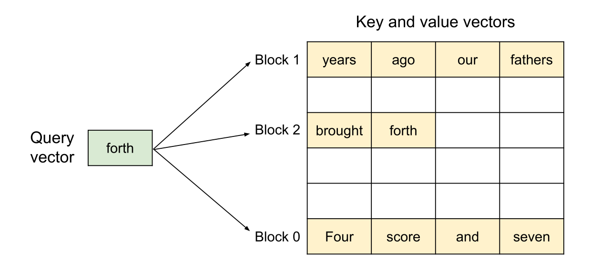

- 推理的两阶段与三个指标
	- [讲义：`landscape()`、`arithmetic_intensity_of_inference()`](../Slides/lecture_10.py)
	- **Prefill**：已知整段 prompt，可并行计算各位置表示，通常更易利用大矩阵乘法；**Decode**：自回归地逐 token 生成，依赖前面已生成结果。
	- **TTFT** 是首 token 等待时间，受排队与 prefill 等影响；**单请求 token 延迟 / TPOT** 看输出流畅度；**Throughput** 看多个请求总共每秒产出多少 tokens。
	- 三者不必同向改善；为服务更多请求扩大 batch，可能让单个用户等待更久。
	- 

- KV Cache 与带宽瓶颈
	- [讲义：`review_of_arithmetic_intensity()`、`throughput_and_latency()`](../Slides/lecture_10.py)
	- 因果模型中，历史位置的 K、V 不随未来 token 改变，可以缓存；decode 只计算新位置的 Q、K、V，再读取历史 KV 做 attention。
	- 标准 KV Cache 约占 $2BSLH_{kv}d_hs$ bytes，分别为 K/V、batch、上下文长度、层数、KV heads、head 维度、每元素字节数。
	- 小 batch 下，MLP 权重每步都要读取却只服务少量新 token，容易 memory-bound；扩大 batch 可复用权重读取。
	- 但每个请求有自己的 KV，扩大 batch 不会同样消除 attention 的历史 KV 读取。长上下文和大 batch 最终会受 KV 带宽与容量限制。
	- “Prefill 偏计算、Decode 偏带宽”是常见工作区间，不是对所有形状、硬件与模型都成立的绝对划分。

- 缩小 KV：共享、压缩与限制访问范围
	- [讲义：`reduce_kv_cache_size()`](../Slides/lecture_10.py)
	- **GQA / MQA** 让多个 query heads 共享 KV heads；**CLA** 跨层共享 KV；都需检查容量下降是否影响质量。
	- **MLA**：存储低维 latent $c=W_ch$，在计算中利用投影吸收等技巧恢复所需内积；为 RoPE 保留解耦的位置分支，不能简单对压缩 latent 套完整 MHA 的 RoPE。
	- **Sliding Window** 限制每层读取的历史，可与全局层交错；固定窗口层的 KV 不再随全部历史无限增长，但全局层仍可能保留长历史。
	- 课件还讨论 token 压缩、选择性稀疏 attention 和递归状态，核心都是在**信息保留与缓存/读取成本**之间取舍。
	- 

- 更便宜的模型：量化、剪枝与蒸馏
	- [讲义：`quantization()`、`model_pruning()`](../Slides/lecture_10.py)
	- **PTQ** 在训练后校准 scale / zero-point 等；**QAT** 在训练中模拟量化误差，代价更高，但能让参数适应低精度。
	- GPTQ 利用二阶信息补偿权重量化误差；AWQ 利用激活找出重要通道并做缩放/保护，不能只按权重绝对值决定重要性。
	- 结构化剪枝可删除层、head 或隐藏维度，再通过继续训练/蒸馏恢复质量；是否加速取决于硬件 kernel 能否利用裁剪后的结构。
	- 更小文件并不自动等于同倍率提速：还受解量化、精度支持、batch 与瓶颈变化影响。

- Speculative Sampling：利用“验证比生成更并行”
	- [讲义：`speculative_sampling()`](../Slides/lecture_10.py)
	- Draft 模型 $p$ 先提议多个 token；Target 模型 $q$ 一次并行计算这些位置的条件分布，然后从前往后验收。
	- 对候选 $x\sim p$，接受概率为 $\min(1,q(x)/p(x))$；首次拒绝时，从归一化后的 $[q-p]_+$ 残差分布采样，并丢弃后续草稿。全接受时还可从 target 再采一个 token。
	- 这套修正可**保持 target 的采样分布**，不只是“target 觉得差不多就收下”；实现中要一致处理 temperature 等采样变换。
	- 加速取决于 draft 成本、接受率、草稿长度与硬件利用；Medusa / EAGLE 等进一步改进草稿产生方式。
	- 

- Continuous Batching 与 PagedAttention：处理真实请求流
	- [讲义：`continuous_batching()`、`paged_attention()`](../Slides/lecture_10.py)
	- 请求到达和结束时间不同，静态 batch 会等待最长请求；**Continuous Batching** 按 decode iteration 动态加入/移除请求。
	- 不同序列可拼接 token 做非 attention 运算，attention 再按各序列边界处理；不必为了矩形 batch 浪费大量 padding。
	- **PagedAttention** 把逻辑连续 KV 映射到非连续物理 blocks，按需分配，减少内外碎片；共享前缀可配合引用计数与 Copy-on-write。
	- 分页不改变每 token 所需的原始 KV 维度，主要改善内存利用与调度；与 FlashAttention 的 IO 优化、GQA 的结构压缩可以组合。
	- 
