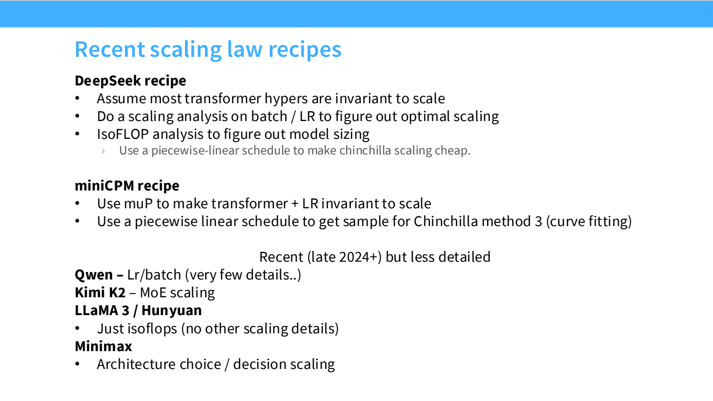
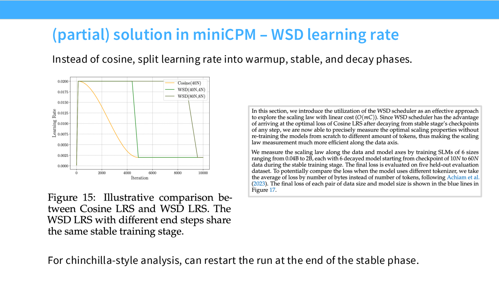
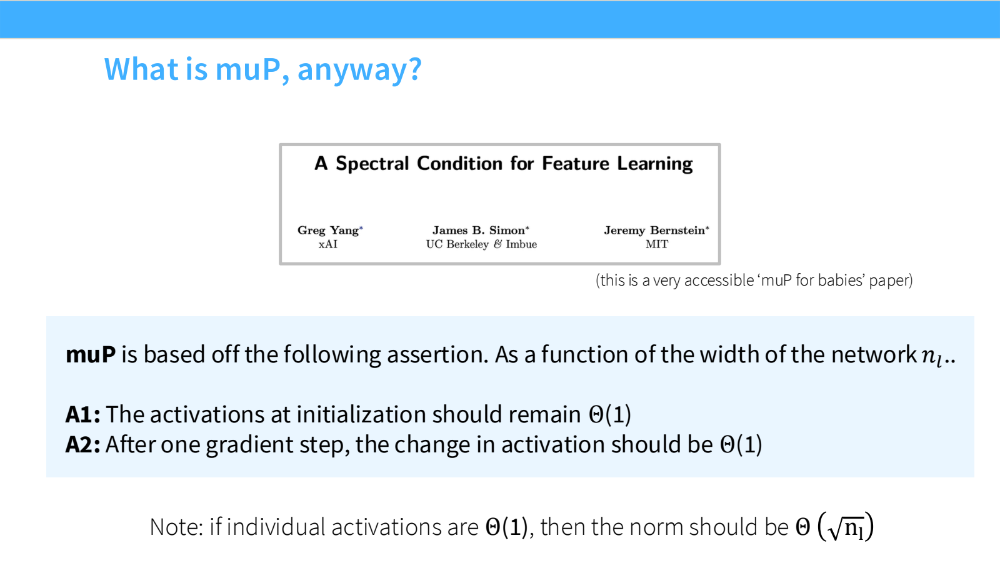

- Scaling Recipe：预测的不只是 loss，还有超参数怎么变
	- [Slides 2–5、30](../Slides/lecture_11.pdf#page=2)
	- [Lecture9](Lecture9%20Scaling%20Laws.md) 讲模型与数据的最优分配；这一讲追问：初始化、learning rate、batch 和 schedule 在放大时是否仍合适？
	- 一次小模型调参不能自动覆盖大模型。要定义**从计算预算到一整套训练配置的映射**，再检验其 scaling 曲线。
	- 比较方法时必须公平调参；换 optimizer 却沿用另一种 optimizer 的最优 LR，容易得出错误结论。

- MiniCPM 与 DeepSeek：两条公开 recipe
	- [Slides 6–30](../Slides/lecture_11.pdf#page=6)
	- **MiniCPM**：使用 μP 类参数化提高跨宽度的稳定性，研究 batch 与数据量的关系，再拟合模型—数据联合 scaling。
	- **DeepSeek**：直接在小规模搜索 near-optimal LR / batch，并拟合它们随预算变化的关系，再做 IsoFLOPs 选择模型大小。
	- 两条路线都不是“照抄一个学习率”：一个更多依赖参数化使最优点稳定，另一个更多依赖经验外推。
	- 后续模型也会对 MoE 稀疏度、架构比例等做 scaling；公开信息详略不一，不能把缺少报告理解成没有调参。
	- 

- WSD：让多种训练终点共享一段训练
	- [Slides 13–18、22](../Slides/lecture_11.pdf#page=13)
	- **Warmup–Stable–Decay**：先预热，再以稳定学习率训练，最后快速衰减；cosine schedule 则通常提前绑定总训练长度。
	- 为比较不同 token 预算，可从 stable 阶段的不同 checkpoint 分支，再各自完成 decay，复用昂贵的前半段训练。
	- 中间 checkpoint 不等于完成衰减的最终模型；直接拿未退火 loss 做 IsoFLOPs 比较，可能改变最优点判断。
	- WSD 节省的是一组实验的重复工作，不意味着任意训练长度都能零成本复用，仍需计入每条分支的尾段成本。
	- 

- LR / Batch 与 Optimizer：规模是重要混杂因素
	- [Slides 31–43](../Slides/lecture_11.pdf#page=31)
	- 在固定模型/数据设置中，LR 与 batch 往往有可搜索的最优区域；但用 compute、目标 loss 或训练数据量作为外推变量，会产生不同 recipe。
	- 不同 optimizer 在不同模型规模、训练长度、参数/token 比下，排序可能变化；一次 NanoGPT 小实验不能证明前沿规模同样占优。
	- **Muon** 主要面向矩阵参数，对动量矩阵做近似正交化（如 Newton–Schulz 迭代）；与 Adam 的差异不只是某个学习率数值，需要重新核算调参与实际训练成本。

- μP（Maximal Update Parametrization）：让宽度改变时，学习尺度不失控
	- [Slides 44–51](../Slides/lecture_11.pdf#page=44)
	- 简化目标有两个：初始化时每个激活分量保持 $\Theta(1)$；一次更新带来的激活变化也保持 $\Theta(1)$，不随网络宽度趋零或爆炸。
	- 如果每分量是常数量级，宽度为 $n$ 的向量范数应是 $\Theta(\sqrt n)$；**不是整条向量范数也要求恒定**。
	- 同时调节初始化、不同类型参数的 LR 与输出缩放；输入、隐藏矩阵、输出层不能无差别套同一个缩放公式，SGD 与 Adam 的规则也不同。
	- 实用目标是 **μTransfer**：在小宽度模型上找到好的基础超参数，再按规定的参数化迁移到更大宽度。
	- 

- μP 不是万能的“免调参开关”
	- [Slides 52–58](../Slides/lecture_11.pdf#page=52)
	- 理论通常围绕宽度极限与特定更新规则；深度、数据分布、batch、学习率 schedule 的变化，不会自动全部被消除。
	- 课件中的实验证明，一些 RMSNorm gain、强 weight decay 或特殊 optimizer 设置会影响迁移；结论有具体架构与实验条件。
	- 实际流程：保守架构 → 小规模 sweep → 确认跨尺度最优区间 → 中等规模检验 → 再拟合大训练配置；记录不确定性，而不是只报一个外推数字。
