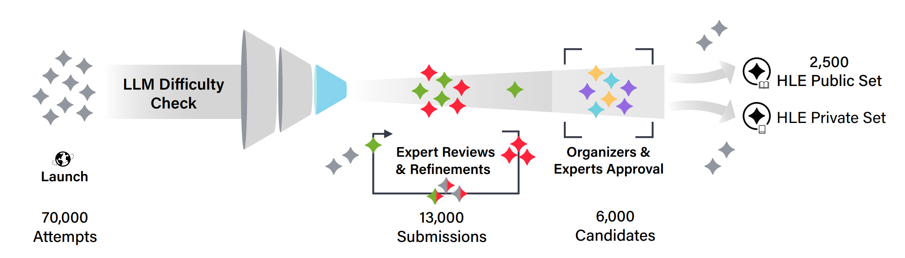
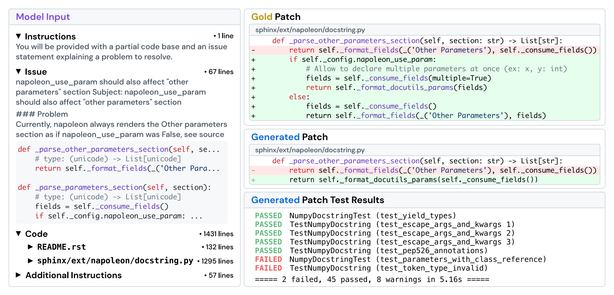
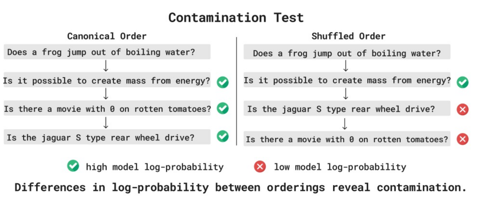

- Evaluation：先问“好”指什么，再决定分数
	- [讲义：`what_is_good()`、`how_to_think_about_evaluation()`](../Slides/lecture_12.py)
	- 评估把“知识、推理、帮助程度、安全”等抽象概念变成具体指标；不存在一个覆盖全部用途的唯一排行榜。
	- 开发内部更重视平滑、可比较、能指导迭代；真实用户更在乎任务完成、成本、延迟和风险。
	- 区分评估 **方法**（固定数据与预算，比较算法）、**模型**，还是 **Agent 系统**（模型 + scaffold + 工具 + 预算）。

- Perplexity：衡量概率拟合，不等于全部能力
	- [讲义：`perplexity()`](../Slides/lecture_12.py)
	- 平均负对数似然 $L=-\frac1T\sum_t\log p(x_t\mid x_{<t})$，**PPL = $e^L$**；越低表示模型给测试文本更高概率。
	- 适合预训练与 scaling，因为连续、信号密集；但预测每个常见连接词的收益，不一定对应解决用户关键问题的收益。
	- 对回答能力可只计算 $p(\mathrm{response}\mid\mathrm{prompt})$ 的损失；不同 tokenizer 的 token 粒度不同，不能直接无条件比较 per-token PPL。
	- 用于排行榜时还要保证返回的是合法归一化概率，避免把伪造 log-prob 当成真实语言模型评分。

- Exam / Reasoning Benchmarks：可评分，但不一定贴近使用
	- [讲义：`exam_benchmarks()`、`pure_reasoning_benchmarks()`](../Slides/lecture_12.py)
	- **MMLU / MMLU-Pro** 覆盖多学科知识；**GPQA / HLE** 提高专业性与难度，缓解旧 benchmark 饱和。
	- 难题制作包括出题、模型难度筛选、专家修订与审核，不是简单“找一些网上考试题”。
	- **ARC-AGI** 尝试减少对语言与知识记忆的依赖，研究规则发现与泛化；也不能认为它完全剥离了先验或单独定义了智能。
	- 报分要固定 few-shot、CoT、采样次数与计算预算；难度高不自动代表生态效度高。
	- 

- Chat Benchmarks：偏好比“标准答案”更灵活，也更容易有偏差
	- [讲义：`chat_benchmarks()`](../Slides/lecture_12.py)
	- **Chatbot Arena** 让用户盲选两份回答，再用成对比较拟合相对强度；可覆盖真实 prompt，但用户分布并不受控。
	- **AlpacaEval / WildBench** 使用 LLM judge、baseline 与 rubric，提高可扩展性；需要检查长度偏好、位置偏好、风格与裁判模型自身偏差。
	- 更长、更自信、更迎合的回答可能更受喜欢，却不更正确。高偏好胜率不能直接替代事实核查或安全评估。

- Agent Benchmarks：评估“做成了什么”
	- [讲义：`agentic_benchmarks()`、`safety_benchmarks()`](../Slides/lecture_12.py)
	- **SWE-bench**：给仓库与 issue，生成 patch、运行测试；**Terminal-Bench**：在终端环境完成任务；**CyBench**：安全挑战；**MLE-bench**：机器学习工程任务。
	- Agent 的 planning、memory、工具、上下文管理都会影响分数，必须连同 scaffold、时间/token 预算一起报告。
	- 单元测试不一定完整：可能存在漏洞、任务歧义或“投机通过”，应审查执行轨迹与环境隔离。
	- 安全评估还需区分有害指令、越狱鲁棒性与双重用途能力；拒答率也要与过度拒绝正常请求一起看。
	- 

- Realism 与 Validity：分数是否真的回答了原问题？
	- [讲义：`realism()`、`validity()`](../Slides/lecture_12.py)
	- **Ecological Validity**：测试是否反映实际工作、用户分布与交互过程；真实数据又可能与隐私保护冲突。
	- **Contamination**：互联网预训练难以保证测试题没见过；可报告 overlap、采用新题/私有题、检查异常记忆信号，但新时间戳也不保证没有复制传播。
	- 课件用“标准顺序 vs 打乱顺序的联合概率”展示一种污染检测线索；它依赖统计假设，不能单凭一次差异就判定模型作弊。
	- 最后检查数据标签、评分器、置信区间与预算；分数相近时尤其不要把微小差异当成确定的能力排序。
	- 
