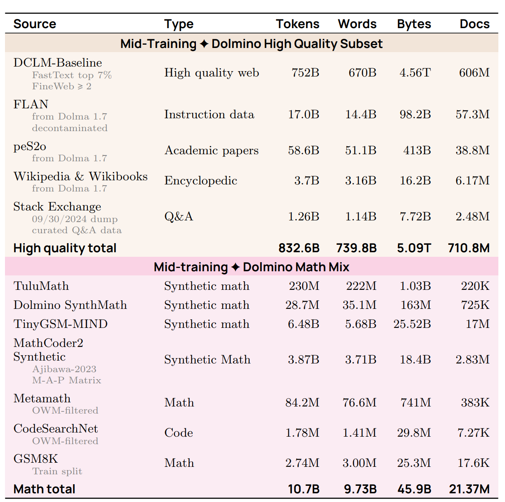
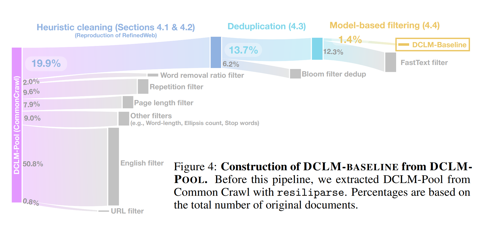
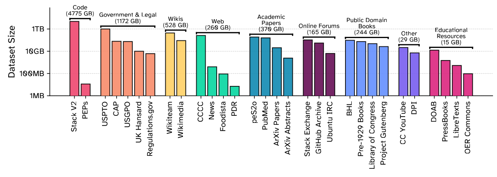

- Data 决定模型学什么，不是训练前随便下载一个压缩包
	- [讲义：`motivation()`、`raw_sources()`](../Slides/lecture_13.py)
	- 训练阶段大体从**海量、广泛数据**走向**更少、更高质量、更贴近任务的数据**：Pre-training → Mid-training → Post-training，边界并不总是清晰。
	- Base Model 通常指完成预训练/中期训练的模型；Instruct / Chat Model 还经过指令与偏好等后训练。
	- 数据工程链条是 **Live Service → Crawl / Dump → Processed Corpus → Training Mixture**；“训练于整个互联网”忽略了访问限制、筛选和采样。
	- 

- 获取数据：能看到、能下载、能训练，是不同问题
	- [讲义：`raw_sources()`、`copyright()`](../Slides/lecture_13.py)
	- 动态页面、登录/付费墙、反爬、限速和地区限制，让 crawler 不能覆盖所有在线内容；下载活动也应考虑站点负载与访问约定。
	- 数据来源需记录许可、使用条件与来源链；**公开可访问不等于无版权或任意使用**，集合许可证也不自动覆盖每一份组成内容。
	- 课件讨论 license、ToS、fair use 与相关争议：数据取得方式和训练用途是不同层面，不能只以“模型不逐字记忆”判断。
	- 这里记录的是课程的数据治理问题，不把讲义中的案件进展或简化法律表述当成通用、实时法律结论；实际项目需要按辖区与具体用途核查。

- Common Crawl：网页只是原料，文本抽取决定成品
	- [讲义：`common_crawl()`](../Slides/lecture_13.py)
	- Crawler 从 seed URLs 出发，维护队列、下载页面、发现新链接；还需选择抓取对象、重访周期与礼貌策略。
	- **WARC** 保留原始 HTTP 响应等信息，网页主体通常是 HTML；**WET** 是已抽取文本，转换过程有损。
	- 原始 HTML → 主体文本时，导航、广告、表格和布局处理都会影响模型效果；不能认为“有了 WET 就完全不必再处理”。
	- 多次 crawl 有重复页面、镜像与模板内容，需要过滤与跨文档/跨时间去重。

- 专业来源：优势与陷阱都更具体
	- [讲义：`wikipedia()`、`github()`、`arxiv()`、`project_gutenberg()`、`stackexchange()`](../Slides/lecture_13.py)
	- **Wikipedia**：结构清晰、知识密集，有周期 dump；但覆盖不均，也可能含错误、破坏性编辑与数据投毒。
	- **GitHub / Software Heritage**：代码、目录、历史与 PR/issue 提供工程信息；fork、复制文件、生成物和许可证差异需要处理，PR 还要决定如何线性化。
	- **arXiv**：PDF、元数据与部分 LaTeX 源码；宏展开、公式和参考文献影响抽取，元数据的开放许可不等于正文采用同样许可。
	- **Books / Project Gutenberg**：长篇连贯文本，但获取方式与许可要分别核查；**Stack Exchange** 的问答结构和评分有助于筛选，也可能有重复内容与分布偏差。

- 从原始来源到经典预训练语料
	- [讲义：`gpt2_webtext()` 到 `nemotron_cc()`](../Slides/lecture_13.py)
	- **WebText** 用 Reddit 外链作为质量信号；**C4** 用规则清理网页；**The Pile** 混合多种来源；**RefinedWeb / FineWeb** 强调精细处理的大规模网页。
	- **Dolma** 组合网页、论文、代码、书籍等，并进行语言识别、质量/毒性处理与去重；这些步骤会改变语料的分布。
	- **DCLM** 用较统一的训练/评估设置比较数据处理算法，并用质量分类器从大池筛出训练子集。
	- **Nemotron-CC** 等探索分类器组合和重写/合成：既要质量，也要避免过度过滤后数据不够。
	- 

- 开放数据：可复现性与来源透明度也是质量
	- [讲义：`the_stack()`、`common_pile()`](../Slides/lecture_13.py)
	- **The Stack / Stack v2** 系统处理代码、元数据、PR 等；除了去重，还涉及二进制、恶意软件、PII 与结构化内容转换。
	- **Common Pile** 探索只使用开放许可/公有领域等来源训练模型的路径，来源涵盖代码、公共文档、学术资料、图书等。
	- 仍要防范错误标注许可、“许可洗白”和下游重新分发限制；数据集名字或总 license 不能替代逐来源审查。
	- 下一讲 [[CS336/Lectures/Lecture14 Data Processing.md|Data Processing]] 关注共同算法：抽取、过滤、MinHash 去重、混合与合成。
	- 
