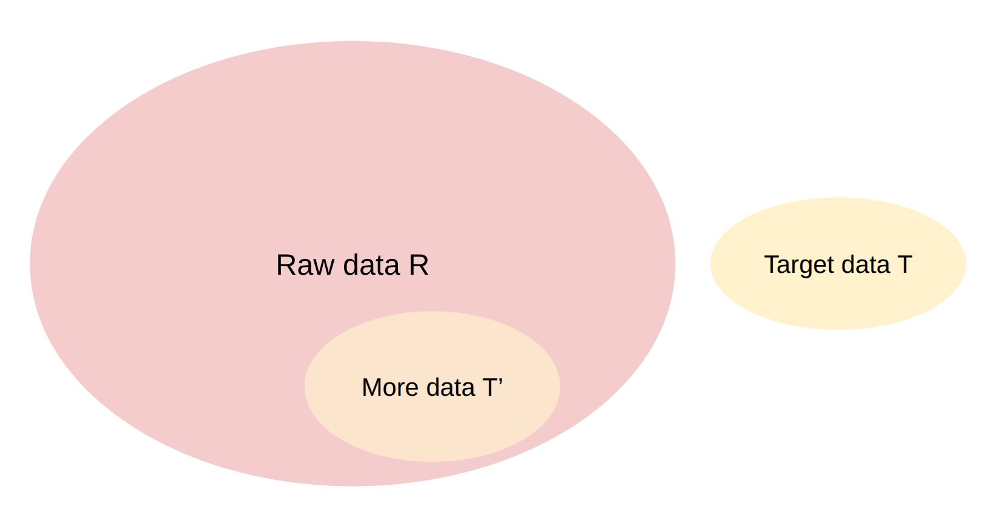
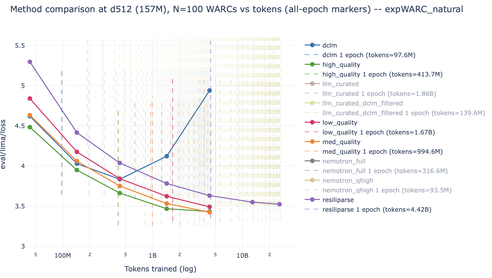
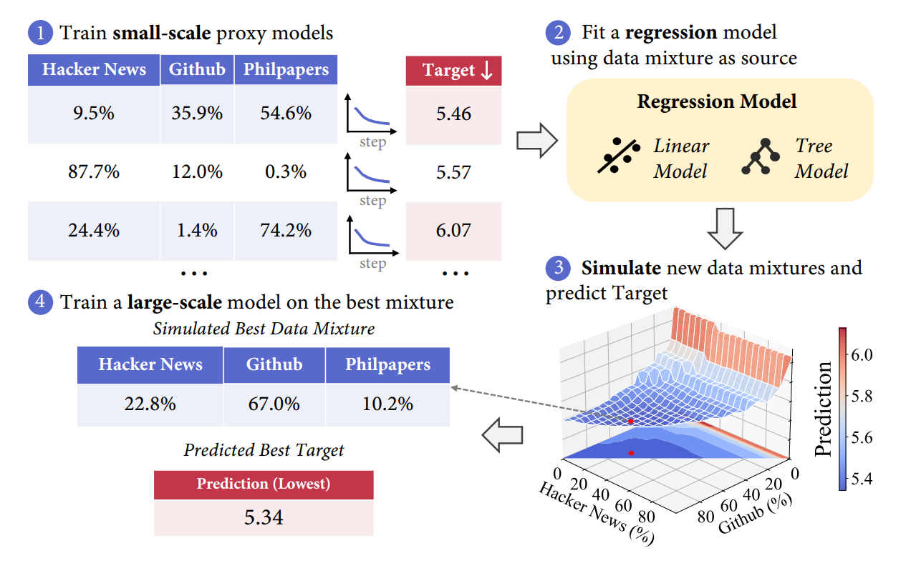

- Data Pipeline：把原料变成值得花算力学习的 tokens
	- [讲义：`transformation()`、`main()`](../Slides/lecture_14.py)
	- 主线：**Transformation → Filtering → Deduplication → Mixing**，再按任务生成/筛选 mid-training 与 SFT 数据；实际顺序可能交错。
	- HTML 要抽正文、去模板；PDF 要恢复阅读顺序、公式与表格，可能用 OCR / VLM。转换有损，抽取器本身也需要评估。
	- 数据质量要通过目标评估与人工抽样检验，不是清洗规则越多越好。

- Filtering：用少量“好样本”定义想保留的分布
	- [讲义：`filtering()`](../Slides/lecture_14.py)
	- 给定目标集合 $T$ 与海量原始集合 $R$，训练打分器，从 $R$ 中找出类似 $T$ 的子集 $T'$，而不是只重复训练 $T$。
	- 可用语言识别/质量/毒性分类器，或 KenLM 等语言模型的概率/PPL；fastText 等轻量模型适合海量数据上的快速过滤。
	- Target 的选择隐含价值判断和分布偏差；“像百科”“教育价值高”“无毒”不是同一个质量维度。
	- 

- 最佳过滤阈值依赖训练规模
	- [讲义：`filtering()` 后半部分](../Slides/lecture_14.py)
	- 短训练可优先最好的数据；预算大时，过严过滤会造成高质量集合反复 epoch，新增低一些质量的数据可能更有价值。
	- 因此不能把“小模型、少 tokens 上的最好阈值”原封不动迁移到长训练；要看保留量、重复率和目标 loss 的关系。
	- 

- 去重第一层：精确匹配与粒度选择
	- [讲义：`deduplication()`、`hash_functions()`、`exact_deduplication()`](../Slides/lecture_14.py)
	- 重复文本浪费计算、增加记忆风险，还可能造成 train-test overlap；要先明确比较单位是句子、段落、文档还是代码文件。
	- **Exact Dedup**：规范化后计算 hash、分组，再按策略保留；需考虑 hash collision，严格匹配可在候选内再核对内容。
	- 删除文档中的重复片段可能破坏连贯性；“发现相似”与“删除哪些内容”是两个独立设计。

- 去重第二层：Jaccard → MinHash → LSH
	- [讲义：`jaccard_minhash()`、`locality_sensitive_hashing()`](../Slides/lecture_14.py)
	- 将文档变成 shingles / n-grams 集合，**Jaccard**：$J(A,B)=|A\cap B|/|A\cup B|$，用于定义近重复。
	- **MinHash**：对随机排列/理想随机 hash，集合最小 hash 相同的概率为 $J(A,B)$；多次独立签名的匹配率估计相似度。
	- **LSH Banding**：把 $br$ 个签名分成 $b$ bands，每个含 $r$ 行；同一 band 全部相同就成为候选。若相似度为 $s$，候选概率为 **$1-(1-s^r)^b$**。
	- 增大 $r$ 更严格，增大 $b$ 更容易召回；它是概率筛选，不是无误差的硬阈值，必要时还要对候选做验证。
	- 这样避免所有文档两两比较；实际成本仍受候选数量、热门模板与分桶倾斜影响，不能无条件保证任何数据都严格线性。

- Data Mixing：质量、多样性与重复次数共同约束
	- [讲义：`data_mixing()`](../Slides/lecture_14.py)
	- 基线有均匀采样、按来源 token 数比例采样、人工加权；高质量小来源应加权，但不能无限重复。
	- 若训练总 tokens 为 $D$、来源 $s$ 有 $U_s$ 个独立 tokens、混合权重为 $p_s$，预期 epoch 数约为 **$p_sD/U_s$**。
	- **UniMax** 类方法限制每来源的最大 epoch：$p_sD\le C U_s$；**RegMix** 类方法训练很多小 proxy，拟合“混合比例 → loss”，再优化比例。
	- **Simulated Epoching** 按规模同比缩小各来源，让小实验复现大训练的重复压力，避免虚假的小规模最优混合。
	- 

- 合成数据：题目、回答与环境都需要设计
	- [讲义：`post_training_data()`](../Slides/lecture_14.py)
	- 通用配方：定义环境与 prompt → 用 teacher 生成回答/轨迹 → 做任务特定过滤与验证；teacher 更强不一定就更适合学生。
	- **OpenThoughts** 展示推理数据的题源、teacher 与多次采样；**SWE-smith** 在真实仓库中合成任务；**SWE-Zero / SWE-rebench** 从 PR 与工程环境构造轨迹。
	- 代码环境的依赖安装与可复现执行很昂贵；无执行反馈的轨迹更易扩展，但不能自动保证 patch 正确。
	- 合成数据不免除数据污染检查，也不能省掉样本查看；验证条件必须与真正希望学到的行为一致。
