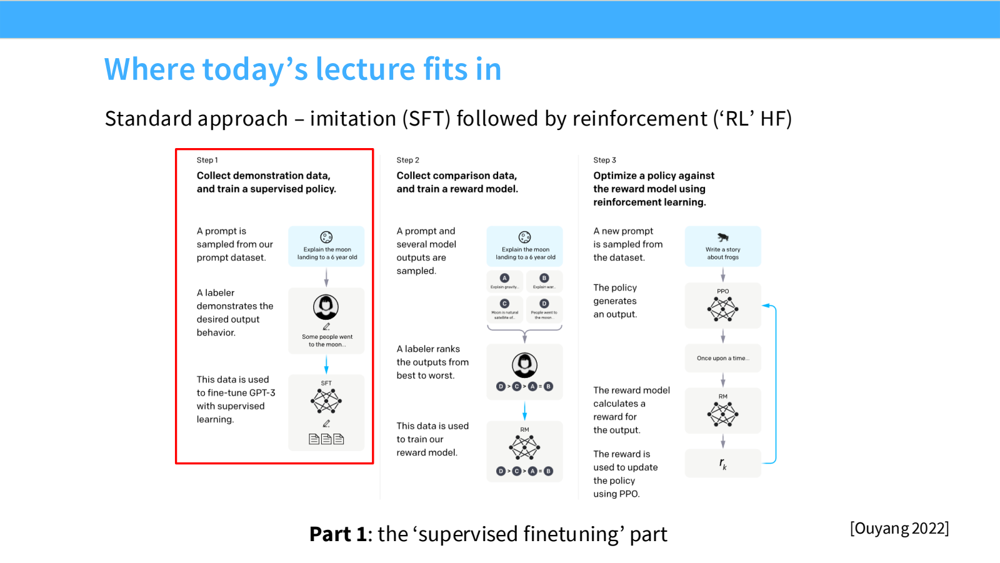
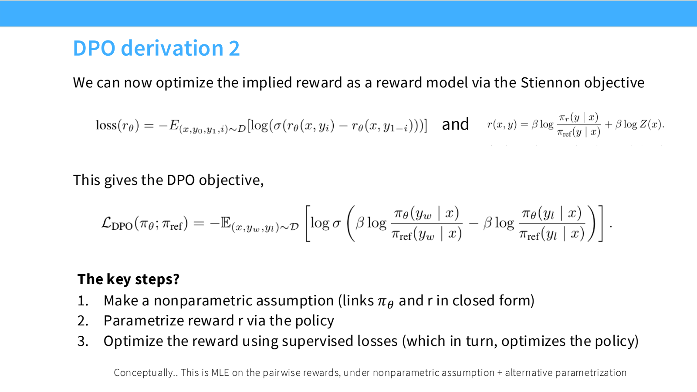
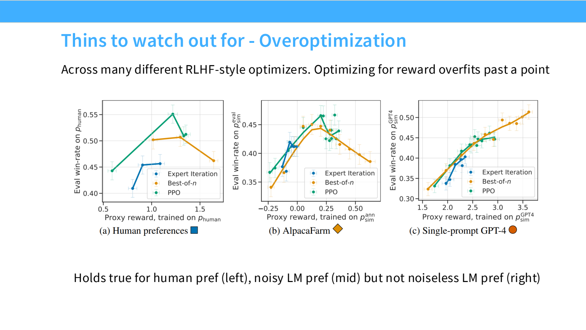

- 从 Base Model 到 Assistant：模仿与优化是两件事
	- [Slides 2–7、31–34](../Slides/lecture_15.pdf#page=2)
	- 预训练学习文本分布；**SFT** 学示范回答的条件分布；**RLHF / Preference Optimization** 则优化“什么回答更受偏好”。
	- 人写得出来的答案，与人能识别出的好答案并不相同；后者提供超出纯模仿的数据通道。
	- 常见流程是 SFT → 偏好数据/奖励建模 → 策略优化，但实际后训练会多轮迭代并混合不同数据。
	- 

- SFT：数据内容与风格同样影响行为
	- [Slides 8–30](../Slides/lecture_15.pdf#page=8)
	- 典型目标：$L_{SFT}=-\mathbb E_{(x,y)}\log\pi_\theta(y\mid x)$；训练时常只对 assistant 回答 tokens 计算 loss，具体 mask 取决于数据格式。
	- 从 FLAN、Alpaca 到 OpenAssistant、代码/工具数据，变化包括任务覆盖、对话性、长度、事实细节与工具行为，不只是样本数量。
	- 少量高质量行为示范能产生明显改变；但 SFT 并非永远只“唤醒已有能力”，长尾任务仍需要合适数据和训练。
	- 用包含模型未知事实的答案微调，可能诱发不可靠输出；**示范事实正确，也不保证模型学会在未知时承认不知道**。
	- Safety SFT 用场景与安全回答塑造边界；mid-training 混入更贴近任务的数据，可缓解一次窄分布微调的冲击，但仍要检测遗忘。

- 偏好数据：谁偏好、按什么标准偏好？
	- [Slides 35–48](../Slides/lecture_15.pdf#page=35)
	- 同一 prompt $x$ 下收集两个回答，并标注 chosen $y_w$ 与 rejected $y_l$；评价指南、标注者背景与任务难度都会改变训练信号。
	- 长度、语气、排版和迎合程度会影响偏好；**win rate 提升不自动等于事实正确性提升**。
	- AI Feedback 可扩展比较数量，Constitutional AI 等用原则辅助自评/修订；但裁判偏差和自我强化也可能进入数据。
	- 人工标注也不等于无噪声真值：需要验证、合适报酬、清晰 rubric 与数据治理。

- Reward Model 与 PPO：把偏好变成可优化奖励
	- [Slides 49–53](../Slides/lecture_15.pdf#page=49)
	- 常用 Bradley–Terry 模型：$P(y_w\succ y_l\mid x)=\sigma(r_\phi(x,y_w)-r_\phi(x,y_l))$，对成对数据做负对数似然训练。
	- 策略优化常写成 $\max_\pi\mathbb E_{x,y\sim\pi}[r_\phi(x,y)]-\beta\mathbb E_xD_{KL}(\pi(\cdot\mid x)\Vert\pi_{ref}(\cdot\mid x))$。
	- 奖励鼓励偏好行为，KL 约束模型不要离 reference 太远；reference 与 PPO 用于重要性比率的旧策略不是同一个概念。
	- PPO 在当前/近期策略采样的回答上更新，用 advantage 降低方差、clipping 限制过大更新；具体实现见 [[CS336/Lectures/Lecture16 RLVR and Reasoning.md|Lecture16]]。

- DPO：用隐式奖励，直接训练偏好
	- [Slides 54–61](../Slides/lecture_15.pdf#page=54)
	- KL 正则化目标的理想最优策略满足 $\pi^*(y\mid x)\propto\pi_{ref}(y\mid x)e^{r(x,y)/\beta}$，因此可将 reward 改写为策略对数比。
	- 定义 $\Delta_\theta=\log\frac{\pi_\theta(y_w\mid x)}{\pi_{ref}(y_w\mid x)}-\log\frac{\pi_\theta(y_l\mid x)}{\pi_{ref}(y_l\mid x)}$，则 **$L_{DPO}=-\mathbb E\log\sigma(\beta\Delta_\theta)$**。
	- 直接用成对数据更新策略，不必单独训练显式 reward model，也不必在每步生成在线 rollout；相对 reference 提高 chosen、降低 rejected 的偏好对比。
	- 闭式推导有理想策略空间等假设；离线数据覆盖、长度偏差和迭代采样仍影响效果，不能把 DPO 当成所有 PPO 训练的完全等价替代。
	- 

- Reward Overoptimization：指标越高，不一定回答越好
	- [Slides 62–65](../Slides/lecture_15.pdf#page=62)
	- 策略可能利用 reward model 的漏洞：代理奖励继续上升，真实人工偏好或独立指标却下降。
	- 还要关注输出多样性下降、长度漂移与校准变差；优化后的策略不再以忠实拟合原始文本概率分布为唯一目标。
	- 使用独立评估、检查训练长度与 KL、人工抽样审查；DPO 与 PPO 都不能仅凭算法名字免疫过拟合。
	- 
