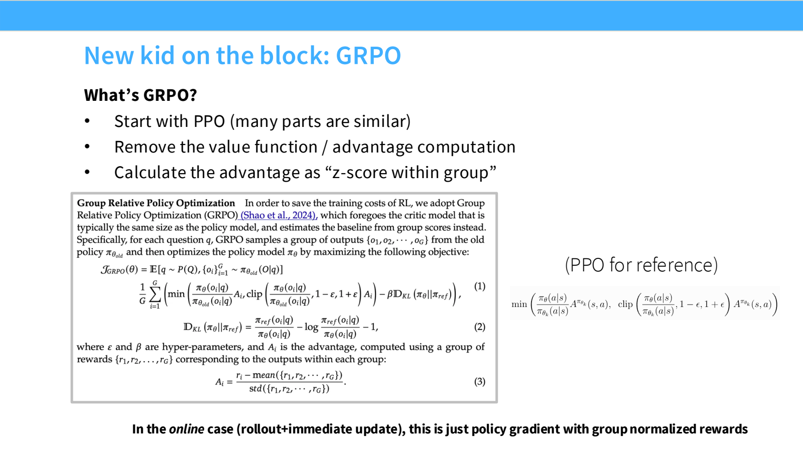
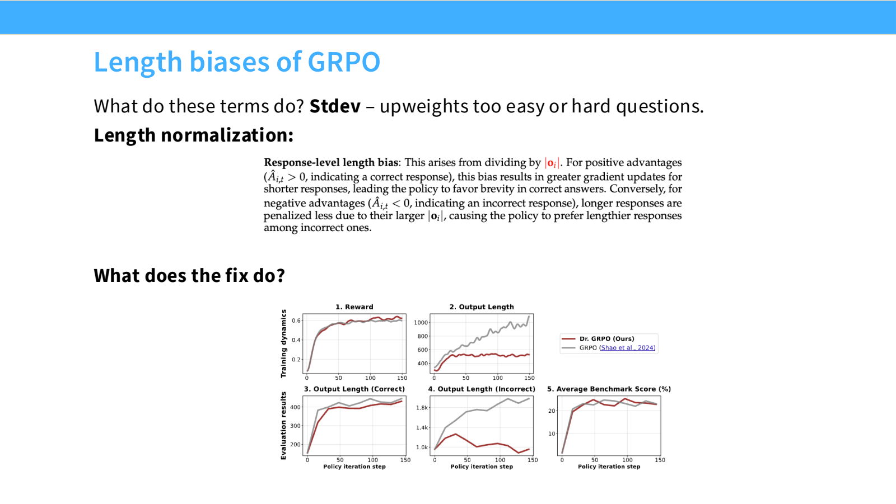
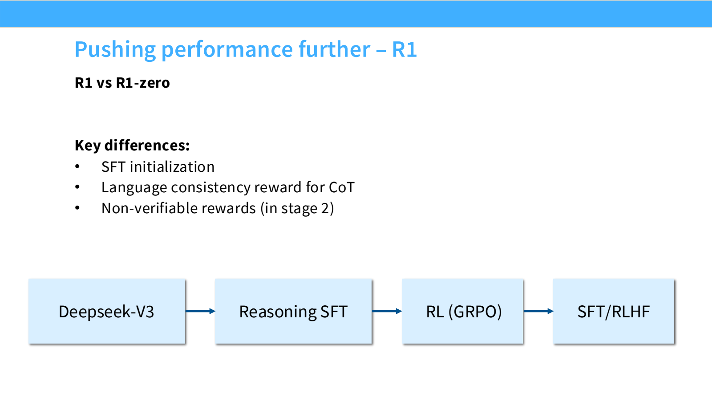
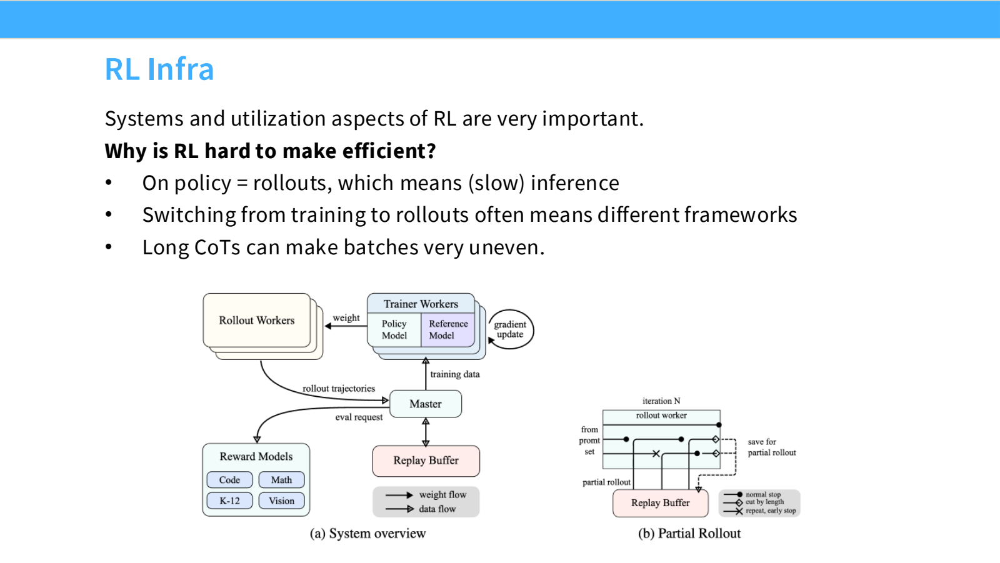

- 从 RLHF 到 RLVR：让奖励更容易检查
	- [Slides 2–4、17、25](../Slides/lecture_16.pdf#page=2)
	- RLHF 的偏好奖励容易带有噪声并被过度优化；**RLVR（Reinforcement Learning with Verifiable Rewards）** 使用答案校验、程序测试等更可验证的结果反馈。
	- 典型任务是数学、代码与可执行环境；可验证奖励更容易扩展，但只验证最终结果，不等于保证推理过程真实或覆盖所有用户需求。
	- 本讲主线：PPO 实现 → GRPO → DeepSeek-R1 / Kimi / Qwen 推理训练 → Agent RL。

- PPO：策略、奖励、Value 与 Reference 各司其职
	- [Slides 5–16](../Slides/lecture_16.pdf#page=5)
	- 把 token 看成 action，prefix 看成 state；生成完整回答后得到主要任务奖励，KL shaping 可在 token 级施加。
	- 重要性比率为 $\rho_t=\pi_\theta(a_t\mid s_t)/\pi_{old}(a_t\mid s_t)$；最大化 clipped surrogate：$\mathbb E[\min(\rho_tA_t,\operatorname{clip}(\rho_t,1-\epsilon,1+\epsilon)A_t)]$。
	- **Old Policy** 负责采样/比率，**Reference Policy** 负责 KL 约束，**Value Model** 预测未来回报以构造 advantage；不要混为一个模型。
	- 一轮通常先 rollout、打分与估计 advantage，再在这批数据上做有限次更新；还要处理 value loss、mask、截断与数值稳定性。
	- PPO 的困难往往不在纸上公式，而在额外模型显存、超参数与生成—训练两套计算流程。

- GRPO：用同一道题的一组回答代替 Value Model
	- [Slides 18–21](../Slides/lecture_16.pdf#page=18)
	- 每个 prompt 采样 $G$ 个回答，得到奖励 $r_1,\ldots,r_G$；基础形式使用 **$A_i=(r_i-\bar r)/(\operatorname{std}(r)+\epsilon)$** 作为组内相对 advantage。
	- 回答中的 token 共享相应的结果级 advantage，再配合 PPO 风格比率/clipping 与可选 KL 正则更新。
	- 去掉 value model，节省显存与 value 拟合；但仍需生成多个回答，不是“无需 rollout 的监督学习”。
	- 同组奖励完全相同时，区分性信号很弱；题目难度与采样策略因此也会影响有效训练数据量。
	- 

- GRPO 的两个偏差：组内标准差与回答长度
	- [Slides 22–24](../Slides/lecture_16.pdf#page=22)
	- 对奖励减去合适 baseline 可以降方差，但除以组内标准差还会改变不同题目的权重，**不只是一个保持原目标不变的 baseline 技巧**。
	- 按每个回答长度取 token 平均，会让长短回答在正/负 advantage 下受到不同更新强度；不能把训练后 CoT 变长全部归因于推理能力增强。
	- Dr. GRPO 等修改归一化与 baseline；比较变体时需明确具体 loss，而不只写“用了 GRPO”。
	- 

- DeepSeek-R1：纯 RL 实验与完整产品 recipe 不同
	- [Slides 26–38](../Slides/lecture_16.pdf#page=26)
	- **R1-Zero**：从 base model 出发做推理 RL，主要依靠正确性与格式奖励；出现较长推理、自检等现象，但有可读性、语言混杂等问题。
	- **R1**：加入 cold-start 推理 SFT，再做 RL，并混合推理与通用数据进行后续 SFT / RLHF；不是只用一个“答案对错”奖励从头训练全部能力。
	- **Distillation**：让强模型产生长 CoT 数据，监督训练较小学生；学生获得推理行为不要求自己也执行同一套大规模 RL。
	- “Aha moment”并不能单独证明产生了全新机制：base model 的已有行为、目标偏差与采样分布变化都应被控制分析。
	- 

- Kimi / Qwen：数据难度、长度控制与多阶段组合
	- [Slides 39–54](../Slides/lecture_16.pdf#page=39)
	- **Kimi K1.5**：筛选题目难度、长 CoT SFT、RL 与课程式采样；引入长度控制，避免只用无限延长回答换成绩。
	- **Qwen3**：推理 SFT / RL 后融合 thinking 与 non-thinking 数据，用标签/预算控制推理长度，再做通用对齐与蒸馏。
	- Test-time Scaling 可以增加尝试、验证与思考预算，但收益依赖题目、采样与验证器；更多 tokens 不保证更好。
	- 通用 RLHF 可能略损数学/STEM 指标，提醒我们各阶段目标并非天然一致，必须分项评估。

- Agent RL：环境工程与系统利用率也是算法的一部分
	- [Slides 45–46、55–61](../Slides/lecture_16.pdf#page=45)
	- Agent 把单轮回答扩展到工具调用与多步执行；代码任务需要仓库、依赖、测试和可重置环境，奖励要反映真实完成度并防止投机。
	- 推理 rollout 慢、轨迹长度不齐、训练与生成切换频繁；需要调度、批处理和权重同步等系统设计，连接到 [[CS336/Lectures/Lecture10 Inference.md|Lecture10]]。
	- 最后应一起报告效果、生成成本、训练成本与环境条件，而不是只报告训练 reward。
	- 
