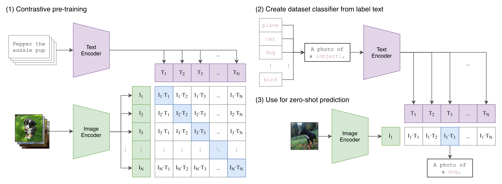
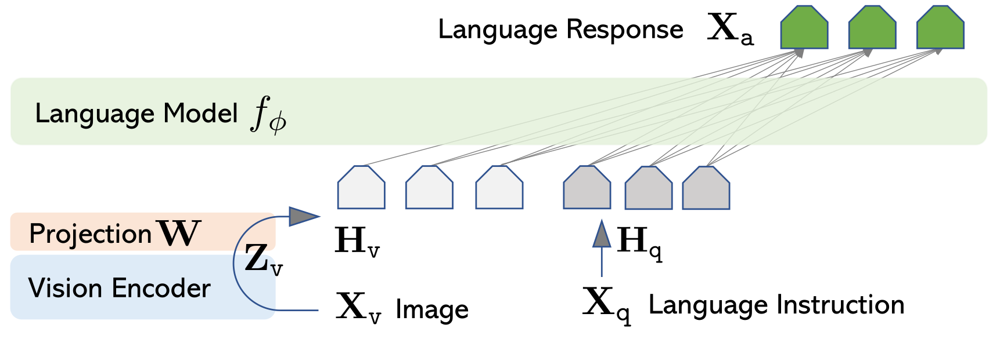
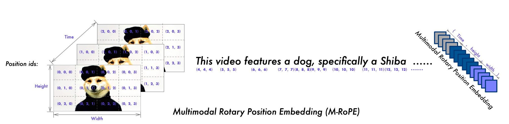
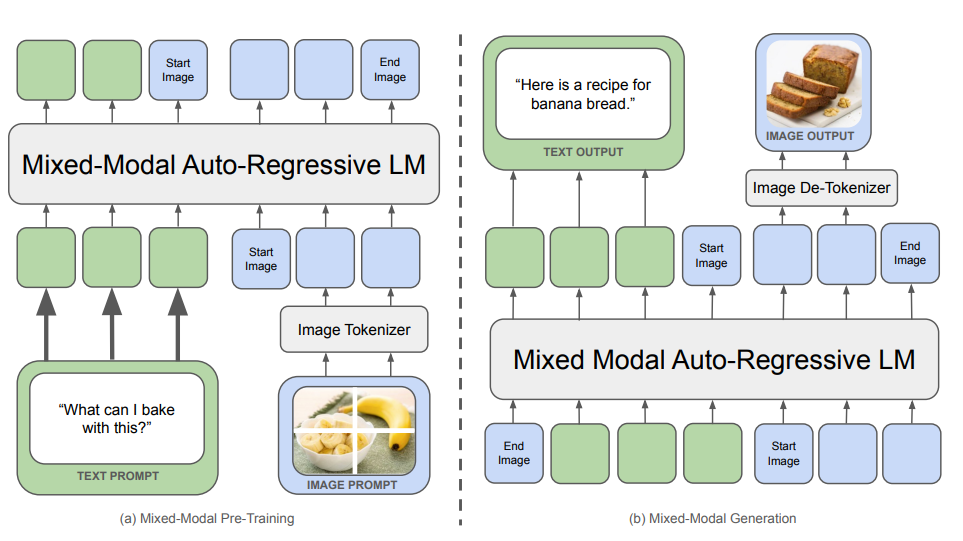

- Multimodal：Transformer 需要先“看得懂”非文本输入
	- [讲义：`main()`](../Slides/lecture_17.py)
	- 从 text → text 扩展到图像、视频、语音等模态，核心问题是：**如何编码成模型可处理的表示，以及如何再生成非文本内容？**
	- Transformer 的输入 token 不一定是离散词表 ID，也可以是视觉编码器输出的连续向量；但要用标准离散自回归分类生成图像，就需要可预测的离散表示等设计。
	- 本讲主要围绕视觉—语言模型展开；Omni 是任意组合模态输入/输出的方向，不等于讲义已经完整覆盖音频、视频生成的所有方法。

- CLIP：用图文配对学习语义空间
	- [讲义：`clip()`](../Slides/lecture_17.py)
	- 图像 encoder 与文本 encoder 分别得到表示；对一个 batch 的图文对，增大匹配 pair 的相似度、压低非匹配 pair，相当于双向对比分类。
	- 视觉端可用 ViT：把图像分为 patches 再做 Transformer；文本端得到句子级表示。共同空间支持检索与零样本分类。
	- 零样本分类可把候选类别写成文本描述，与图像表示比较；CLIP 本身**不是一个会生成对话的视觉助手**。
	- 语义对齐不保证保留 OCR、位置和像素细节；统一缩放/裁剪还可能丢失图像边缘与小字。
	- 

- SigLIP：从 batch 内 softmax 改为 pair 的二分类
	- [讲义：`siglip()`](../Slides/lecture_17.py)
	- CLIP 的目标在 batch 候选上归一化；**SigLIP** 对图文 pair 判断“匹配 / 不匹配”，采用 sigmoid loss。
	- 省去同样形式的全局 softmax 归一化，使 batch 与跨设备计算更灵活；并不意味着不需要负样本、通信或足够的数据。
	- 视觉编码器常成为下游 VLM 的基础；比较效率时也要同时考虑数据、模型尺寸、分辨率与训练设置，不能只归功于一个 loss 名字。

- LLaVA：Vision Encoder + Projector + LLM
	- [讲义：`llava()`、`llava_onevision()`](../Slides/lecture_17.py)
	- 图像经 CLIP / SigLIP 编码，再通过线性层或 MLP **Projector** 映射到 LLM 的 embedding 维度，与文本一起输入语言模型。
	- 经典 LLaVA 先冻结两侧、训练 projector 做对齐，再冻结视觉端、训练 projector 与 LLM 做指令跟随；不同后续模型不一定沿用同样冻结方案。
	- 可用图像 caption / 检测信息让强文本模型生成问答，再与原图配对；合成指令覆盖面与视觉依据都需检查。
	- **OneVision / AnyRes** 通过切图、编码多个局部块保留高分辨率信息；单图、多图、视频要在细节与视觉 token 数之间平衡。
	- 

- Qwen-VL 系列：动态分辨率与多维位置信息
	- [讲义：`qwen_vl()`、`qwen2_vl()`、`qwen3_vl()`](../Slides/lecture_17.py)
	- Qwen-VL 用 adaptor、视觉位置与 `` / `<box>` 等特殊标记连接视觉与文本；训练从大规模对齐数据走向更高质量任务数据和指令数据。
	- **Dynamic Resolution** 按输入尺寸分配视觉 tokens，减少固定裁剪损失；视频还需控制采样帧数与总长度。
	- **MRoPE** 将位置扩展到时间、高度、宽度；Qwen3-VL 的 interleaved MRoPE 将各轴分配到不同频率段，并使用显式视频时间戳。
	- **DeepStack** 将不同层视觉特征注入 LLM 多层；长视频样本 token 多，loss 权重也需平衡，避免视觉长度压倒文本训练。
	- 

- Chameleon：让图像也变成可生成的离散 tokens
	- [讲义：`chameleon()`](../Slides/lecture_17.py)
	- 前面的理解型 VLM 主要接收连续视觉特征，并不因此自动具备图像输出能力；Chameleon 则把图像编码为离散 codebook 索引。
	- 用 VQ 类图像 tokenizer 把图像映射到离散序列，再由 decoder 重建；文本和图像 tokens 混合做 next-token prediction，可统一理解与生成。
	- 离散化有信息损失，可能影响小字/OCR 等精细理解；图像表示既要便于生成，也要保留语义和细节，目标不完全一致。
	- 不同模态的熵与激活尺度不同，训练会遇到 norm growth / logit drift；QK Norm、z-loss 等稳定技巧重新变得重要。
	- **统一离散序列**与**连续视觉 encoder + LLM + 专门生成器（如 diffusion）**是不同路线；不能只凭形式更统一就判断效果更好。
	- 
