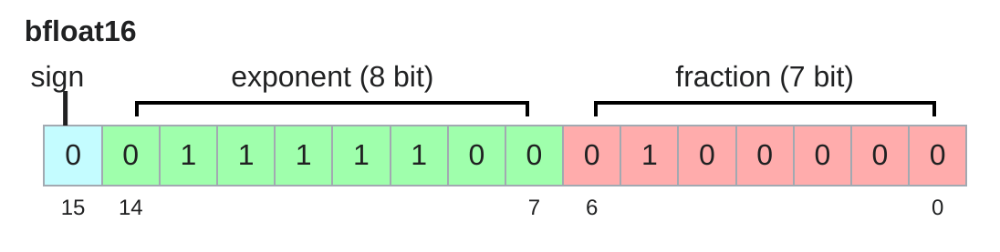
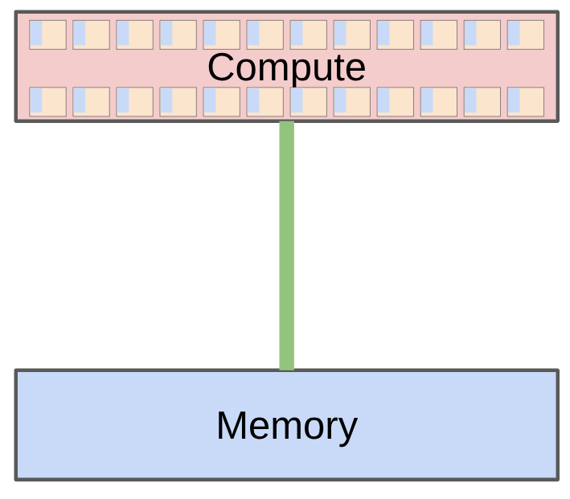
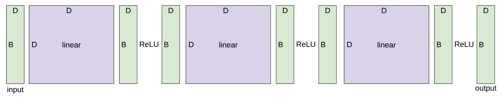

- Resource Accounting：先算资源，再谈训练
	- [讲义：`motivating_questions()`、`tensors_basics()`](../Slides/lecture_02.py)
	- 把训练拆成张量：**参数、梯度、激活、优化器状态、输入数据**。显存由“元素数 × 每元素字节数”决定，不能只数模型权重。
	- 区分 **FLOPs**（总计算量）与 **FLOP/s**（计算速度）；GPU 的标称速度还依赖精度、是否使用稀疏加速，不能直接拿最高数字估算训练时间。
	- 粗估时间：$t\approx C/(G\cdot P\cdot u)$，$G$ 为 GPU 数、$P$ 为单卡对应精度的峰值速度、$u$ 为有效利用率；还要考虑通信、数据加载与故障等开销。

- 精度：省一半显存，不只是少一半小数位
	- [讲义：`tensors_memory()`](../Slides/lecture_02.py)
	- **FP32** 为 4 bytes；**FP16 / BF16** 为 2 bytes。BF16 与 FP32 指数位数相同，动态范围相近，但有效数字精度更低。
	- FP16 动态范围较窄，更容易上溢或下溢；BF16 也不是训练稳定性的自动保证。
	- **Mixed Precision**：矩阵乘法和部分激活用低精度，敏感的归约、优化器状态等保留较高精度；是否另存 FP32 master weights 取决于实现。
	- FP8 / FP4 还需缩放、分块与误差控制；不能把所有张量直接转换后就假设训练效果不变。
	- 

- 张量维度与矩阵乘法的账
	- [讲义：`tensor_einops()`、`tensor_operations_flops()`](../Slides/lecture_02.py)
	- `einsum` 用命名维度表达缩并；没有出现在输出中的维度会被求和。`rearrange` 负责拆分、合并和重排维度，`reduce` 负责归约。
	- $A\in\mathbb R^{m\times k}$、$B\in\mathbb R^{k\times n}$，计算 $AB$ 约需 **$2mkn$ FLOPs**：每个输出累加 $k$ 次乘加。
	- 一层 $Y=XW$ 的反向包含 $\nabla_XL=\nabla_YL\,W^T$ 与 $\nabla_WL=X^T\nabla_YL$，因此反向矩阵乘法约是前向的两倍。
	- 对矩阵乘法占主导的稠密模型，训练约为 **$6ND$ FLOPs**。这不是精确恒等式：长上下文 attention、重计算、MoE 路由和其他操作需另算。

- Roofline：算得快，还是搬得快？
	- [讲义：`arithmetic_intensity()` 到 `roofline_plots()`](../Slides/lecture_02.py)
	- **Arithmetic Intensity**：$I=F/Q$，即每搬运 1 byte 做多少 FLOPs；硬件拐点为 $I_{\mathrm{hw}}=P/W$，$W$ 是内存带宽。
	- 理想下界：$t\ge\max(F/P,Q/W)$；等价地，可达吞吐上界为 $\min(P,WI)$。
	- $I<I_{\mathrm{hw}}$ 时偏 **Memory-bound**，如逐元素操作、矩阵向量乘；大矩阵乘法能复用权重，更可能 **Compute-bound**。
	- **MFU** 是模型有效 FLOP/s 与对应硬件峰值的比值；Roofline 只给理想上界，实际还受 kernel launch、占用率、通信等限制。
	- 

- 训练显存：Adam 的状态也很贵
	- [讲义：`gradients_flops()`、`deep_network()`、`optimizer()`](../Slides/lecture_02.py)
	- Adam 的一阶、二阶矩若都用 FP32，单独就需 **8 bytes / parameter**；还未包括参数、梯度、master weights 和激活。
	- 一种常见混合精度配置：BF16 参数 2B + BF16 梯度 2B + FP32 master weights 4B + 两个 FP32 moment 8B，合计 **16B / parameter**，再加激活与临时 buffer；这不是所有实现的固定值。
	- 激活显存通常随 batch、序列长度、层数和隐藏维度增长；朴素 attention 还可能保存序列长度平方的中间量。
	- 

- 两种省激活显存的方法
	- [讲义：`gradient_accumulation()`、`activation_checkpointing()`](../Slides/lecture_02.py)
	- **Gradient Accumulation**：把大 batch 分成 micro-batch，多次反传累积梯度，再更新一次参数；要按有效样本/token 数正确归一化，并在更新后清零梯度。
	- 它降低单次保留的激活，但**不会减少参数与优化器状态**，也不意味着 batch 可以无限变大。
	- **Activation Checkpointing**：前向只保存部分激活，反向时重新计算缺失部分，用额外计算换显存。
	- 对简化的 $L$ 层链式网络，每隔约 $\sqrt L$ 层存 checkpoint，可把激活存储从 $O(L)$ 降到 $O(\sqrt L)$，同时保留 $O(L)$ 量级的重计算；实际 Transformer 需要按块核算。
