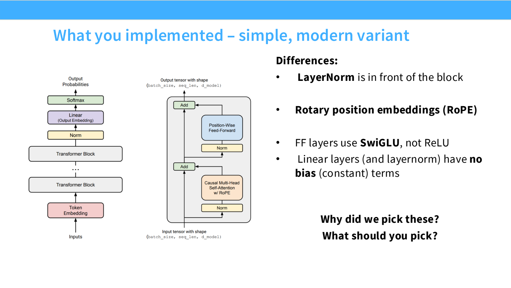
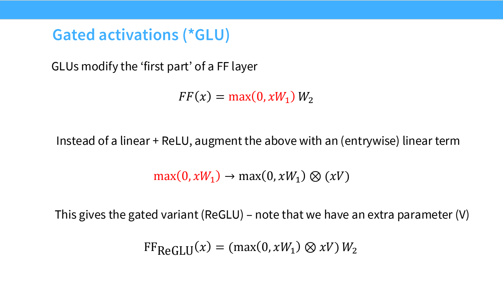
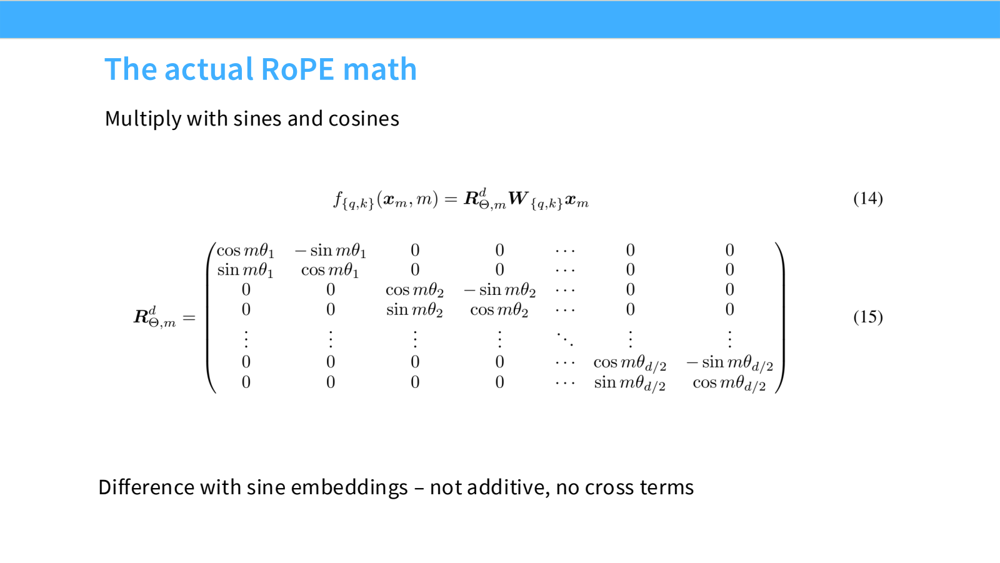

- 现代 Transformer：哪些选择值得优先理解？
	- [Slides 3–9](../Slides/lecture_03.pdf#page=3)
	- 常见 decoder-only 模型仍是 **Causal Attention + MLP + Residual**；变化集中在归一化、激活、位置编码、张量形状与 attention 的成本控制。
	- 作业中的现代变体采用 Pre-Norm、RoPE、SwiGLU，并去掉许多 bias；这些是可靠起点，不是每个场景都最优的定理。
	- 选择架构同时考虑**效果、稳定性、训练速度、推理显存与并行难度**，不能只比较参数量或 FLOPs。
	- 

- Normalization：别破坏残差主通路
	- [Slides 10–19](../Slides/lecture_03.pdf#page=10)
	- **Post-Norm**：$x' = \operatorname{Norm}(x+F(x))$；**Pre-Norm**：$x'=x+F(\operatorname{Norm}(x))$。后者让残差路径保持直接连接，通常更容易稳定训练深层模型。
	- 也有分支输出再归一化、双重归一化等设计；“Norm 一律放前面”不是唯一方案。
	- **RMSNorm**：$y_i=\gamma_i x_i/\sqrt{\frac1d\sum_jx_j^2+\epsilon}$，不减均值，通常也不加 bias；相比 LayerNorm，减少归约和访存。
	- 关键提醒：**FLOPs 少不等于运行时间同比例减少**。归一化常受内存搬运影响，需要实测 fused kernel 的收益。

- SwiGLU：用门控替换普通 FFN
	- [Slides 20–29、37–41](../Slides/lecture_03.pdf#page=20)
	- 普通 FFN 为 $\phi(xW_1)W_2$；**SwiGLU** 为 $[\operatorname{SiLU}(xW_g)\odot(xW_u)]W_d$，其中 $\operatorname{SiLU}(z)=z\sigma(z)$。
	- 门控让一条分支控制另一条分支的信息流，但从两个矩阵变为三个矩阵，需要同时调整中间宽度。
	- 普通 FFN 常取 $d_{ff}\approx4d$；GLU 常取 $d_{ff}\approx\frac83d$，使主要参数量与计算量大致可比，具体模型也会偏离这个比例。
	- Serial Block 先 attention 再 MLP；Parallel Block 从同一个输入同时计算两个分支，可能更利于系统实现，但不是普遍标准。
	- 

- RoPE：旋转绝对位置，内积体现相对距离
	- [Slides 30–35](../Slides/lecture_03.pdf#page=30)
	- 将 Q、K 每两维组成一组，按位置 $m$ 旋转：$\tilde q_m=R_mq_m$、$\tilde k_n=R_nk_n$；V 通常不旋转。
	- $\tilde q_m^T\tilde k_n=q_m^TR_{n-m}k_n$，所以内积中的位置因子只依赖相对位移。
	- 与把正余弦向量加到 embedding 不同，RoPE 不引入同样的内容—位置加法交叉项；但**相对结构不等于天然长文本外推，也不保证距离越远 attention 越小**。
	- 推导与上下文扩展可回看 [Position Embedding](../../%E5%AE%8F%E6%AF%852526/%E5%AE%8F%E6%AF%8526/Units/Unit3-Position&Harness/Lecture7%20Position%20Embedding.md)。
	- 

- 超参数：先用保守基线，再做消融
	- [Slides 36–51](../Slides/lecture_03.pdf#page=36)
	- 常见 $n_{heads}d_{head}=d_{model}$，但这是经验约定，不是数学要求；词表大小也要结合语言覆盖与输出层成本。
	- 深宽比不只影响表达能力：太深会增大逐层延迟与 pipeline 难度，太宽会改变矩阵效率和并行切分。
	- 大规模预训练中 dropout 常少用或不用；weight decay 仍可能通过优化动态起作用，不能仅用“小数据防过拟合”解释。

- 稳定性与 Attention 成本控制
	- [Slides 52–67](../Slides/lecture_03.pdf#page=52)
	- Softmax 对大 logit 敏感：**z-loss** 约束 log-partition，**QK Norm** 控制 Q、K 尺度，**Soft-capping** 用 $c\tanh(z/c)$ 限制 logit 范围；它们作用位置不同。
	- **MHA** 每个 query head 有独立 KV；**MQA** 所有 query heads 共用一组 KV；**GQA** 介于两者之间，主要节省 decode 的 KV Cache 与读取带宽。
	- Sliding Window / Sparse Attention 减少访问范围；交错局部层与全局层，在成本和长距离信息之间折中。
	- 不要混淆：GQA 改变 KV 结构，稀疏 attention 改变连接范围，[FlashAttention](Lecture5%20GPUs%20and%20FlashAttention.md) 则优化给定 attention 的计算与 IO。
