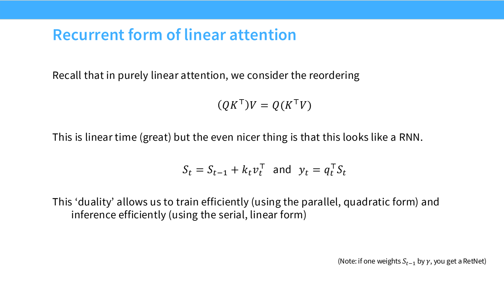
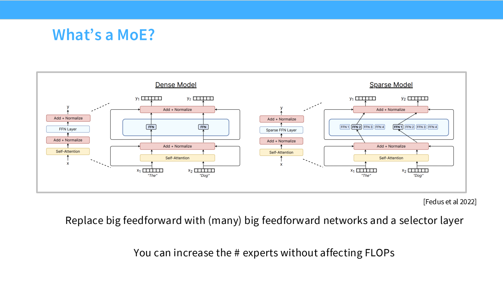
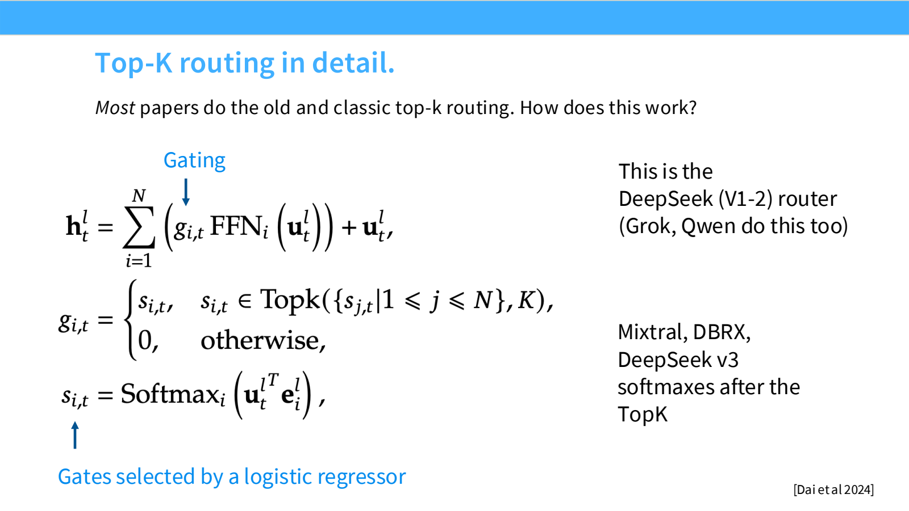
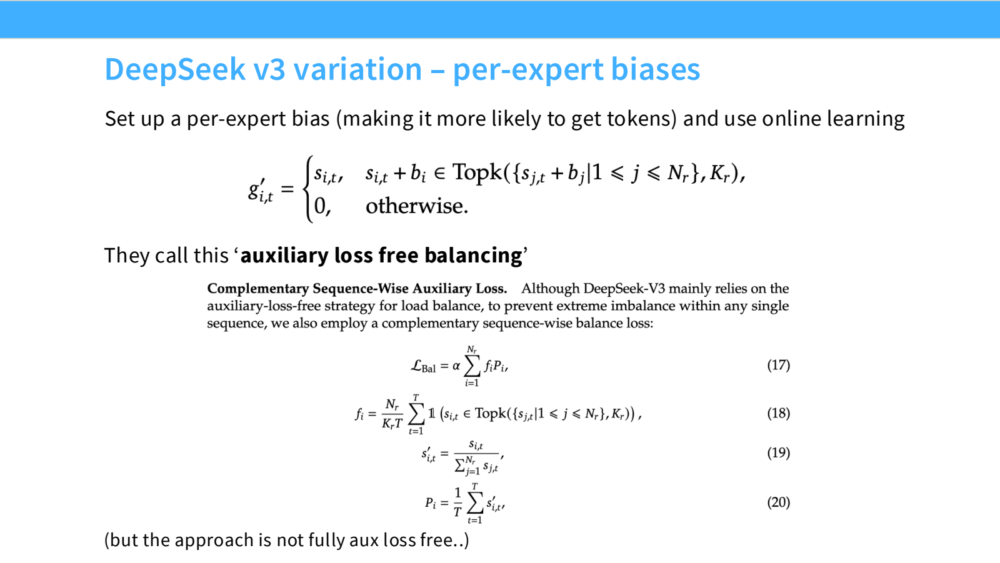

- Attention Alternatives：长上下文不一定保存全部历史 KV
	- [Slides 2–13](../Slides/lecture_04.pdf#page=2)
	- 标准 attention 的序列交互成本随长度平方增长；路线包括局部/全局混合、稀疏选择、Linear Attention、状态空间模型，以及混合架构。
	- 去掉 softmax 时可重排：$(QK^T)V=Q(K^TV)$，避免显式构造 $n\times n$ 矩阵。**标准 softmax attention 不能直接这样交换运算顺序**。
	- 因果线性版本可写成 $S_t=S_{t-1}+k_tv_t^T$，$y_t=S_t^Tq_t$；状态尺寸由 head 维度决定，而不是随历史长度持续增加。
	- 

- 从 Linear Attention 到 Mamba / Gated DeltaNet
	- [Slides 6–13](../Slides/lecture_04.pdf#page=6)
	- **Mamba-2 的简化视角**：给旧状态加入输入相关的遗忘门 $\gamma_t$，控制保留多少历史信息。
	- **Gated DeltaNet**：进一步加入写入门和沿当前 key 方向的选择性擦除，避免状态只会累加；这是理解机制的入口，不是完整实现。
	- 固定容量状态节省显存，但精确检索远处细节可能更困难；因此常与完整 attention 层交错使用，混合比例也需实验验证。
	- **DSA** 等稀疏路线则用索引/选择机制只访问部分历史 token，不必把所有历史都压入固定状态。

- MoE（Mixture of Experts）：参数很多，每个 token 只用一部分
	- [Slides 14–26](../Slides/lecture_04.pdf#page=14)
	- 通常把稠密 MLP 替换为多个 expert MLP 与一个 router；每个 token 只激活少量专家，因此可以在相近 FFN 计算量下增加总容量。
	- **总参数量**决定模型存储需求；**激活参数量**更接近每 token 的主要计算需求。二者不能混为一谈。
	- 同样激活 FLOPs 下 MoE 可能效果更好，但代价是路由、跨设备通信、小矩阵效率与训练稳定性的复杂度。
	- 

- Routing：Token 选择哪些专家？
	- [Slides 27–39](../Slides/lecture_04.pdf#page=27)
	- 常见 **Token-choice Top-k**：先计算 expert 分数，再选前 $k$ 个，输出为 $y=\sum_{i\in\mathrm{TopK}(s(x))}g_i(x)E_i(x)$。
	- 有的模型先 softmax 再选，有的先选再归一化；也有 Expert-choice、hash routing 等不同方案，不能把所有 router 当成同一个公式。
	- **Fine-grained Experts**：把专家做小、数量变多；**Shared Experts**：一部分专家始终激活，另一些按 token 路由。是否有益仍依赖规模与配置。
	- 离散 Top-k 的选择本身不可微，但选中 expert 的连续 gate 权重与专家参数仍可获得梯度；训练路由还会引入噪声、辅助目标等机制。
	- 

- Load Balancing：只去“最受欢迎”的专家会怎样？
	- [Slides 40–49](../Slides/lecture_04.pdf#page=40)
	- 失衡让少数 GPU 过载，其他 GPU 空闲；若容量有限，还可能丢弃或延后 token，影响效率与效果。
	- 常见辅助损失写成 $L_{bal}=\alpha E\sum_i f_iP_i$，$f_i$ 是 token 分配比例、$P_i$ 是平均路由概率，鼓励更均衡的专家使用。
	- **Auxiliary-loss-free Balancing**：为专家添加动态选择偏置，过载者降低偏置、低载者提高偏置；偏置用于选路，不一定进入最终加权分数。
	- DeepSeek 的这一设计仍可能配合序列级辅助损失，所以名称不等于“完全没有辅助目标”。Router 使用 FP32、加入 z-loss 也可改善数值稳定性。
	- 

- 系统与扩展：MoE 的收益不是免费的
	- [Slides 44–60](../Slides/lecture_04.pdf#page=44)
	- **Expert Parallelism** 把专家放到不同 GPU，token dispatch 与结果回收依赖 All-to-all；需要足够的网络带宽与负载均衡，详见 [Lecture8](Lecture8%20Distributed%20Training.md)。
	- **Upcycling**：从稠密模型初始化多个专家，再继续训练，降低从零开始训练 MoE 的成本；还要处理专家同质化与微调过拟合。
	- **MLA** 压缩 KV Cache，**MTP** 增加未来 token 预测目标、也可支持推测解码；它们与 MoE 是可组合的不同模块，不是 MoE 的同义词。
	- 比较 MoE 时至少同时报告总/激活参数、训练 tokens、FLOPs、实际吞吐与设备数量；“参数大很多、计算差不多”不等于部署成本相同。
