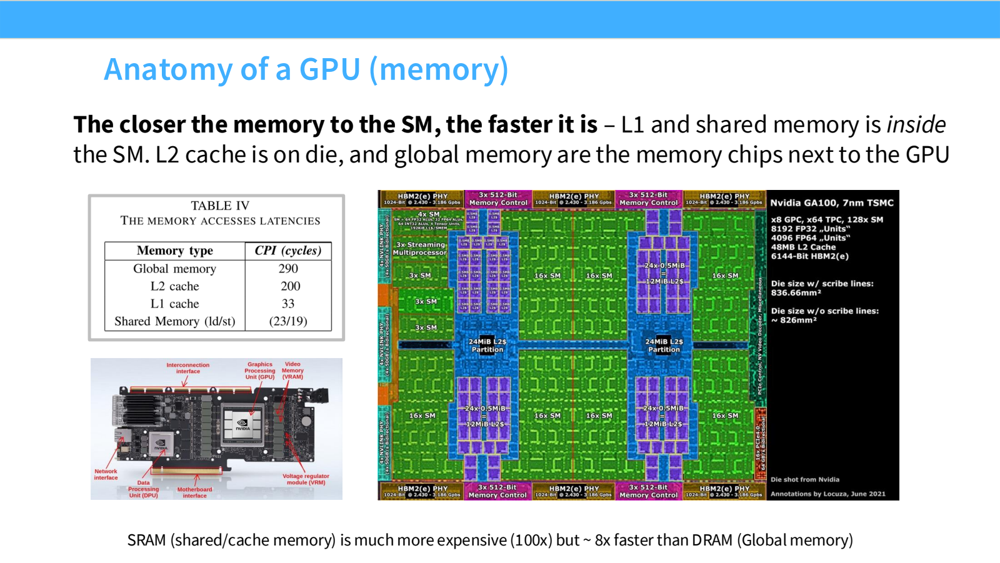
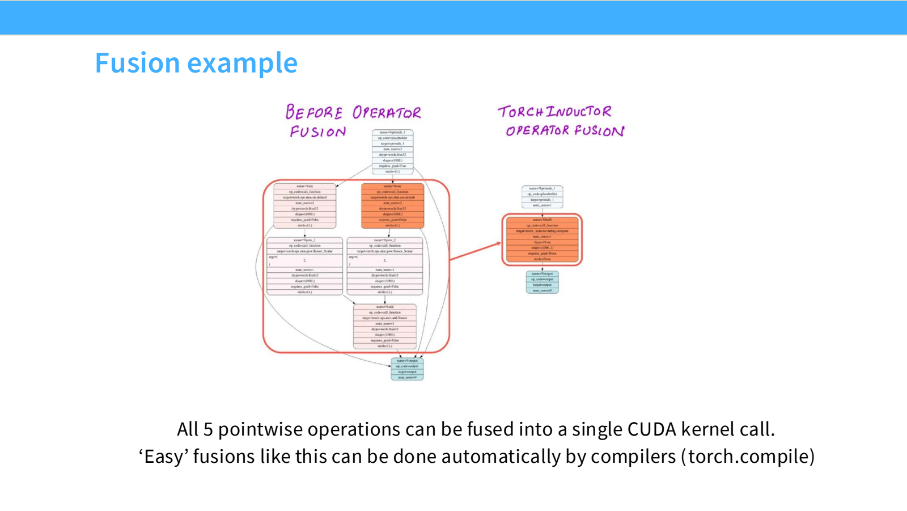
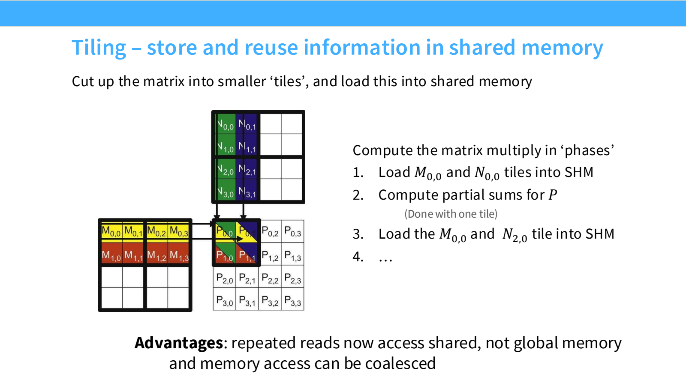
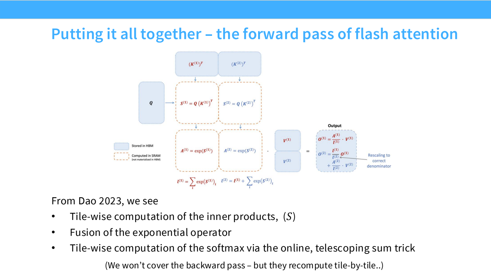

- GPU：不是单个很快的 CPU，而是大量并行工作单元
	- [Slides 5–19](../Slides/lecture_05.pdf#page=5)
	- CPU 偏向少量低延迟线程；GPU 偏向大量相似任务的吞吐。多个 **SM** 执行 thread blocks，一个 block 内的线程可以使用共享内存协作。
	- 一个 **Warp** 通常有 32 个线程，以 SIMT 方式执行；同一 warp 内分支不一致会降低执行效率，不是“代码里出现 if 就一定慢”。
	- 存储层次：Registers → L1 / Shared Memory → L2 → HBM。越靠近计算单元，一般越快、越小；Tensor Cores 专门加速适配形状和精度的矩阵运算。
	- 

- Roofline：先确定瓶颈属于哪一边
	- [Slides 20–29](../Slides/lecture_05.pdf#page=20)
	- 延续 [Lecture2](Lecture2%20Resource%20Accounting.md)：比较计算强度 $F/Q$ 与硬件算力/带宽之比，而不只数数学运算。
	- **低精度**可同时减少数据量并利用更高的低精度矩阵吞吐；但要处理缩放、异常值与累积误差，实际混合精度方案往往并非所有权重都用同一种格式。
	- 算力增长快于带宽增长，使“让数据留在离 SM 更近的地方”越来越重要。

- Fusion 与 Recomputation：少搬运，甚至值得多算一点
	- [Slides 30–36](../Slides/lecture_05.pdf#page=30)
	- **Operator Fusion**：把连续操作放进一个 kernel，中间结果不必反复写回和读出 HBM；还减少了 kernel launch 开销。
	- 例如 $\sin^2x+\cos^2x$ 的多个逐元素操作可融合；收益主要来自数据流改变，不是公式本身变简单。
	- **Recomputation**：反向需要某些中间量时再算，避免保存和读取；对于 memory-bound 操作，多做 FLOPs 也可能更快。
	- 

- Coalescing 与 Tiling：让一次读取发挥更多作用
	- [Slides 37–49](../Slides/lecture_05.pdf#page=37)
	- **Memory Coalescing**：同一 warp 的访存尽量落在相邻、对齐的地址，用更少的内存事务取回有效数据；要结合行主序、stride 和线程映射考虑。
	- **Tiling**：把矩阵切块，先读入片上存储，再反复使用同一块数据计算多个输出。理想化的边长 $T$ tile 可将相关全局内存读取减少约 $T$ 倍。
	- Tile 不是越大越好：shared memory、寄存器、边界 padding 与 SM 占用率都会限制它。
	- **Tile / Wave Quantization**：尺寸稍增可能多出一批 tile，最后一波只有少数 SM 工作；因此矩阵更大时，运行时间也可能突然跳变。
	- 

- FlashAttention：不把完整 attention 矩阵落到显存
	- [Slides 50–54](../Slides/lecture_05.pdf#page=50)
	- 朴素实现依次生成 $S=QK^T/\sqrt d$、$P=\operatorname{softmax}(S)$、$O=PV$，会读写 $N\times N$ 的中间矩阵。
	- FlashAttention 将 Q、K、V 分块，融合 score、softmax 和加权求和；**核心是减少 IO，不是把完整 attention 换成稀疏近似**。
	- 对一个 query，维护最大值 $m$、归一化分母 $\ell$ 和未归一化输出 $u$。新 score 块 $s$ 到来时：
		- $m'=\max(m,\max s)$。
		- $\ell'=e^{m-m'}\ell+\sum_j e^{s_j-m'}$。
		- $u'=e^{m-m'}u+\sum_j e^{s_j-m'}v_j$，最后 $o=u/\ell$。
	- 更新最大值时同步缩放旧统计量，因此所有块共享同一个正确的 softmax 分母；不能对每块分别 softmax 后直接相加。
	- 

- 记住它解决什么、不解决什么
	- [Slides 52–55](../Slides/lecture_05.pdf#page=52)
	- 对稠密 attention，主要交互计算量仍是 $O(N^2d)$；省掉的是完整 $N^2$ 中间结果的存储与大量 HBM 访问。
	- 反向可按块重计算中间量，用额外计算换显存；数学目标与标准 attention 一致，浮点运算顺序可能带来小数值差异。
	- **KV Cache** 避免推理时重复计算历史 K、V；**FlashAttention** 优化 attention 内部 IO，两者可以一起用。
