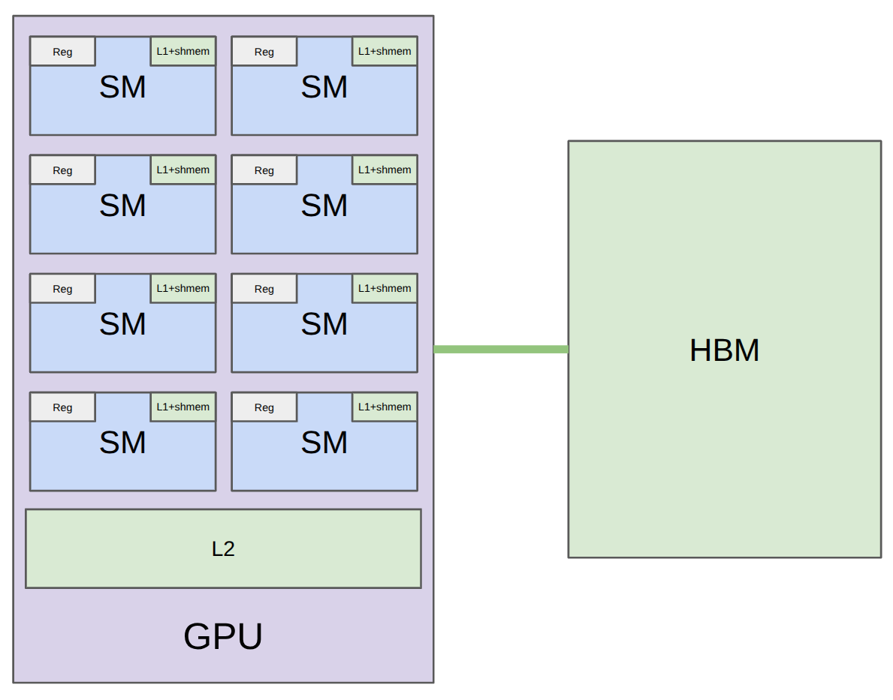
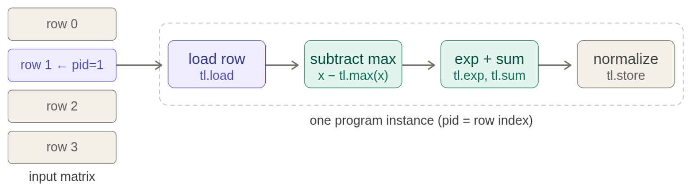
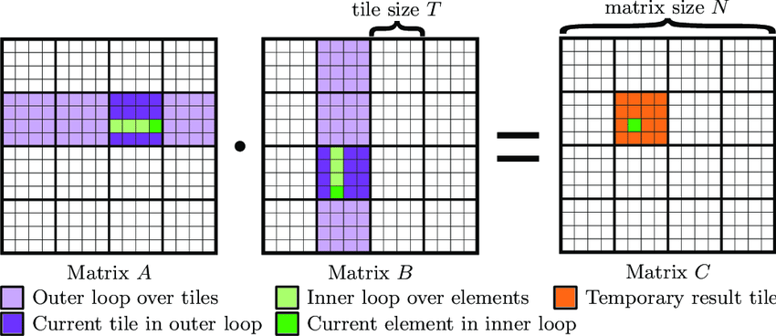

- 从“知道 GPU 原理”到“知道程序慢在哪里”
	- [讲义：`review_of_gpus()`、`benchmarking_and_profiling()`](../Slides/lecture_06.py)
	- 正确性依赖编程模型，性能依赖硬件细节：warp、occupancy、bank conflict、coalescing 和 tile 大小。
	- 寄存器太多会限制同时驻留的 warp，但 occupancy 高并不必然更快；每线程做更多工作，也可能提高复用、减少开销。
	- 优化循环：**Benchmark / Profile → 提出瓶颈假设 → 修改 → 再测量**，不要凭代码看起来更短判断性能。
	- 

- Benchmark：GPU 异步执行，不能直接量 Python 调用时间
	- [讲义：`benchmarking()`、`benchmark()`](../Slides/lecture_06.py)
	- 先 **Warmup**，避免把编译、初始化和冷启动混入稳态耗时；首次调用延迟则应另行报告。
	- 用 CUDA Events 记录 GPU 时间，读取结果前同步；讲义还在 warmup 后调用 `torch.cuda.synchronize()`。
	- 多次重复、记录波动，分别改变形状、dtype、设备和实现；小输入可能被固定启动开销主导，大输入才显出计算量的增长趋势。
	- 比较必须口径一致：是否包括内存分配、CPU 开销、输入搬运和编译时间，都要讲清楚。

- Profile：为什么内置 GeLU 比逐步计算快？
	- [讲义：`profiling()`、`naive_vs_builtin_vs_compiled_gelu()`](../Slides/lecture_06.py)
	- Benchmark 回答“总共多久”，Profiler 回答“调用了哪些 kernel、时间花在哪”。PyTorch Profiler 可查看算子与 CUDA 调用，更细节可用 Nsight。
	- 朴素 GeLU 拆成多个逐元素操作，会反复读写中间张量；内置实现或 `torch.compile` 可能融合成一个 kernel。
	- 相同数学运算、不同执行图，会有很大速度差；形状变化还可能选择不同底层 kernel，不能从一个尺寸推断全部性能。

- Triton：以数据块为单位组织 GPU 程序
	- [讲义：`triton_introduction()`、`triton_gelu_kernel()`](../Slides/lecture_06.py)
	- CUDA 更直接描述线程做什么；Triton 通常描述一个 **Program Instance** 处理的一块数据，再由编译器映射到线程与硬件。
	- `program_id` 确定数据块，`arange` 构造块内索引，`load/store` 读写，mask 防止边界越界；编译后仍需检查访存与资源使用。
	- “按块编程”不代表所有中间张量都显式放入 shared memory；寄存器、共享内存和布局由具体操作及编译结果决定。
	- PTX 可帮助检查全局读写、线程索引和寄存器等；看懂指令是辅助，最终仍以正确性与测量结果为准。

- Fused Softmax：一行的数据尽量只读写一次
	- [讲义：`naive_softmax()`、`triton_softmax_kernel()`、`row_sum_kernel()`](../Slides/lecture_06.py)
	- 稳定 softmax：先减行最大值，再取指数、求和、归一化；朴素逐算子实现会多次访问 HBM。
	- 行能放进单个 program 时：一次加载 → 行内归约 → 归一化 → 写回；padding 位置对 max 使用 $-\infty$，避免污染分母。
	- 行太大时不能无限扩大 block：需要 tile 迭代与局部累积，再做归约。讲义先用 Row Sum 展示这一思路。
	- 

- Matmul + Activation：用 Tiling 复用数据，再融合输出
	- [讲义：`triton_matmul_relu_example()`、`matmul_relu_kernel()`](../Slides/lecture_06.py)
	- 每个 program 负责一个输出 tile，沿缩并维度 $K$ 循环加载 A、B 子块，用 `tl.dot` 累积结果，最后融合 ReLU 并写回。
	- 朴素“每个输出元素独立读取输入”计算强度为 $O(1)$；tile 内复用可提升到随 tile 边长增长的量级，但片上容量有限。
	- 检查非整除边界、stride、累积精度和数值容差；再比较 PyTorch / 编译版 / 自定义 kernel，而不是默认手写一定更快。
	- 
