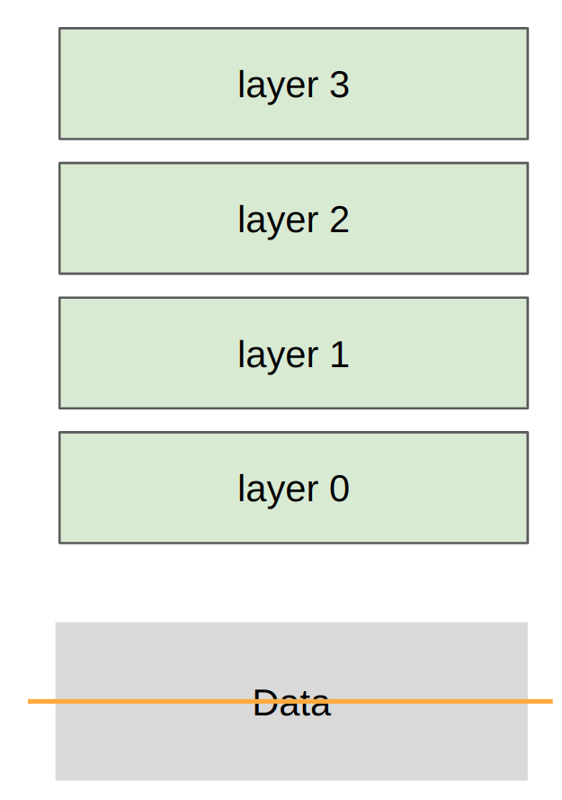
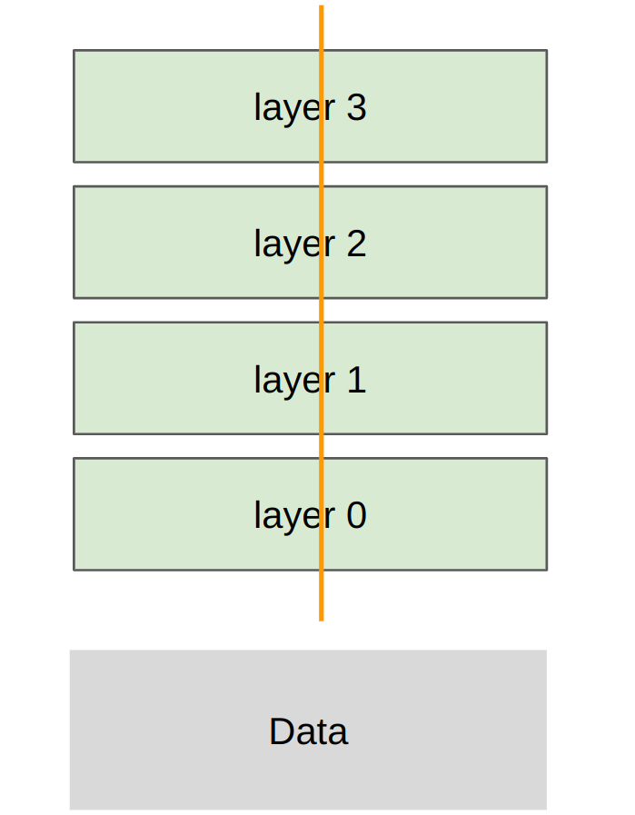
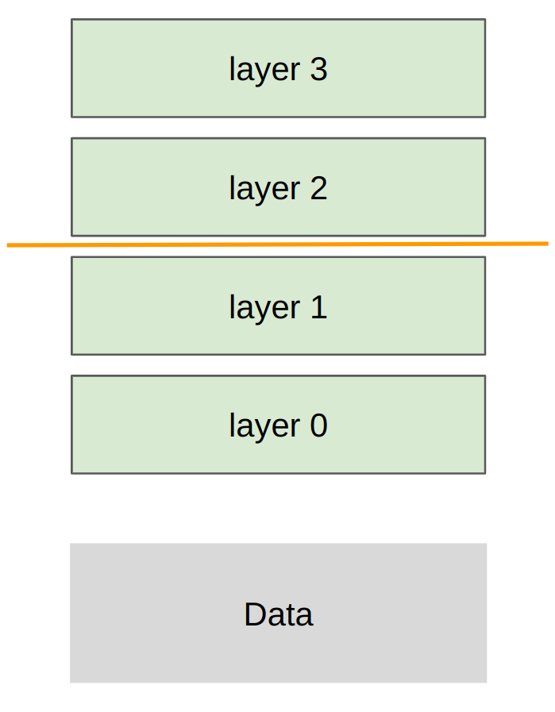

- 单卡优化与多卡训练有同一条主线
	- [讲义：`main()`、`hardware()`](../Slides/lecture_07.py)
	- 单卡上减少 HBM↔SM 搬运，多卡上减少 GPU↔GPU / 节点↔节点搬运；模型放不下和希望训练更快，是多卡的两个主要动机。
	- 大致层次：片上存储 → HBM → 节点内 NVLink / NVSwitch → 跨节点网络；不同层级的带宽与延迟差异决定切分方案。
	- **Rank** 是进程/设备在通信组中的编号，**World Size** 是组内参与者数量；NCCL 将 collective 映射到硬件通信路径。

- Collective Operations：先掌握积木
	- [讲义：`collective_operations()`、`collective_operations_main()`](../Slides/lecture_07.py)
	- **Broadcast**：一份数据复制给所有 rank；**Scatter / Gather**：分发不同切片 / 汇集到一个 rank；**Reduce**：求和、最大值等聚合到指定 rank。
	- **All-gather**：把各 rank 的不同切片拼完整，让每个 rank 都得到完整结果；常用于临时恢复分片参数。
	- **Reduce-scatter**：先逐元素聚合各 rank 的张量，再让每个 rank 只保留结果的一片；常用于梯度分片。
	- **All-reduce = Reduce-scatter + All-gather**：先聚合并切片，再复制完整聚合结果。两者的分解是 ZeRO / FSDP 的基础。
	- **All-to-all**：每个 rank 向其他 rank 发送不同数据，典型用途是 MoE 的 token 路由。

- Data Parallelism：模型相同，数据不同
	- [讲义：`data_parallelism()`、`data_parallelism_main()`](../Slides/lecture_07.py)
	- 每张卡有完整模型，处理 batch 的不同切片；本地 loss 不同，但梯度同步后，使用相同优化器更新即可保持参数一致。
	- DDP 的核心通信是梯度 All-reduce；若本地求均值，要按各卡实际样本/token 数处理全局归一化，不能对不等长数据盲目等权平均。
	- 朴素 DP 复制参数与优化器状态，因此**提升总吞吐，不解决单个模型的状态显存上限**。
	- 

- Tensor Parallelism：把一层的矩阵切开
	- [讲义：`tensor_parallelism()`、`tensor_parallelism_main()`](../Slides/lecture_07.py)
	- 按列切 $W=[W_1,W_2]$，各卡计算 $XW_i$，拼接得到完整输出；按行切时，则对各卡的局部结果求和。
	- 讲义用逐层 All-gather 激活展示最小前向实现；高效 Transformer 会结合列切与行切，避免每一步都恢复完整张量。
	- 各卡合作完成同一层，通信频繁，对低延迟、高带宽互连要求高，通常优先放在同一节点。
	- 

- Pipeline Parallelism：把层分到不同设备
	- [讲义：`pipeline_parallelism()`、`pipeline_parallelism_main()`](../Slides/lecture_07.py)
	- 不同 rank 负责不同层，只在 stage 边界传递激活；反向则反向传递激活梯度。
	- 一个 batch 顺序经过全部 stage，会让多数设备等待；拆成 micro-batches 后，前一段处理后续 micro-batch，后一段处理前面的 micro-batch。
	- 通信频次相对低，适合较慢的节点间链路，但必须处理 **Pipeline Bubbles**、阶段负载平衡和激活缓存。
	- 

- 阅读代码时要保留边界意识
	- [讲义：`torch_distributed()`、`main()`](../Slides/lecture_07.py)
	- 讲义重点是通信原语和最小 MLP 示例，不是可直接用于大模型的完整训练框架；TP / PP 示例的反向传播留作练习，也没有完整隐藏通信开销。
	- 实际训练还需正确清零梯度、同步随机初始化、处理异步通信和 checkpoint；所有 rank 必须按一致的通信协议参与，否则可能死锁。
	- 下一讲 [[CS336/Lectures/Lecture8 Distributed Training.md|Distributed Training]] 将加入状态分片、调度与多种并行的组合。
