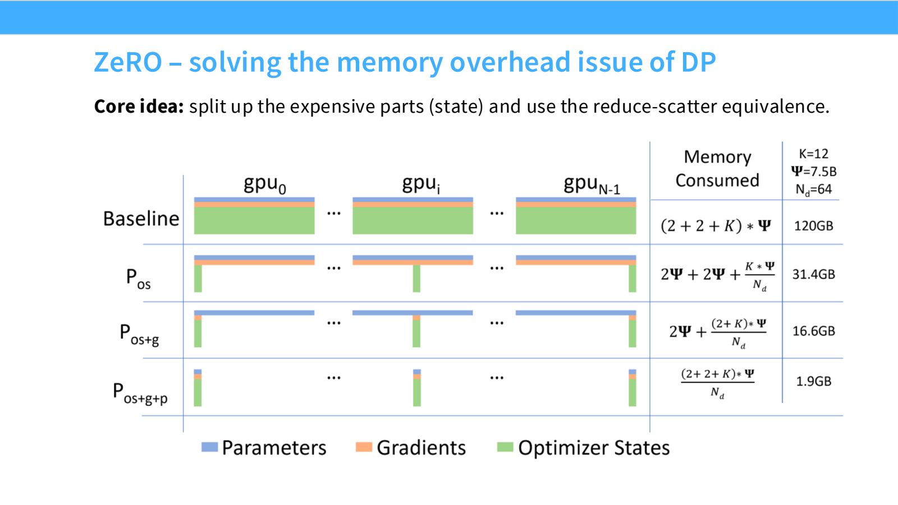
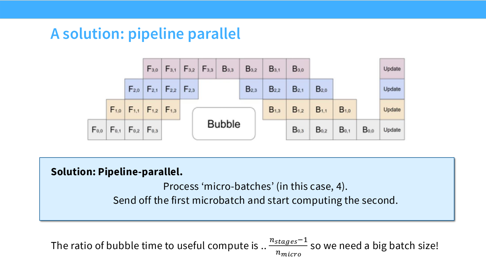
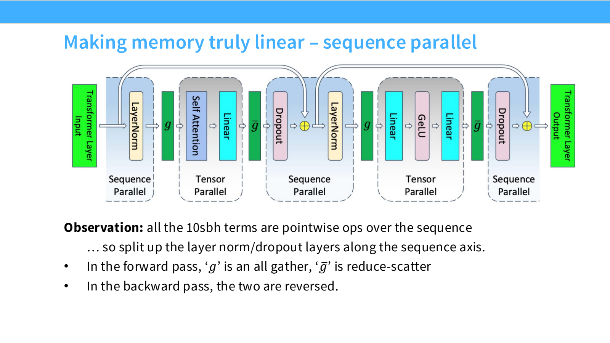

- 多机训练：显存、计算、网络需要一起扩展
	- [Slides 4–17](../Slides/lecture_08.pdf#page=4)
	- 目标不只是“GPU 更多”，而是尽可能让可容纳模型大小与有效计算吞吐随设备数增长；网络拓扑、collective 和状态复制会破坏理想线性扩展。
	- 朴素 DDP 把完整参数、梯度与优化器状态放在每张卡上；一种混合精度 Adam 配置约需 **16 bytes / parameter**，还没有算激活。
	- 参数状态与激活是两类问题：解决了模型权重放不下，不代表长上下文训练也放得下。

- ZeRO：利用 All-reduce 的分解，逐步消除冗余状态
	- [Slides 18–28](../Slides/lecture_08.pdf#page=18)
	- **Stage 1**：分片 optimizer states，每个 rank 只更新自己负责的参数片；梯度聚合后，再 All-gather 更新的参数。
	- **Stage 2**：进一步分片梯度，反传到一层就 Reduce-scatter 并释放不再需要的部分，避免保留完整梯度。
	- **Stage 3 / FSDP 类方案**：参数也分片，计算某块前 All-gather，用完释放；反向再取参数，梯度做 Reduce-scatter。
	- 简化带宽核算下，DDP / ZeRO-1/2 每步通信约为 $2P$ 个参数元素量级，ZeRO-3 约 $3P$；实际还受分组、精度、缓存策略与延迟影响，不能理解为“完全免费”。
	- FSDP 需预取、通信计算重叠并控制峰值 buffer；不是任何时刻都严格只占 $1/G$ 参数内存。
	- 

- Pipeline Parallelism：靠 micro-batch 隐藏等待
	- [Slides 31–38](../Slides/lecture_08.pdf#page=31)
	- 沿深度切分模型，stage 边界传递激活/激活梯度，通信主要与 $bsh$ 相关，而不是每步复制全部参数。
	- 简化 GPipe 调度下，**Bubble 时间 / 有效计算时间**约为 $(p-1)/m$，$p$ 是 stage 数、$m$ 是 micro-batch 数；这不是空闲时间占总时间的比例。
	- 更多 micro-batches 可降低 bubble，但也影响 kernel 效率、batch 需求和调度；1F1B、交错与 Zero-bubble 等方案进一步调整前反向工作。
	- 

- Tensor Parallel + Sequence Parallel：参数切分之外还要省激活
	- [Slides 39–49](../Slides/lecture_08.pdf#page=39)
	- TP 常让 QKV / MLP up-projection 按列切，attention output / down-projection 按行切；非线性在局部完成，再用 collective 合并。
	- 优点是没有 pipeline 式的填充/排空 bubble，也不强依赖很大 batch；代价是每层多次激活通信，优先使用快速互连。
	- TP 仍可能复制 LayerNorm、dropout 与残差等激活。**Sequence Parallelism** 沿序列切分这些逐 token 操作，再在需要时 All-gather / Reduce-scatter。
	- 此处 SP 与 **Context Parallelism** 不完全相同：后者进一步切分长序列 attention 工作，可能通过 Ring Attention 交换 KV；不能把 SP 当成“完整 attention 在各卡独立做完”。
	- 

- Expert Parallel 与多维组合
	- [Slides 50–58](../Slides/lecture_08.pdf#page=50)
	- **EP** 将完整专家分到不同设备，靠 All-to-all dispatch / combine token；可以避免把 expert 矩阵切得太碎，但要求路由均衡与通信重叠。
	- Attention 与 MoE MLP 的最佳并行度可能不同，实际框架允许分别设置 TP / CP / DP 与专家侧并行；**并行度不总能无脑相乘**。
	- 常见思路：先用节点内 TP / EP 与必要的 PP / FSDP 让模型放下，再用 DP 扩大吞吐；长上下文阶段增加 CP。
	- “TP≤8、PP 跨节点”等是特定互连规模下的经验，不是硬性规定；更大的 NVLink 域会改变最佳配置。

- 大训练跑起来，还不等于能稳定跑完
	- [Slides 59–73](../Slides/lecture_08.pdf#page=59)
	- 课件比较 DeepSeek、Llama、Gemma、Mixtral、Qwen 等实际配置：共同点是**组合多种并行**，没有单一方法包办全部扩展。
	- Activation Checkpointing 虽增加计算，却可能让更大 batch 放下、减少通信占比，最终提高吞吐。
	- 大集群还要考虑故障恢复、checkpoint、慢节点与负载不均；有效训练吞吐应把这些现实成本计入，而不只看一次理想 step。
