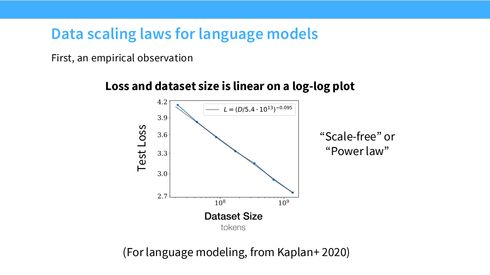
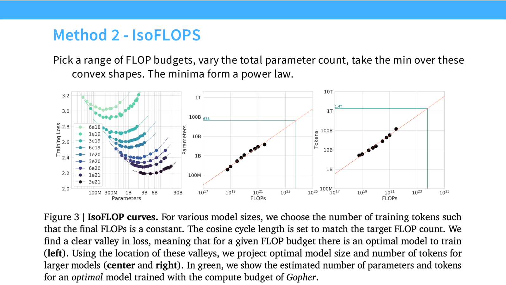
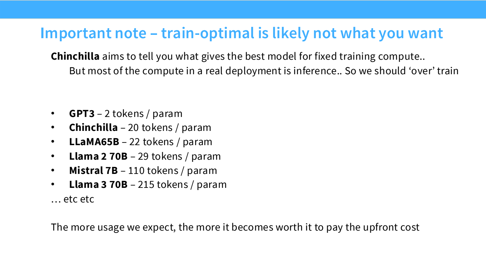

- Scaling Laws：用小实验，为大训练做决策
	- [Slides 2–14](../Slides/lecture_09.pdf#page=2)
	- 面对大计算预算，问题是模型多大、训练多久、用什么 batch / optimizer，而不是先把最大模型跑起来再说。
	- 基本流程：**在多个小规模上实验 → 拟合可预测关系 → 外推到目标规模 → 用更大一档实验检验**。
	- Scaling Law 是给定数据、架构与训练 recipe 下的经验规律，不是模型能力的不可突破上限，也不能替代目标任务评估。

- Power Law：为什么经常看到 log-log 直线？
	- [Slides 15–20](../Slides/lecture_09.pdf#page=15)
	- 常用形式：$L(D)=L_\infty+AD^{-\alpha}$。真正接近直线的是 $\log(L-L_\infty)$ 与 $\log D$；忽略不可约误差项可能扭曲斜率。
	- 简单例子：对方差为 $\sigma^2$ 的独立样本估计均值，均方误差为 $\sigma^2/n$，本身就是幂律。
	- 神经模型的指数不必等于经典参数估计的指数；数据结构、有效维度与学习机制都可能影响它，课件介绍的维度解释也不是完整定论。
	- 

- 数据不是只有数量：分布、质量与重复也改变规律
	- [Slides 21–27](../Slides/lecture_09.pdf#page=21)
	- 训练来源与测试目标不同，分布偏移会改变可达到的损失；小规模最优的数据混合不一定能直接迁移到大规模。
	- **重复数据不等于新增独立数据**：重复训练仍可能有益，但边际价值下降，不能把累计 token 数无条件当成同等质量的有效数据。
	- 高质量集合太小，训练久了会反复 epoch；大预算下可能需要放宽过滤、提高多样性。见 [[CS336/Lectures/Lecture14 Data Processing.md|Lecture14]]。

- 模型与数据联合扩展：预算应该花在哪里？
	- [Slides 28–45](../Slides/lecture_09.pdf#page=28)
	- 常用联合拟合：$L(N,D)=E+AN^{-\alpha}+BD^{-\beta}$，并用 $C\approx6ND$ 约束训练计算量。
	- 太大的模型配很少 tokens，会训练不足；太小的模型用很多数据，也可能受容量限制。最优点在同预算的损失曲线最低处。
	- 也可对架构、优化器、深宽比比较 scaling 曲线；**不是所有参数都等价**，embedding、稠密参数与 MoE 参数不能只按同一个计数套公式。
	- **Critical Batch Size**：batch 变大最初可减少更新步数，超过一定范围后样本效率收益递减；训练更充分、目标 loss 更低时，最优 batch 也可能改变。

- Chinchilla：三种拟合方法与一个常见误读
	- [Slides 46–53](../Slides/lecture_09.pdf#page=46)
	- **方法 1：训练曲线下包络**。收集多种大小模型的学习曲线，对每个计算预算取最佳损失。
	- **方法 2：IsoFLOPs**。固定预算，改变参数量和对应训练 tokens，找每条曲线的最优点，再拟合最优配置随预算的变化。
	- **方法 3：联合参数拟合**。直接拟合 $L(N,D)$，在约束下求最优；拟合范围、参数计数、损失下界与训练 schedule 都影响结论。
	- Chinchilla 常被概括为 $N,D$ 随预算大致同步增长、约 **20 tokens / parameter**；这是特定研究设置的经验，不是每个模型都应严格遵守的常数。
	- Kaplan 与 Chinchilla 的差异也提醒我们：预热、训练终点、参数口径与数据覆盖会改变 scaling 估计。
	- 

- Train-optimal 不等于 Deploy-optimal
	- [Slides 54–57](../Slides/lecture_09.pdf#page=54)
	- Chinchilla 式问题主要最小化**给定训练成本**下的损失；部署还需付出大量重复推理成本。
	- 如果模型会被调用很多次，可能值得训练更久、采用更小模型，以提高每次推理的效率，即相对训练最优点“overtrain”。
	- 决策目标应是训练 + 推理的总预算、质量与延迟约束；下游能力也可能比预训练 loss 更不平滑，不能只看一条 loss scaling 曲线。
	- 
