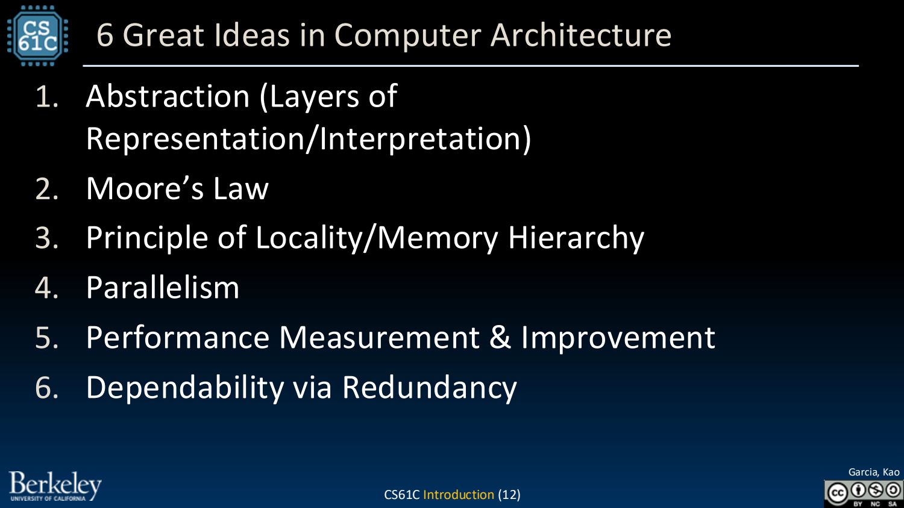
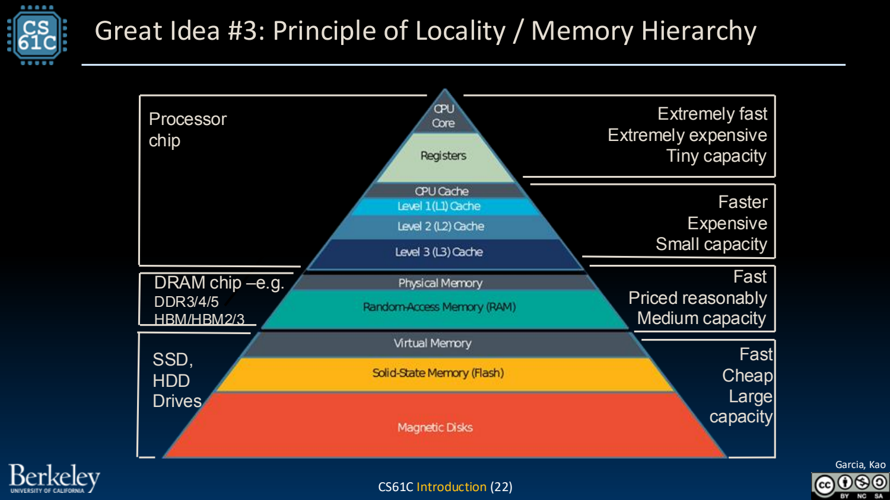

- CS61C：理解程序怎样在机器上运行
	- [Slides 2–14](../Slides/CS61C%202024Fa%20L00%20Intro.pdf#page=2)
	- 核心是**硬件—软件接口**：C → 汇编 → 机器指令 → 数据通路与控制 → 逻辑电路。不同层次描述同一计算，但暴露的细节不同。
	- 本地讲义用 RISC-V 作为 ISA，用简化处理器建立机制理解；不是学习某一款商业 CPU 的全部实现。
	- 六个 Great Ideas：抽象、Moore’s Law、局部性/存储层次、并行、性能测量与改进、通过冗余提高可靠性。
	- 

- Abstraction：隐藏细节，同时保留有用的约定
	- [Slides 9–14](../Slides/CS61C%202024Fa%20L00%20Intro.pdf#page=9)
	- ISA 定义软件可见的指令行为；微体系结构决定如何实现它。同一个 ISA 可以有不同流水线、cache 与执行单元。
	- 编译器把高层表达翻译成指令；理解边界有助于解释为什么相同算法会因数据布局、指令与访存模式而快慢不同。

- Locality：用小而快的存储服务大而慢的数据
	- [Slides 21–22](../Slides/CS61C%202024Fa%20L00%20Intro.pdf#page=21)
	- 时间局部性：刚用过的数据可能再用；空间局部性：附近地址可能很快被访问。Cache 利用二者减少昂贵的远端访问。
	- 寄存器、cache、DRAM、持久存储在速度、容量和成本上分工；层次不是“所有访问都一样快”的物理事实，而是尽量接近这种体验的抽象。
	- 

- Parallelism：不同层级可以同时利用
	- [Slides 23–27](../Slides/CS61C%202024Fa%20L00%20Intro.pdf#page=23)
	- 从数据级 SIMD、指令流水线、线程/多核到多机请求并行，每一层都在寻找可同时进行的工作。
	- **Amdahl’s Law**：若串行比例为 $s$，其余部分加速 $p$ 倍，整体加速为 $1/[s+(1-s)/p]$；串行部分与通信会限制扩展。
	- 先测量瓶颈再优化，不要用峰值算力或核心数量替代实际程序性能。

- 技术约束变化，但设计方法可以迁移
	- [Slides 28–39](../Slides/CS61C%202024Fa%20L00%20Intro.pdf#page=28)
	- 冗余可用于容错，专用硬件可针对特定任务提高效率；二者都会付出容量、成本、通用性等代价。
	- Moore’s Law 是历史技术/经济趋势，不是“所有程序性能永远按固定周期翻倍”的定律；本课中的历史器件与跑分只按讲义年代理解。
	- 学习时持续问：数据如何表示、由谁保存、经过哪些步骤、瓶颈在哪里、出错如何恢复？
