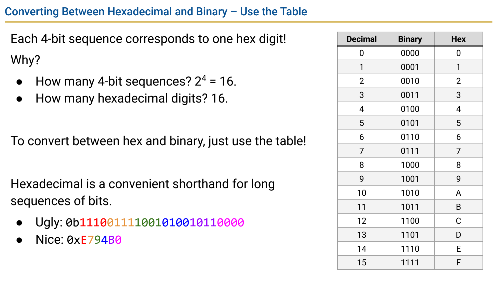
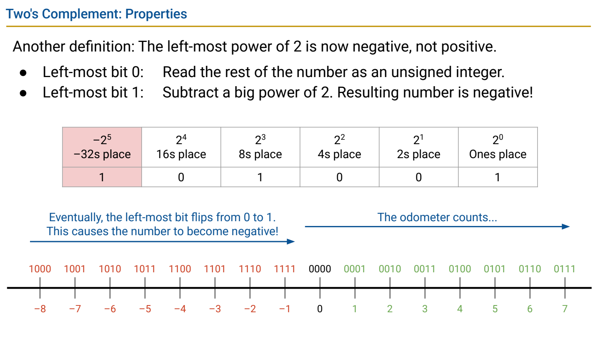
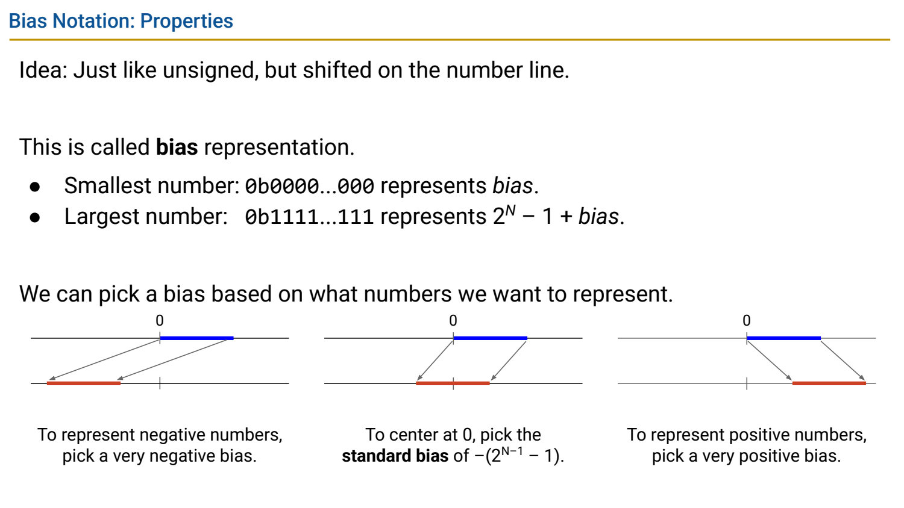

- Everything Is Bits：含义来自解释规则
	- [Slides 22–44](../Slides/CS61C%202024Fa%20L01%20Number%20Representation.pdf#page=22)
	- $N$ 位有 $2^N$ 种不同模式；它们可以表示数字、字符、颜色或指令，bit pattern 本身没有唯一语义。
	- 位置计数法：$(d_k\cdots d_0)_b=\sum_i d_i b^i$。二进制每 4 位对应一个十六进制数位；分组补零应补在左侧。
	- 地址、寄存器值常用十六进制显示，便于直接观察 bit fields，而不是机器内部“改成十六进制存储”。
	- 

- Unsigned 与早期负数方案
	- [Slides 47–61](../Slides/CS61C%202024Fa%20L01%20Number%20Representation.pdf#page=47)
	- $N$ 位无符号整数范围为 $[0,2^N-1]$；固定位宽加法丢弃最高进位后体现模 $2^N$ 行为。
	- Sign-magnitude 用最高位表示正负，One’s Complement 对负数逐位取反；二者都有正零/负零等问题。
	- 比较表示方案时同时看范围、零的唯一性、加法是否统一和硬件实现成本，不只看能不能写出负数。

- Two’s Complement：最高位的权重为负
	- [Slides 62–69](../Slides/CS61C%202024Fa%20L01%20Number%20Representation.pdf#page=62)
	- 补码值为 $-b_{N-1}2^{N-1}+\sum_{i=0}^{N-2}b_i2^i$，范围为 **$[-2^{N-1},2^{N-1}-1]$**。
	- 求相反数常用逐位取反再加一；最小负数没有同位宽的正数对应，不能忽略这个边界。
	- 例如 8 位 `11111111`：按 unsigned 是 255，按补码是 -1；转换“解释”与改变实际位模式是不同问题。
	- 

- Carry、Overflow 与扩展：别混用规则
	- [Slides 62–69](../Slides/CS61C%202024Fa%20L01%20Number%20Representation.pdf#page=62)
	- 无符号溢出看进位/范围；补码加法中，同号相加得到异号结果才是有符号溢出的典型判据，最高进位不是通用判断。
	- 无符号扩宽通常补 0；补码有符号扩宽复制符号位，才能保留数值。
	- **C 语言边界**：无符号算术按模运算，有符号整数溢出则是未定义行为，不能把硬件的位截断直接当成 C 的保证。

- Bias：让位模式按另一个起点排序
	- [Slides 70–78](../Slides/CS61C%202024Fa%20L01%20Number%20Representation.pdf#page=70)
	- 若按 unsigned 读出的值为 $u$，课件用偏移量 $b$ 定义真实值 $u+b$；IEEE 浮点常写成“存储指数减去正 bias”，只是符号约定不同。
	- 偏置表示方便调整可表示区间和指数排序，但加法不再直接等于普通无符号加法；下一阶段会用它编码浮点指数。
	- 
