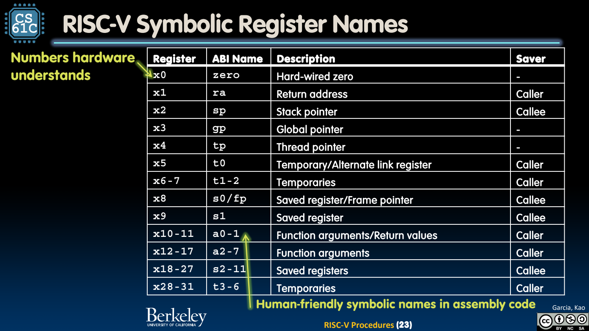
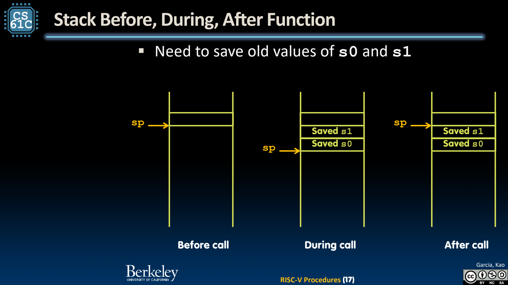

- 过程调用需要数据、控制和返回位置
	- [Slides 3–11](../Slides/CS61C%202023Fa%20L10%20Procedures.pdf#page=3)
	- 调用者传参数，被调用者完成工作并放返回值，然后回到正确调用点；同一函数可能被多个地方调用，返回目标不能写死。
	- `jal rd,label` 写 rd=PC+4 并跳转；ret 通常展开为 `jalr x0,ra,0`。标准 jalr 还会清除计算目标的最低位，见后续编码笔记。

- Caller / Callee：谁负责保存哪些寄存器？
	- [Slides 5、19–23](../Slides/CS61C%202023Fa%20L10%20Procedures.pdf#page=5)
	- a0–a7 传整数参数，a0/a1 用于相应返回值；t* 与 a* 等由 caller 按需要保护，s0–s11 由 callee 若改动则恢复。
	- ra 会被下一次调用覆盖，非叶函数若还需返回给原 caller，通常先保存它。约定不是自动复制每个寄存器，而是明确谁承担责任。
	- sp 返回时必须恢复；gp/tp 有特殊平台用途，不应当作随意的临时寄存器。
	- 

- Stack Frame：为每次调用保留独立状态
	- [Slides 12–17](../Slides/CS61C%202023Fa%20L10%20Procedures.pdf#page=12)
	- 栈向较低地址增长的常见模型中，先减少 sp 申请 frame，再保存必要寄存器/局部值；返回前逆序恢复。
	- 递归每一层都要保留自己的返回地址与中间状态；不能让多个调用共享一个会被覆盖的临时返回位置。
	- 

- 教学简写与真实 ABI 的边界
	- [Slides 16–23](../Slides/CS61C%202023Fa%20L10%20Procedures.pdf#page=16)
	- 课件叶函数示例用 8-byte frame 展示机制；标准整数调用约定要求栈按 **16 bytes** 对齐，不能机械把简写当作完整 ABI 合规代码。[RISC-V psABI](https://riscv-non-isa.github.io/riscv-elf-psabi-doc/#_integer_calling_convention)
	- 标准 ABI 的约定与指令本身是两层：硬件执行 jal，并不会自动替你保存 s*、ra 或维持 frame 对齐。

- 检查函数的四个不变量
	- [Slides 19–25](../Slides/CS61C%202023Fa%20L10%20Procedures.pdf#page=19)
	- 入口参数从哪里来？还活着的值跨调用后是否保留？返回值放在哪里？返回时 sp 与 callee-saved 状态是否恢复？
	- 叶函数可能不需要栈帧；并非每个过程都必须保存所有寄存器。正确性优先，再减少无用 spill 与 reload。
