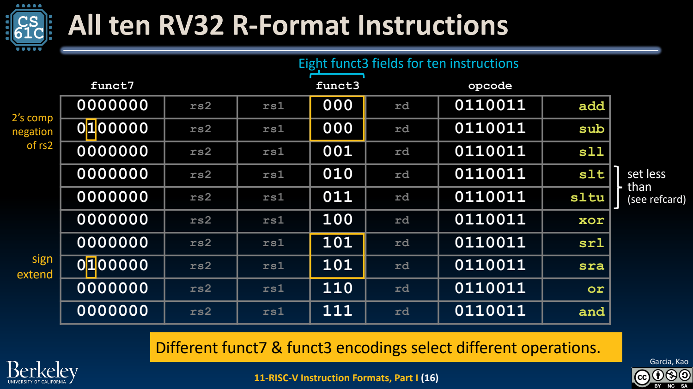
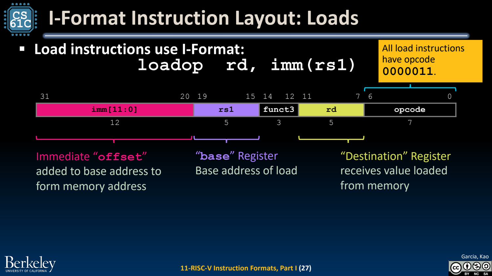
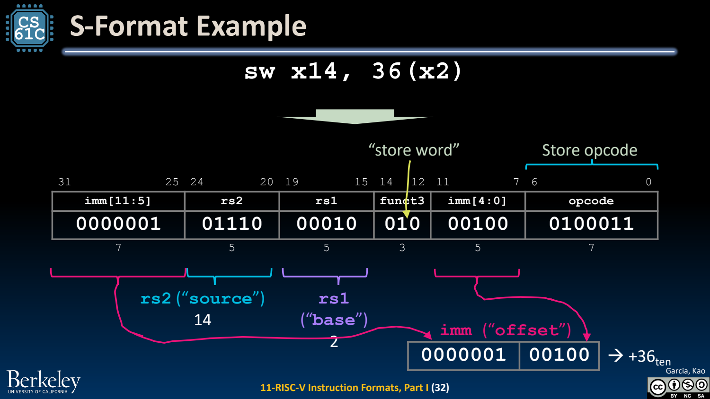

- 机器码：把指令与操作数编码进固定字段
	- [Slides 3–14](../Slides/CS61C%202024Fa%20L11%20Instruction%20Formats.pdf#page=3)
	- 存储程序把指令也放入内存，CPU 按 PC 取 bits 并解码；机器不直接保存 add 等文本助记符。
	- RV32I 基础指令宽 32 bits，opcode 7 bits，寄存器编号各 5 bits。字段位置尽量固定，减少译码与连线复杂度。

- R-type：三个寄存器与操作子类
	- [Slides 10–21](../Slides/CS61C%202024Fa%20L11%20Instruction%20Formats.pdf#page=10)
	- 布局为 `funct7 | rs2 | rs1 | funct3 | rd | opcode`，位宽为 7/5/5/3/5/7。
	- opcode 标出大类，funct3/funct7 再区分 add、sub、shift 等。不能只看某个单独字段就认为整条指令已经唯一确定。
	- 

- I-type：一个源寄存器与 12-bit 立即数
	- [Slides 22–27](../Slides/CS61C%202024Fa%20L11%20Instruction%20Formats.pdf#page=22)
	- 布局为 `imm[11:0] | rs1 | funct3 | rd | opcode`；addi 与 loads 都能复用这一结构，但 opcode/语义不同。
	- Load 地址为 rs1+sign-extended imm；lb/lh 符号扩展，lbu/lhu 零扩展。移位立即指令会把高位部分用于操作编码，不能当成任意 12-bit 数。
	- 

- S-type：没有 rd，把立即数字段拆开
	- [Slides 28–32](../Slides/CS61C%202024Fa%20L11%20Instruction%20Formats.pdf#page=28)
	- Store 需要 rs1 基址和 rs2 数据，不需要目标寄存器；立即数拆成 `imm[11:5]` 与 `imm[4:0]`，保持两个源寄存器位置不变。
	- 例如 `sw x14,36(x2)`：rs1=2、rs2=14、imm=36，不能把语法中第一个寄存器误当 rd。
	- 

- 手动编码/译码的可靠步骤
	- [Slides 21–33](../Slides/CS61C%202024Fa%20L11%20Instruction%20Formats.pdf#page=21)
	- 先确定格式与 opcode，再填寄存器和 funct，最后按实际位宽编码补码立即数；完整拼接 32 bits 后才按四位转换 hex。
	- 反向译码时先按字段切分，识别完立即数布局再符号扩展。机器字在内存中的小端字节顺序与纸上 bits 从高到低书写是不同层次。
