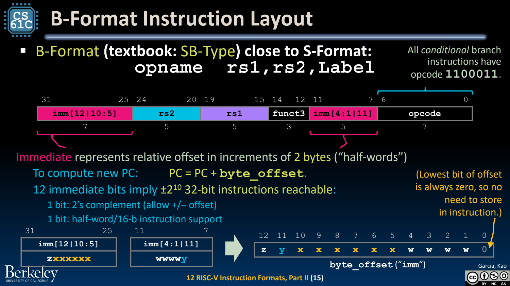
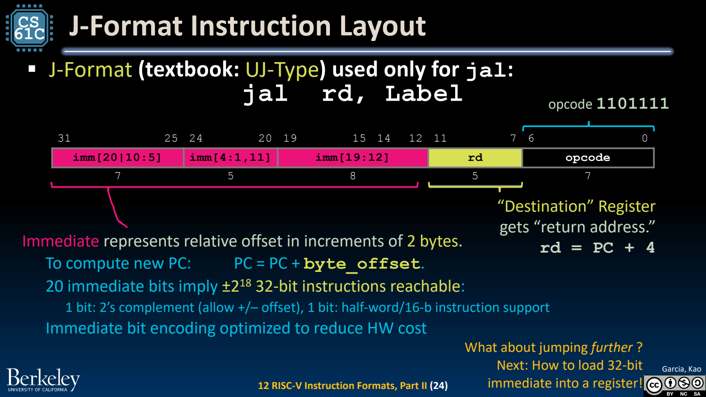
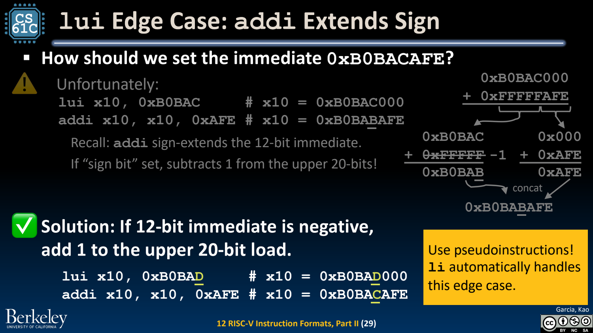

- PC-relative：目标由当前指令地址加偏移得到
	- [Slides 4–8](../Slides/CS61C%202024Fa%20L12%20Instruction%20Formats%20II.pdf#page=4)
	- 分支与 jal 使用当前 PC 加有符号 byte offset，不是总以 PC+4 为基准；PC+4 是常规后继/返回地址。
	- 相对位置不变时，整段代码移动可保留内部跳转关系；外部符号与绝对地址仍需链接/重定位处理。

- B-type：拼回 13-bit 的偶数字节位移
	- [Slides 10–20](../Slides/CS61C%202024Fa%20L12%20Instruction%20Formats%20II.pdf#page=10)
	- B 型将 `imm[12|10:5]` 和 `imm[4:1|11]` 分散编码，最低位隐含为 0；真实偏移范围为 **-4096 到 +4094 bytes**。
	- 两字节对齐编码为压缩指令等扩展留空间；在仅支持 4-byte 对齐指令的环境，部分可编码目标仍不合法。
	- 保持 rs1/rs2 位置、共享符号位与部分连线，是看似“打乱立即数”的设计原因。
	- 

- J-type：跳转更远，同时保存返回地址
	- [Slides 22–24](../Slides/CS61C%202024Fa%20L12%20Instruction%20Formats%20II.pdf#page=22)
	- jal 的 immediate 拼成 21-bit 偶数字节偏移，范围约 ±1 MiB；rd 得到 PC+4，若 rd=x0 就丢弃返回地址，实现 j。
	- 跨更大范围可组合 AUIPC/JALR 等；不能把所有 call 伪指令都当成单条 jal。
	- 

- U-type：长常量要考虑低 12 位符号扩展
	- [Slides 26–30](../Slides/CS61C%202024Fa%20L12%20Instruction%20Formats%20II.pdf#page=26)
	- lui 写入高 20 位、低 12 位清零；auipc 把高立即数加到当前 PC，用于 PC-relative 地址计算。
	- lui+addi 生成常量时，若低 12-bit 作为立即数为负，高 20 位通常需进一。例如 `0xB0BACAFE` 可用高位 0xB0BAD 与 addi -1282 组合。
	- 汇编器 li 伪指令会按常量选择序列，通常比手写截断字段更稳妥。
	- 

- JALR：I-type，没有额外乘二
	- [Slides 31–35](../Slides/CS61C%202024Fa%20L12%20Instruction%20Formats%20II.pdf#page=31)
	- 目标为 **$(R[rs1]+\mathrm{sext}(imm))\ \&\ \sim1$**，rd=PC+4；I-type 立即数本来就按 bytes 解释，不像 B/J 隐含低位移位。
	- 清除目标最低位是 ISA 语义，课件图为简洁常省略；具体见 [RV32I 官方规范](https://docs.riscv.org/reference/isa/v20260120/unpriv/rv32.html)。
