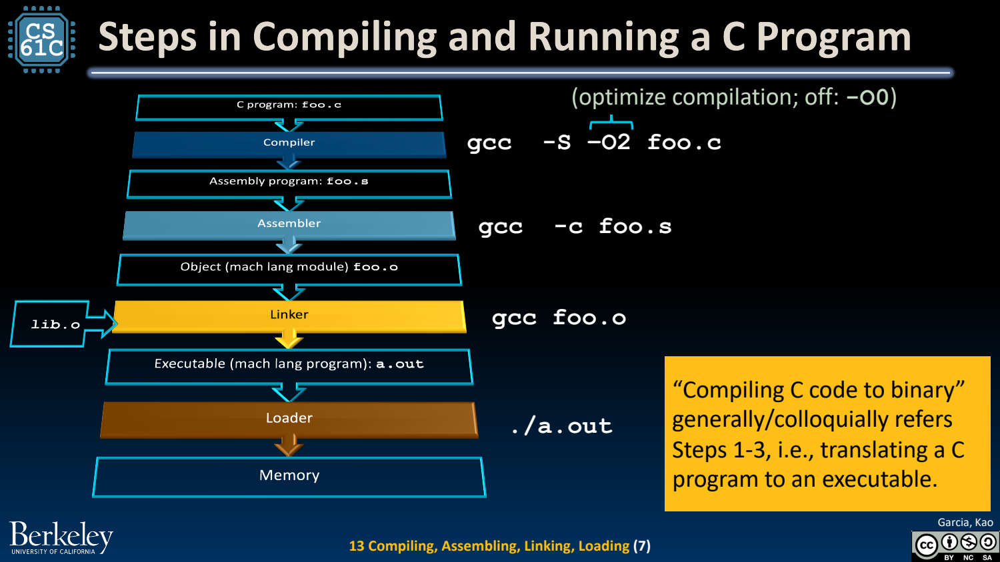
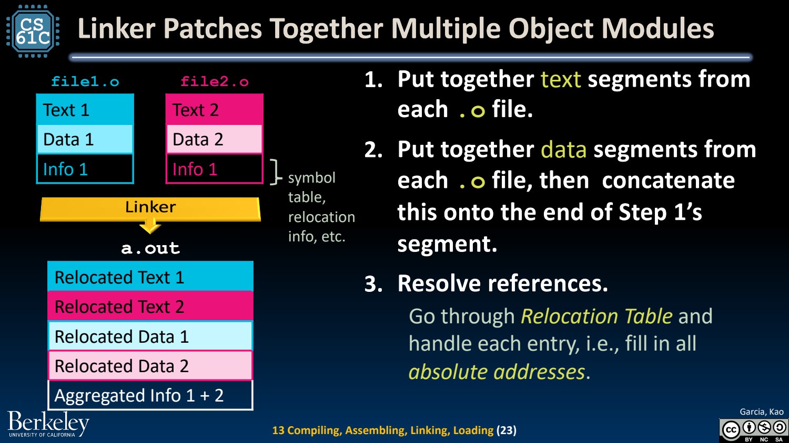
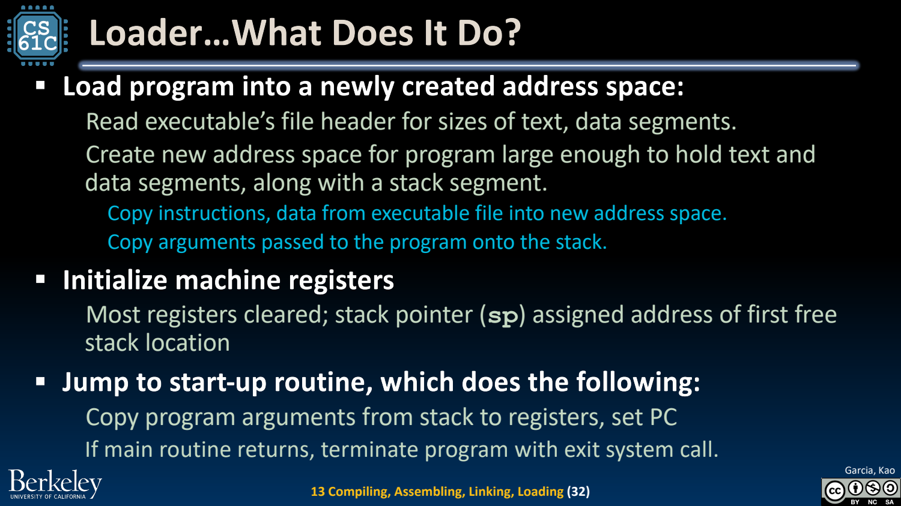

- CALL：从 C 文本到正在运行的进程
	- [Slides 2–9](../Slides/CS61C%202024Fa%20L13%20CALL.pdf#page=2)
	- **Compile → Assemble → Link → Load**：编译组织低层程序，汇编把指令编码进目标文件，链接组合模块与解析符号，装载建立运行环境。
	- `-S` 停在汇编文本，`-c` 生成目标文件；把整段过程口语称为“编译”时，不应因此忽略中间文件的职责。
	- 

- Assembler：展开伪指令，记录还不知道的地址
	- [Slides 10–20](../Slides/CS61C%202024Fa%20L13%20CALL.pdf#page=10)
	- 汇编器处理真实指令与 directives；`.text/.data/.string/.globl` 指导段、数据和符号组织，并非每条 directive 都是一条 CPU 指令。
	- 目标文件包含 text/data、symbol table、relocation 和调试信息；内部前向 label 可用多遍处理解析，外部符号则留给后续阶段。
	- 两遍汇编是教学模型，实际实现可以不同，但“先记录符号、再修补引用”的职责不变。

- Linker：组合模块，并让引用指向正确位置
	- [Slides 21–29](../Slides/CS61C%202024Fa%20L13%20CALL.pdf#page=21)
	- 链接器布局输入段、解析全局/外部符号、处理 relocation，生成可执行文件或共享对象；独立编译让改一个文件不必重编所有源代码。
	- 不是每条指令都要改地址，也不是所有 PC-relative 引用都绝不重定位；跨对象文件、符号可见性与 relaxation 会影响实际处理。
	- 静态链接通常纳入需要的库对象/节，而非无条件复制整个库；动态链接使代码可共享，但增加运行环境与版本管理约束。
	- 

- Loader：建立地址空间与初始执行状态
	- [Slides 30–32](../Slides/CS61C%202024Fa%20L13%20CALL.pdf#page=30)
	- 系统根据可执行格式建立/映射代码与数据、准备栈和参数、初始化所需寄存器，再进入启动代码；main 并不是所有平台上 CPU 直接跳入的第一段用户代码。
	- 现代系统可按需映射页面，并非必须一次把整个文件复制进 DRAM；后续虚拟内存会解释这种实现。
	- 

- 把 Hello World 当成跨层追踪练习
	- [Slides 37–50](../Slides/CS61C%202024Fa%20L13%20CALL.pdf#page=37)
	- 沿 printf 的调用观察：C 声明 → 汇编伪指令 → 符号引用/重定位 → 库与运行时 → 系统输出；每层解决不同问题。
	- 模拟器/解释器能帮助调试 ISA 行为，但宿主机器运行模拟器的指令，不等于被模拟的 RISC-V 指令本身在硬件上原生执行。
