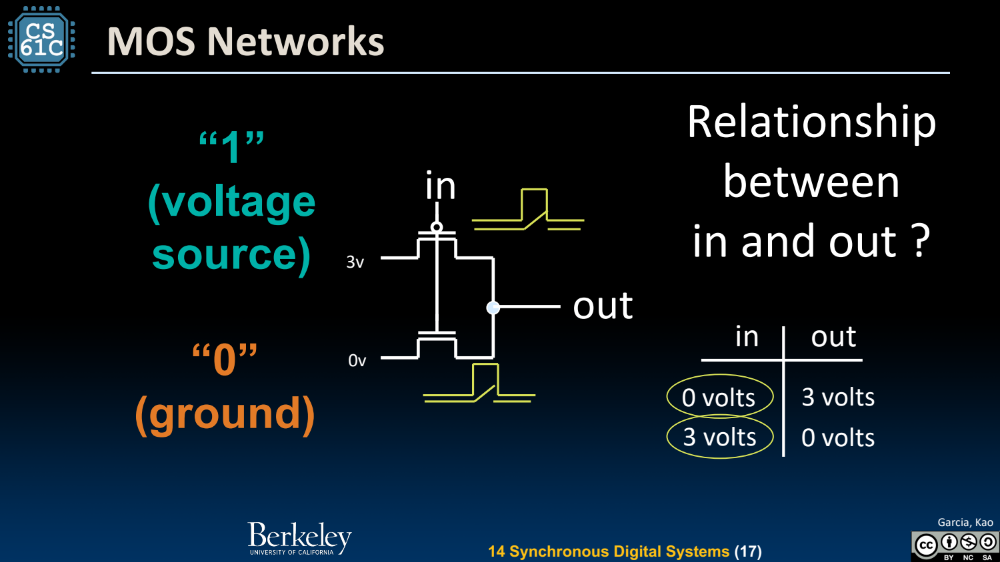
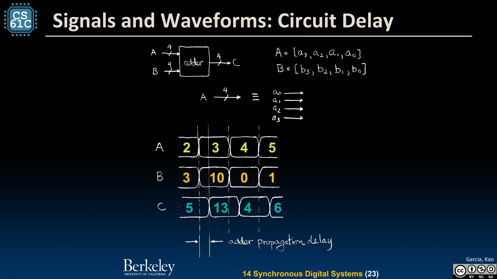

- 从 ISA 往下：用电路实现计算
	- [Slides 3–7](../Slides/CS61C%202024Fa%20L14%20SDS.pdf#page=3)
	- 处理器是同步数字系统：用离散逻辑值表示信息，用时钟协调状态更新。它的物理电压仍是连续量，0/1 是满足电平范围的抽象。
	- 门、电路块、数据通路与处理器逐层组合；抽象让我们不用每次从晶体管物理重新证明 add 的行为。

- Switch / Transistor：用电压控制导通
	- [Slides 9–18](../Slides/CS61C%202024Fa%20L14%20SDS.pdf#page=9)
	- 串联开关可表达 AND，允许多条路径可表达 OR；CMOS 用互补晶体管网络组合出逻辑功能。
	- 简单反相器将高输入对应到低输出、低输入对应到高输出；实际电平、导通条件与功耗需遵循器件约束，不能把示意开关当成理想物理事实。
	- 

- Signal / Bus / Waveform：看的是随时间变化的值
	- [Slides 20–24](../Slides/CS61C%202024Fa%20L14%20SDS.pdf#page=20)
	- 单线携带一位，多位 bus 是相关信号的组合；波形展示输入变化、传播与输出稳定过程。
	- 电路输出不能在输入改变时立即稳定；不同路径延迟会造成短暂毛刺，因此“暂时错误”不一定是逻辑功能错误。
	- 

- Combinational 与 State：是否记住过去？
	- [Slides 25–28](../Slides/CS61C%202024Fa%20L14%20SDS.pdf#page=25)
	- 组合逻辑输出由当前输入决定；状态元件保存历史值，使相同输入在不同内部状态下得到不同后续行为。
	- 寄存器在约定时钟边沿采样，并让两边组合逻辑有时间计算；这为流水线、计数器和 CPU 状态提供基础。

- 同步设计不是假设“没有延迟”
	- [Slides 23–28](../Slides/CS61C%202024Fa%20L14%20SDS.pdf#page=23)
	- 相反，必须在采样前留足稳定时间；时钟约束与下一讲 setup/hold 决定何时能可靠保存值。
	- 阅读硬件图先标状态边界，再标组合路径、位宽和控制信号，比把每条线当成随时可调用的软件函数更可靠。
