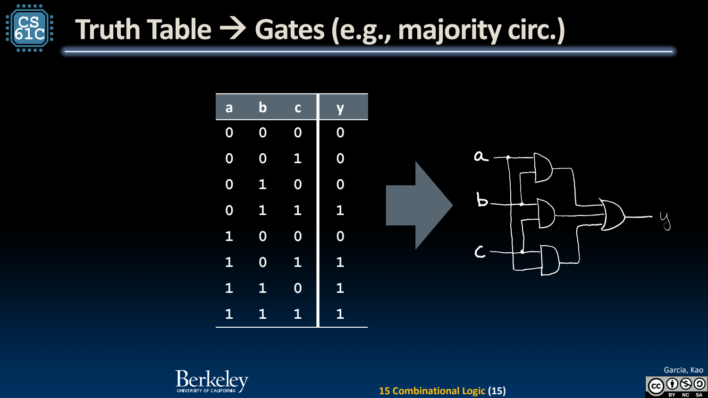
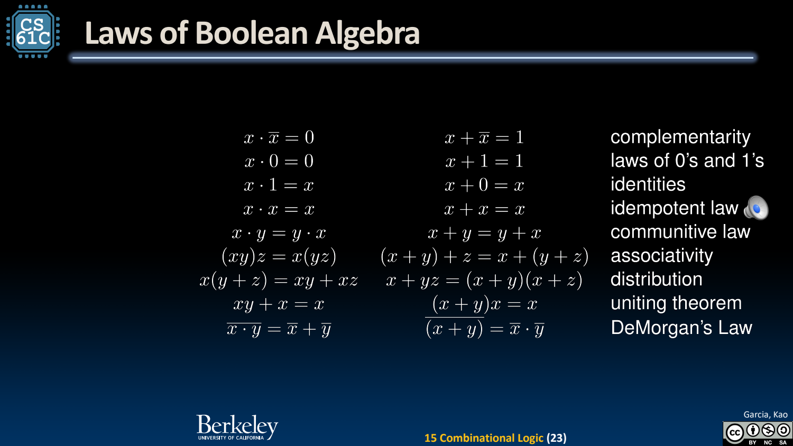

- Truth Table：完整定义一个组合逻辑函数
	- [Slides 3–9](../Slides/CS61C%202024Fa%20L15%20Boolean.pdf#page=3)
	- n 个二值输入共有 $2^n$ 行；每行指定输出，可描述任何固定输入宽度的布尔函数。
	- n 输入、1 输出共有 $2^{2^n}$ 个不同函数；不要把“输入组合数”误当成“可构造函数数”。
	- 多数表决的 3 输入函数在至少两个输入为 1 时输出 1；位宽扩大时真值表会指数增长，需要模块化表达。

- Gates：AND、OR、NOT、XOR 与派生门
	- [Slides 11–16](../Slides/CS61C%202024Fa%20L15%20Boolean.pdf#page=11)
	- AND/OR/NOT 构成基本逻辑；多输入 XOR 在输入 1 的数量为奇数时输出 1，不是“一定恰好一个为 1”。
	- NAND/NOR 可组合出通用逻辑，但不能假设它们像 AND/OR 一样满足结合律；括号与层级会改变结果。
	- 

- Boolean Algebra：表达式对应电路
	- [Slides 18–24](../Slides/CS61C%202024Fa%20L15%20Boolean.pdf#page=18)
	- 用乘积表示 AND、和表示 OR、横线/取反表示 NOT。多数表决可写 **$y=ab+ac+bc$**。
	- 利用交换、结合、分配、吸收、互补及 De Morgan 定律化简，如 $\overline{ab}=\bar a+\bar b$；不是把实数代数所有规则原样套过来。
	- 等价变换保持输入输出函数，可减少门或调整路径，但更少符号未必总对应最小延迟。
	- 

- Canonical Forms：从表格机械地生成实现
	- [Slides 26–27](../Slides/CS61C%202024Fa%20L15%20Boolean.pdf#page=26)
	- Sum of Products：对输出为 1 的行建立 minterm，再 OR；Product of Sums 则利用输出为 0 的行建立对应条件。
	- 标准形便于系统化构造与等价检查，但常含大量冗余，需要之后化简，或通过 mux/层次模块实现。

- 与状态机的连接：组合部分计算下一步
	- [Slides 16、20、31](../Slides/CS61C%202024Fa%20L15%20Boolean.pdf#page=16)
	- 把当前状态位与输入一起作为组合逻辑输入，输出下一状态与外部输出，再由寄存器保存状态。
	- 本份前两页是承接浮点表示的 Unum/Posit 背景，主体仍是组合逻辑；不把新数值格式的示例当成通用替代结论。
