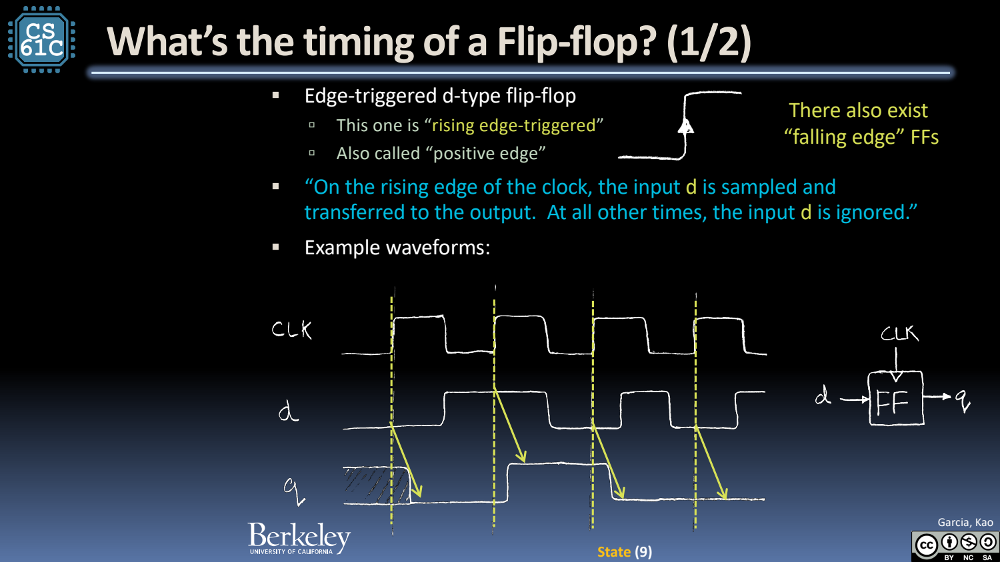
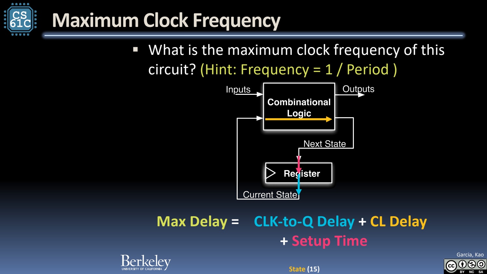
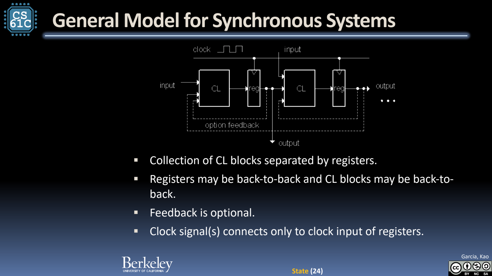

- 为什么要 State：反馈需要一个明确的时间边界
	- [Slides 3–6](../Slides/CS61C%202024Fa%20L16%20State.pdf#page=3)
	- 累加器希望每周期更新 $S_i=S_{i-1}+X_i$。直接把组合输出绕回输入，没有规定何时前进一次，也难以定义初始化与稳定行为。
	- 寄存器保存上一轮 S，组合加法器计算下一轮 S；状态和计算交替，才把迭代变成可控制的电路过程。

- D Flip-flop：在边沿采样，不是持续穿透
	- [Slides 8–13](../Slides/CS61C%202024Fa%20L16%20State.pdf#page=8)
	- 正边沿触发的 DFF 在时钟上升沿采样 D，Q 在 clock-to-Q 延迟后变化；其他时刻保持先前状态。
	- n 个 DFF 组成 n-bit register，可能另有 enable/reset。Reset 的同步/异步方式由具体设计决定，不能只凭一个信号名推断。
	- 

- 最大频率由最慢寄存器间路径决定
	- [Slides 15–18](../Slides/CS61C%202024Fa%20L16%20State.pdf#page=15)
	- 忽略 skew 等额外因素时，**$T_{clk}\ge t_{clk\to Q,max}+t_{CL,max}+t_{setup}$**；最大频率是允许周期的倒数。
	- Hold 还要求最短到达路径不破坏采样后的稳定窗口，约为 $t_{clk\to Q,min}+t_{CL,min}\ge t_{hold}$；单纯降频通常不能修复 hold 违例。
	- 切短组合逻辑并插寄存器可提高吞吐，但带来额外周期延迟、寄存器成本与控制复杂性。
	- 

- FSM：用有限状态记住与未来有关的历史
	- [Slides 20–23](../Slides/CS61C%202024Fa%20L16%20State.pdf#page=20)
	- 例如检测连续三个 1，不必保存整个输入历史，只需记录当前已经匹配多长前缀；状态图转换成位编码、真值表、组合逻辑和寄存器。
	- 状态编码会影响电路复杂度，但不同编码只要实现同一状态转移关系，就可保持相同外部行为。

- 同步系统的一般模型
	- [Slides 24–26](../Slides/CS61C%202024Fa%20L16%20State.pdf#page=24)
	- 系统由组合逻辑与寄存器交替构成，反馈可选；时钟连接状态元件，数据路径在周期内传播并于下一个边沿采样。
	- 验证时分别检查功能真值、reset/enable 语义与时序约束；功能算对却赶不上时钟，同样不是正确实现。
	- 
