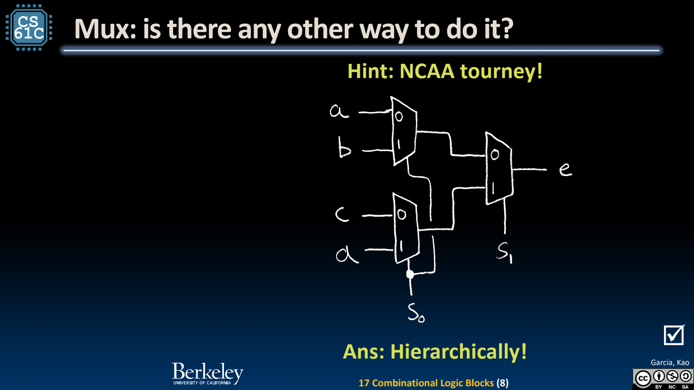
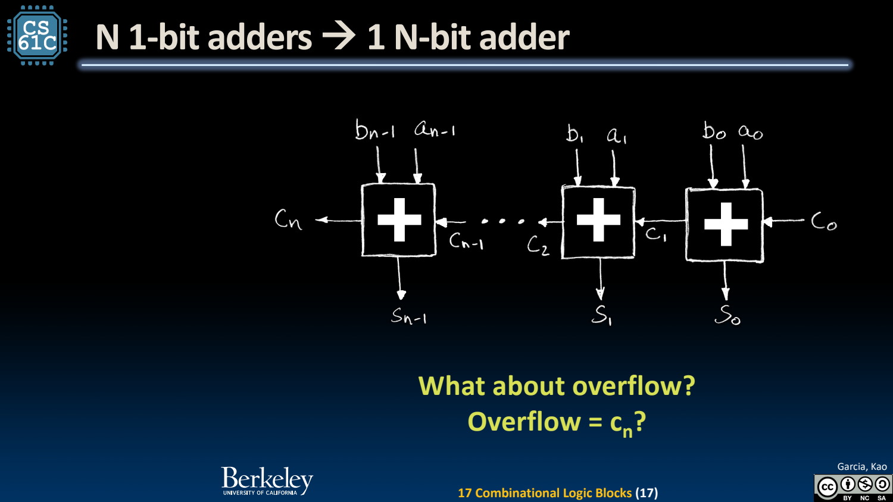
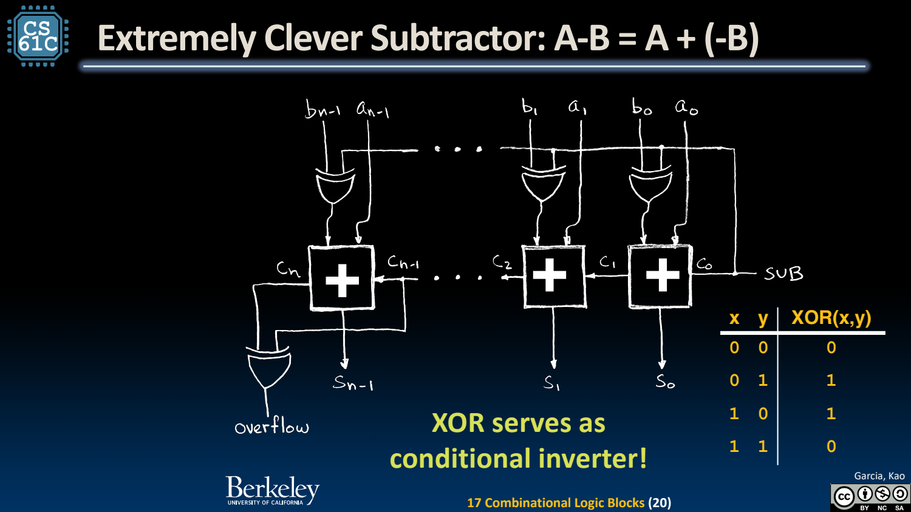

- Mux：用选择位决定哪一路数据通过
	- [Slides 4–8](../Slides/CS61C%202024Fa%20L17%20Blocks.pdf#page=4)
	- 2-to-1 mux 的一位输出为 $y=\bar s a+sb$；n-bit mux 可由 n 份单比特选择器组成。
	- s 个选择位可选 $2^s$ 路输入，**选择位数与每路数据宽度是两件事**。大 mux 可层次化实现，但会增加选择路径延迟。
	- 

- ALU：并行准备结果，再按操作选择
	- [Slides 10–11](../Slides/CS61C%202024Fa%20L17%20Blocks.pdf#page=10)
	- 同一输入可送入加法、AND、OR 等电路，再用控制信号选择结果；ALUOp 决定功能，不直接等于数据内容。
	- ALU 是组合块，寄存器负责保存结果；把软件里的“调用”类比到硬件时，不要忽略多个内部路径可同时存在。

- Full Adder：从一位组合到整个 word
	- [Slides 13–17](../Slides/CS61C%202024Fa%20L17%20Blocks.pdf#page=13)
	- 一位全加器输入 $a_i,b_i,c_i$，输出 $s_i=a_i\oplus b_i\oplus c_i$，进位 $c_{i+1}=a_ib_i+c_i(a_i\oplus b_i)$。
	- Ripple-carry 把前一级 carry 传给后一级，结构简单但高位需等待进位链；总延迟随级数增长。
	- 

- 减法复用加法：A-B = A + ~B + 1
	- [Slides 20](../Slides/CS61C%202024Fa%20L17%20Blocks.pdf#page=20)
	- 用 SUB 与 B 各位 XOR，SUB=0 保持 B，SUB=1 逐位取反；再把最低 carry-in 设为 SUB，即可共用加减器。
	- 这体现补码表示与硬件实现的配合，而不是额外为所有负数再造一套运算电路。
	- 

- Overflow：别把最后进位当成所有解释下的答案
	- [Slides 17–18、23](../Slides/CS61C%202024Fa%20L17%20Blocks.pdf#page=17)
	- 无符号加法可由最高 carry-out 判断超范围；补码有符号溢出可看同号输入/异号结果，或符号位 carry-in 与 carry-out 的 XOR。
	- 同一个 bit-level 加法结果可以同时用于不同解释，但“是否溢出”的语义依赖数值类型。
