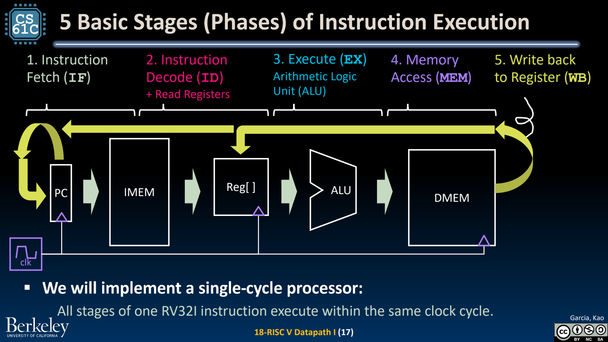
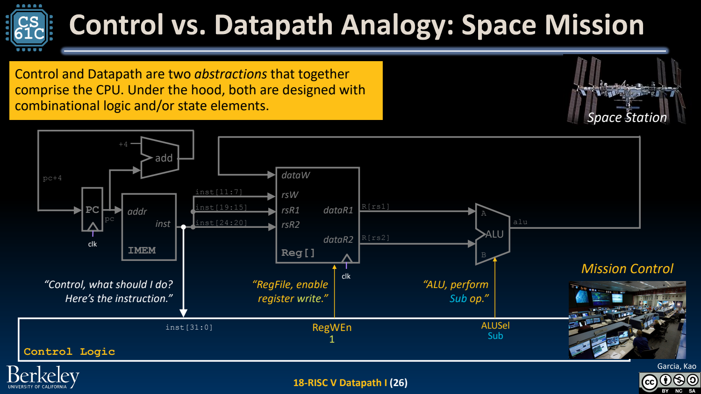
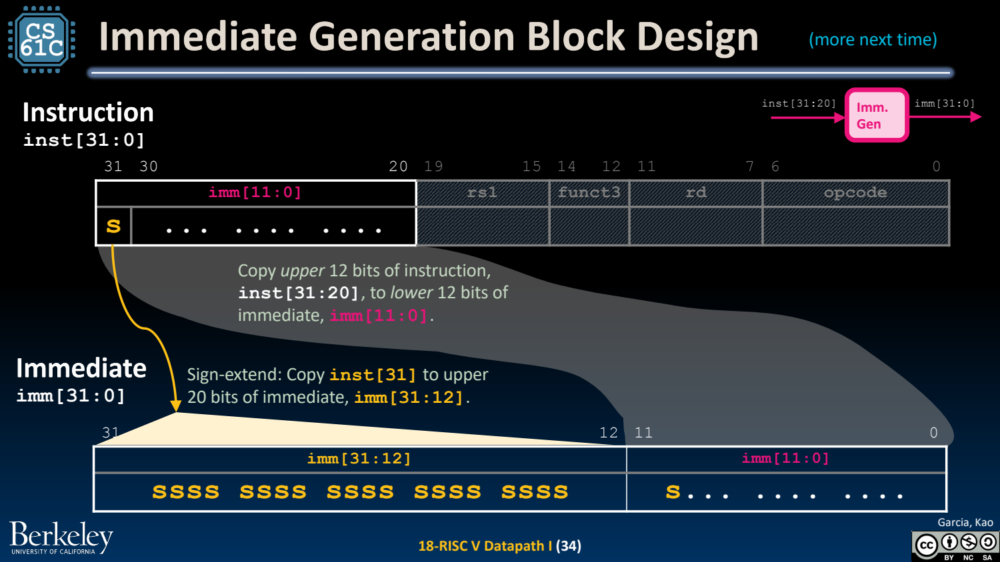

- 处理器 = Datapath + Control
	- [Slides 3–11](../Slides/CS61C%202024Fa%20L18%20Datapath%20I.pdf#page=3)
	- 数据通路负责搬运/运算值，控制决定 mux 选择、ALU 功能与状态写入；两者共同实现 ISA。
	- PC、register file、存储器是状态，ALU、mux、立即数生成器等主要组合逻辑连接它们。

- 五个执行阶段是逻辑拆分，不一定五个周期
	- [Slides 12–18](../Slides/CS61C%202024Fa%20L18%20Datapath%20I.pdf#page=12)
	- **IF 取指 → ID 译码/读寄存器 → EX 运算 → MEM 访存 → WB 写回**。并非每条指令都使用全部资源。
	- 本讲先做单周期处理器：同一条指令的所有逻辑阶段在一个周期内完成；随后才通过寄存器把它们切成流水阶段。
	- 

- 从 add 起步：把字段接到正确位置
	- [Slides 20–27](../Slides/CS61C%202024Fa%20L18%20Datapath%20I.pdf#page=20)
	- IMEM[PC] 给出指令，rs1/rs2 选两个读端口，ALU 相加，rd 选写端口，RegWEn 允许下个边沿写入；PC 常规更新为 PC+4。
	- 固定寄存器字段位置减少译码连线；sub 等可复用通路，只需改变 ALUSel，体现规则化 ISA 的价值。
	- 

- addi：为 ALU 第二输入加入 Mux
	- [Slides 29–34](../Slides/CS61C%202024Fa%20L18%20Datapath%20I.pdf#page=29)
	- R-type 取第二寄存器值，addi 取符号扩展立即数；BSel 选择第二输入，ImmSel 指定立即数格式。
	- I-type 把 inst[31:20] 接到低 12 位，并复制 inst[31] 到更高位；不要只补 0，否则负立即数错误。
	- 

- 读通路图：先状态变化，再倒推数据来源
	- [Slides 12–18、37](../Slides/CS61C%202024Fa%20L18%20Datapath%20I.pdf#page=12)
	- 先确定这条指令会写哪个状态、值从哪里来，再追踪每个 mux/运算块需要的控制；无用输出不意味着无用的写使能可以乱设。
	- 本课程图是简化 RV32I 数据通路，不包括完整特权态、所有扩展与商业处理器细节。
