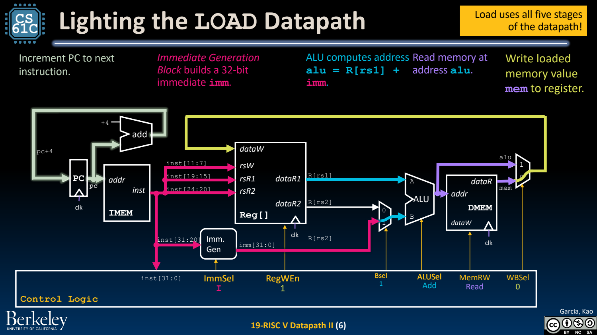
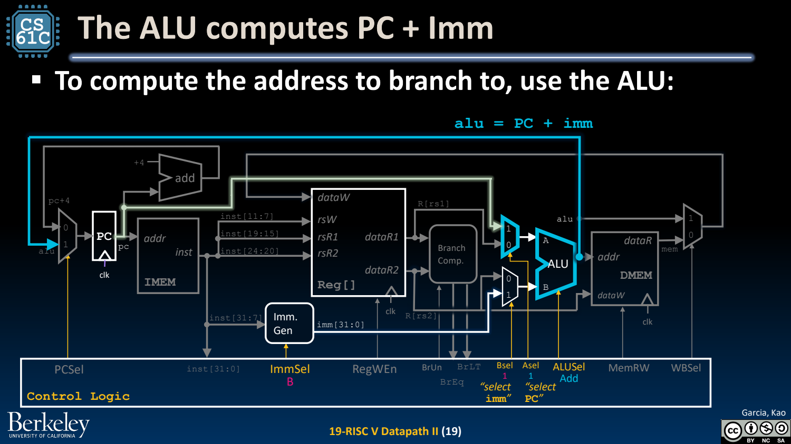
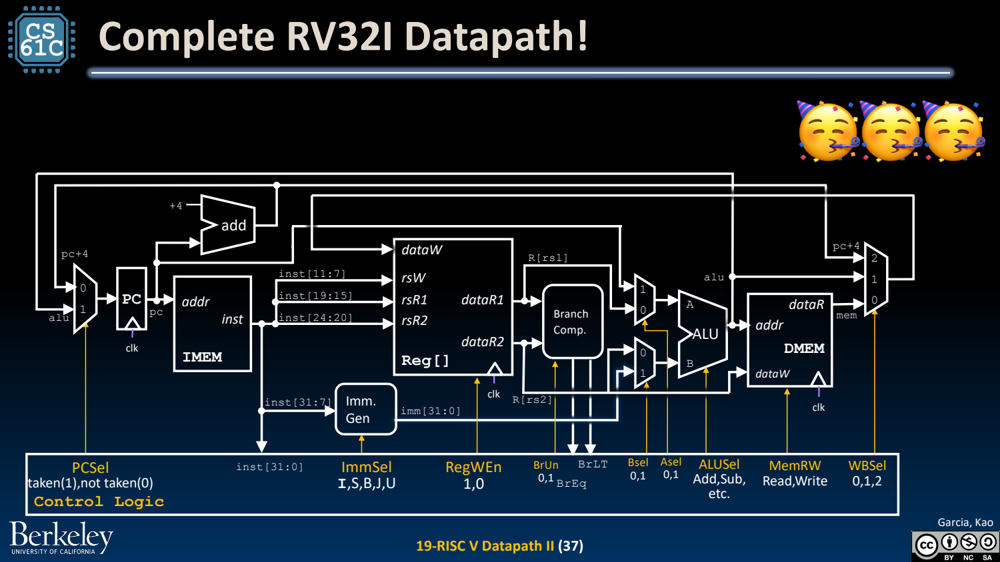

- Load：ALU 算地址，存储器提供写回值
	- [Slides 4–7](../Slides/CS61C%202024Fa%20L19%20Datapath%20II.pdf#page=4)
	- lw 的 ALU 输入是 rs1 与符号扩展偏移，结果作 DMEM 地址；WBSel 选择 memory data 而不是 ALU 输出。
	- 访问宽度与有/无符号扩展还需由指令类型控制；“地址计算相同”不代表 lb/lbu/lw 的最终结果相同。
	- 

- Store：写内存，不写 rd
	- [Slides 9–13](../Slides/CS61C%202024Fa%20L19%20Datapath%20II.pdf#page=9)
	- sw 用 S-type immediate 算地址，把第二读端口 rs2 的值送进 DMEM write data；MemRW 允许写，RegWEn 必须关闭。
	- 字段位置上与 rd 重叠的 bits 在 S-type 中属于立即数；不能照 R-type 误用作寄存器写地址。

- Branch：比较操作数，同时计算 PC+offset
	- [Slides 15–24](../Slides/CS61C%202024Fa%20L19%20Datapath%20II.pdf#page=15)
	- Branch Comparator 产生 BrEq/BrLT，BrUn 指定有/无符号；ALU 选择 PC 与 B-type immediate 算候选目标，PCSel 决定跳或顺序前进。
	- 比较是否跳转与计算跳转地址是两条逻辑任务；二者的结果都必须在 PC 更新前到位。
	- 

- jal / jalr / U-type：再增加输入与写回来源
	- [Slides 26–35](../Slides/CS61C%202024Fa%20L19%20Datapath%20II.pdf#page=26)
	- jal 用 PC+J-immediate 作目标、PC+4 作写回；jalr 用 rs1+I-immediate 作目标并清最低位，同时写回 PC+4。
	- lui 直接产生高立即数，auipc 产生 PC+高立即数；通过选择 ALU 输入与功能尽量复用原硬件。

- 完整图只是起点：接下来还要控制与计时
	- [Slides 36–38](../Slides/CS61C%202024Fa%20L19%20Datapath%20II.pdf#page=36)
	- 读一条指令时，在完整图上只追踪其有效数据路径与状态写入，避免被所有备选连线淹没。
	- ImmSel/ASel/BSel/ALUSel/WBSel 决定数据来源与运算；RegWEn/MemRW 决定是否产生副作用，下一讲建立真值表。
	- 
