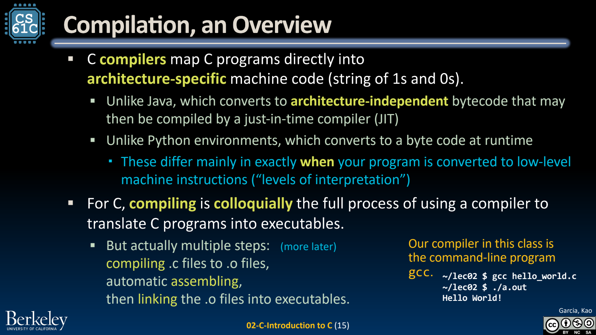
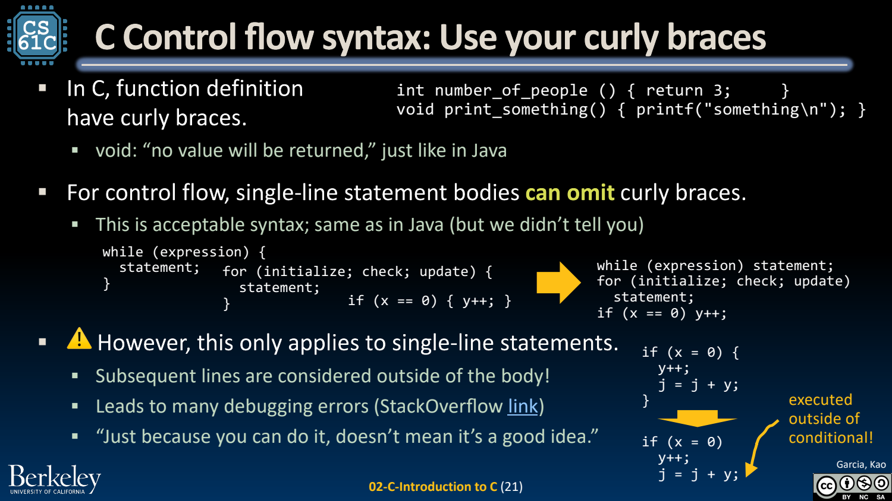

- C：更直接地接触内存与机器
	- [Slides 3–16](../Slides/CS61C%202024Fa%20L02%20C%20Intro.pdf#page=3)
	- C 提供较小的语言核心、显式类型与指针，常把很多资源和边界检查责任交给程序员；它不是“没有抽象”的汇编。
	- 通常先编译/汇编成目标文件，再链接成可执行文件。`gcc`/`clang` 是驱动程序，可按选项只执行某些阶段。
	- 语言与执行方式不是一一绑定：C 可以被解释/模拟，高层语言也可用 JIT；课程对比强调常见工具链，不是语言的绝对定义。
	- 

- 变量、类型和 sizeof：大小依赖目标平台
	- [Slides 17–32](../Slides/CS61C%202024Fa%20L02%20C%20Intro.pdf#page=17)
	- 常见类型有 char、int、float、double、指针；用 `<stdint.h>` 的定宽整数可明确位宽需求，用 sizeof 查询对象大小。
	- 课程常按 RV32 的 8-bit byte、32-bit word 讲解；**不能据此假设所有 C 平台的 int、long、指针都一样宽**。
	- 声明不一定初始化内置值；读取未初始化自动变量可能导致未定义行为。函数参数按值传递，想修改调用者对象需借助指针等方式。

- 控制流与函数：熟悉语法，也理解代价
	- [Slides 19–21、42–50](../Slides/CS61C%202024Fa%20L02%20C%20Intro.pdf#page=19)
	- if、while、for 用括号和花括号组织，习惯保留大括号，避免添加一行后意外跑到控制范围之外。
	- `=` 是赋值，`==` 是相等比较；条件中的赋值可能合法但并非原意。整数除法与浮点除法也要根据操作数类型区分。
	- `&& / || / !` 操作逻辑真假，`& / | / ^ / ~` 操作位；前者的短路求值会影响是否执行右侧表达式。
	- 

- Struct、typedef 与枚举：组织数据和名字
	- [Slides 27–41](../Slides/CS61C%202024Fa%20L02%20C%20Intro.pdf#page=27)
	- struct 把相关字段组合成一个类型，使用 `.` 访问对象成员；通过指针访问用 `->`，下一讲会展开。
	- typedef 给已有类型起别名，不会自动创造运行时包装；enum 提供有名字的整数常量，仍应遵守其类型/转换规则。
	- 不要把 C 与 C++ 混为一谈：标准库、对象生命周期、隐式转换和许多安全机制都不同。

- 写 C 的固定检查问题
	- [Slides 8、47–50](../Slides/CS61C%202024Fa%20L02%20C%20Intro.pdf#page=8)
	- 编译警告、参数类型、格式化字符串与返回值应配套检查；编译成功不代表数组、指针和资源使用正确。
	- 先写小测试，再扩大输入；避免依赖具体平台“碰巧没崩”的结果。后续指针、内存、汇编课程会解释这些错误为何发生。
