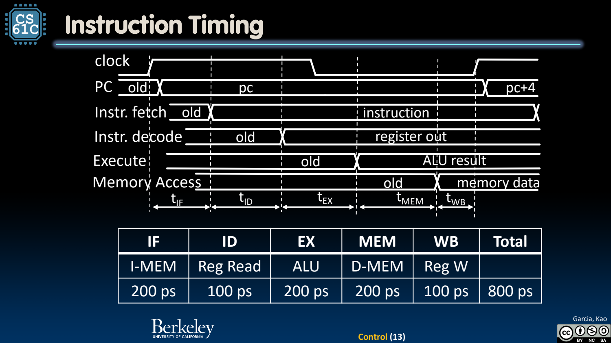
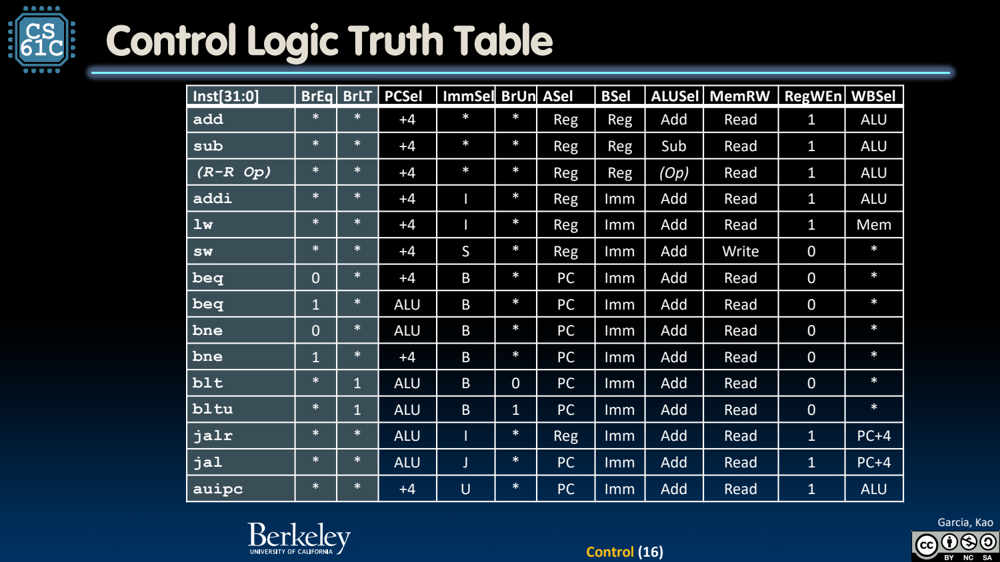
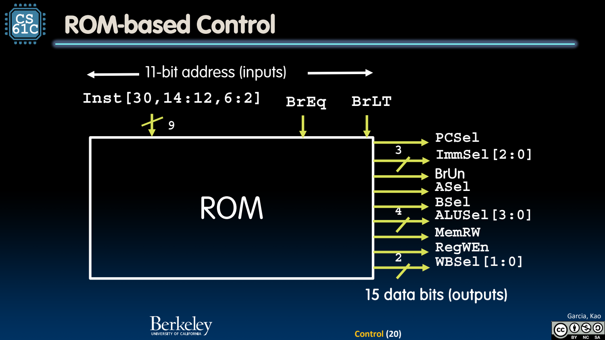

- Control：把指令语义翻译成信号组合
	- [Slides 3–12](../Slides/CS61C%202024Fa%20L20%20Control.pdf#page=3)
	- 控制器输入指令的关键字段与 branch flags，输出 PCSel、ImmSel、ALUSel、RegWEn 等，让数据通路完成当前指令。
	- add 写寄存器、sw 写内存、branch 只改变潜在 PC；先明确副作用，再决定其他 mux/功能选择。

- 单周期时序：所有指令共用最慢路径决定的周期
	- [Slides 11–14](../Slides/CS61C%202024Fa%20L20%20Control.pdf#page=11)
	- 课件示例延迟 IF/ID/EX/MEM/WB 为 200/100/200/200/100 ps，总 load 路径 800 ps，对应理想最高约 1.25 GHz。
	- 短指令也要等同一时钟周期，导致许多模块空闲；这些示例值用于解释设计，不是实际 RISC-V 的固定时延。
	- 真实时序还需计入状态元件、控制到达、setup 与布线等，不能只把模块标注相加当作最终芯片频率。
	- 

- Truth Table：区分必要值与 Don’t-care
	- [Slides 16](../Slides/CS61C%202024Fa%20L20%20Control.pdf#page=16)
	- 按指令逐行列输出信号；无关字段可用 don’t-care 协助化简，但必须保证任何选择都不会产生错误的状态写入。
	- 例如 sw 的写回选择可无关，因为 RegWEn=0；不能把 MemRW 随意当无关，否则会破坏内存。
	- 

- 两种实现：组合逻辑或 ROM 查表
	- [Slides 17–22](../Slides/CS61C%202024Fa%20L20%20Control.pdf#page=17)
	- 组合译码通过门电路识别指令并生成输出；ROM 把输入编码当地址、控制字当数据，结构规则，便于理解和修改。
	- 课件“九位 ISA”是对所支持指令控制分类的精简输入，不是把 32-bit 指令宽度改成了 9 bits；其余字段仍携带寄存器/立即数信息。
	- 

- 从功能正确到性能改进
	- [Slides 24–25](../Slides/CS61C%202024Fa%20L20%20Control.pdf#page=24)
	- 至此软硬件闭环：高层程序经 ISA 变成字段，控制解码字段，数据通路执行，时钟提交状态。
	- 下一讲用流水线提高不同指令的重叠程度；这会引入 hazard，不是只“插几组寄存器”就自动保持正确。
