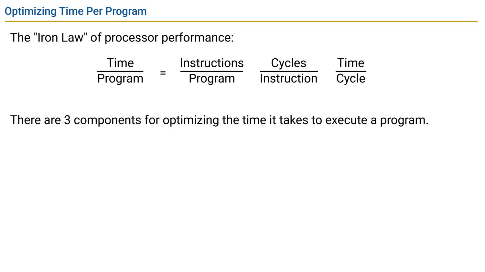
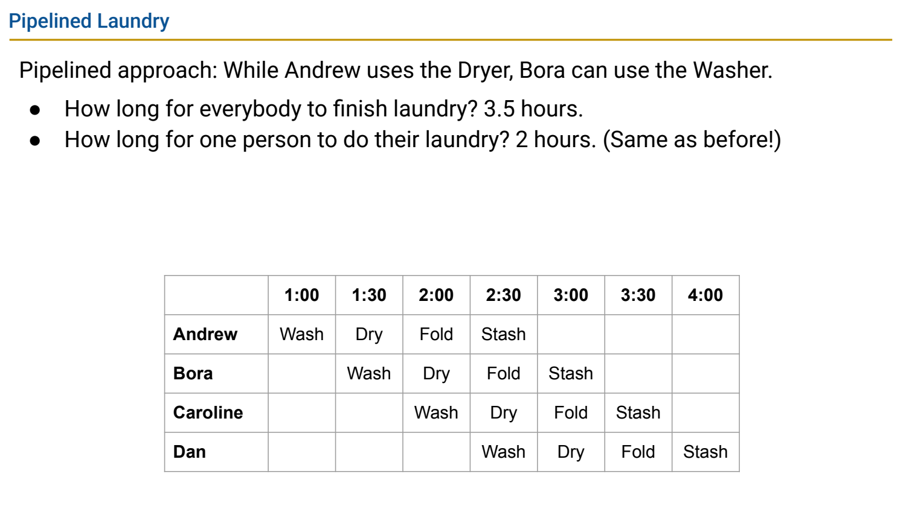
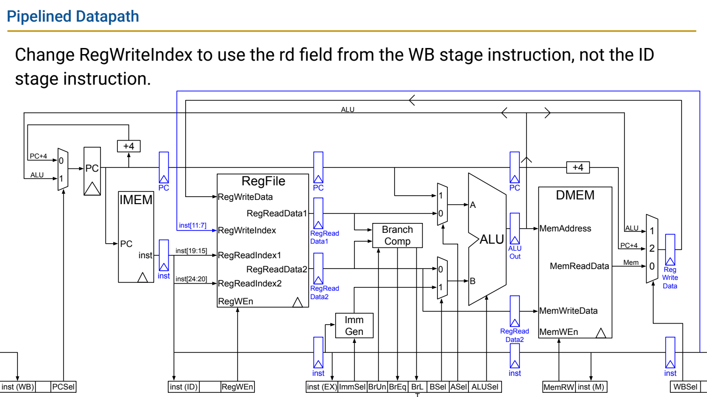
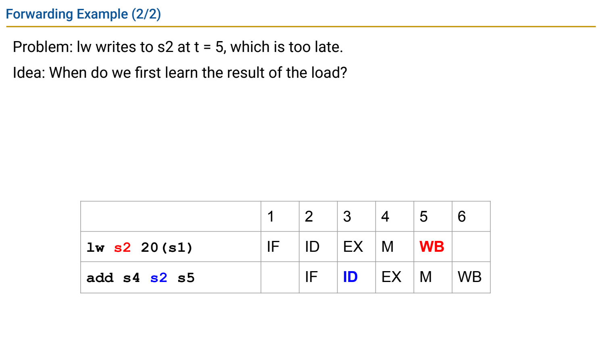
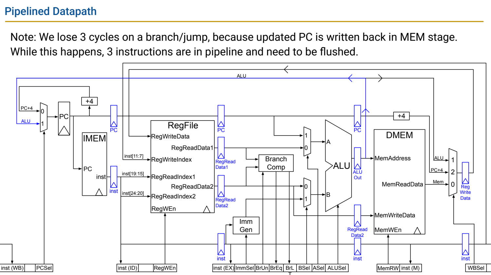

- Performance：先明确比较延迟、吞吐还是能耗
	- [Slides 3–14](../Slides/%5B61C%20FA24%5D%20Lectures%2021-22%20-%20Pipelining.pdf#page=3)
	- **CPU Time = Instruction Count × CPI × Clock Period**。单看频率、指令数或 CPI，不能决定整个程序谁更快。
	- 吞吐是单位时间完成多少任务，延迟是单任务需要多久；动态能量常随电容与电压平方变化，性能优化不能忽略功耗约束。
	- 不同 ISA/编译选项可能改变指令数，同一指令组合也会改变平均 CPI；比较必须固定任务、正确性与输入口径。
	- 

- 洗衣类比：流水线提高吞吐，不自动缩短单次延迟
	- [Slides 16–31](../Slides/%5B61C%20FA24%5D%20Lectures%2021-22%20-%20Pipelining.pdf#page=16)
	- 不同任务占用不同阶段，可以同时进行；理想 k-stage、N-task 的总周期数约为 $N+k-1$，而不是 kN。
	- 时钟周期受最慢 stage 加流水寄存器开销约束；实际单指令延迟可能增加，吞吐收益还需足够多指令摊薄填充/排空成本。
	- 

- 流水数据通路：数据、控制与身份要一起前进
	- [Slides 33–42](../Slides/%5B61C%20FA24%5D%20Lectures%2021-22%20-%20Pipelining.pdf#page=33)
	- IF/ID、ID/EX、EX/MEM、MEM/WB 寄存器保存各阶段所需的值；写回 rd 必须来自 WB 中那条指令，而不是当前 ID 指令。
	- 控制也需与对应数据同步传递。结构冒险来自同时争用物理资源，例如单端口内存或不足的寄存器访问端口。
	- 分离指令/数据访问端口、增加资源或停顿都可解决某些结构冲突，各有硬件成本。
	- 

- 数据冒险：Stall、Forwarding 与 Load-use
	- [Slides 44–67](../Slides/%5B61C%20FA24%5D%20Lectures%2021-22%20-%20Pipelining.pdf#page=44)
	- RAW 依赖中，消费者可能在生产者写回前读寄存器。依赖关系是程序性质，是否必须停顿取决于流水时序与旁路路径。
	- Forwarding 从结果刚产生的阶段送到消费者，不必等 WB；但 load 数据在 MEM 后才可得，紧邻消费者常仍需一个 bubble（按本课时序）。
	- Stall 要保持需要等待的前端状态，并向后注入无副作用 bubble；x0 不是真正可写依赖目标，旁路控制还要在多个候选中选最新结果。
	- 

- 代码调度：用独立工作填等待，但不能改语义
	- [Slides 69–70](../Slides/%5B61C%20FA24%5D%20Lectures%2021-22%20-%20Pipelining.pdf#page=69)
	- 编译器可把独立指令移入原本的停顿空隙；必须保留寄存器依赖、内存别名与可见副作用次序等约束。
	- 调度不是给错误执行补一个事后的答案，而是在已有合法等价范围中寻找更好的次序。

- 控制冒险：预测错了，要撤销错误路径副作用
	- [Slides 72–78](../Slides/%5B61C%20FA24%5D%20Lectures%2021-22%20-%20Pipelining.pdf#page=72)
	- 分支结果未确定时，后续取指可能来自错误路径；flush 需要把年轻指令变成不产生状态写入的 bubble。
	- 本课图中 PC 到 MEM 更新造成约 3 个年轻指令被冲刷；**branch penalty 与判定/重定向阶段有关，不是所有 CPU 固定三周期**。
	- 预测可减少常见等待，但错预测仍需恢复；预测不是改变 ISA 要求的真实执行结果。
	- 

- 把所有代价放回 CPI
	- [Slides 80–84](../Slides/%5B61C%20FA24%5D%20Lectures%2021-22%20-%20Pipelining.pdf#page=80)
	- 理想单发射流水稳态 CPI≈1，实际加上数据/结构停顿与控制恢复；简化可写 CPI≈1+每指令平均 stall cycles。
	- 超标量可让多条指令每周期发射，平均 CPI 可能小于 1；性能仍受依赖、访存、预测和能耗限制。
	- 合并 PDF 同时覆盖 Lecture21–22，本笔记也保留合并编号，不把主题分界冒充原始授课页界。
