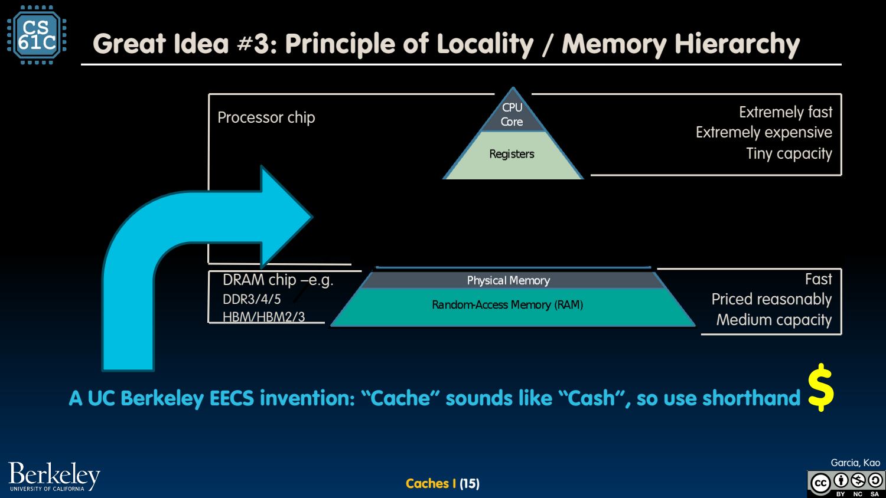
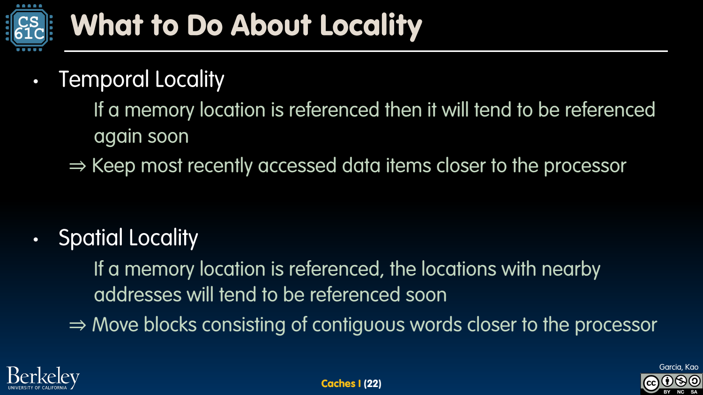

- 容量单位：先分清 kB 与 KiB
	- [Slides 3–7](../Slides/CS61C%202024Fa%20L24%20Caches%20I.pdf#page=3)
	- SI 十进制 kB/MB/GB 按 $10^3/10^6/10^9$；IEC 的 KiB/MiB/GiB 按 $2^{10}/2^{20}/2^{30}$，分析题应明确口径。
	- 字节寻址 M bytes 至少需要 $\lceil\log_2M\rceil$ 位地址，但“最小地址位数”不等于任何硬件接口都恰好这样设计。

- 为什么需要层次：大容量很难同样低延迟
	- [Slides 11–19](../Slides/CS61C%202024Fa%20L24%20Caches%20I.pdf#page=11)
	- 寄存器、L1/L2/L3、DRAM、持久存储在延迟、带宽、容量与成本上分工；CPU 等远端数据会浪费大量潜在执行机会。
	- Cache 保存活跃数据的副本，希望多数访问享受快速层，同时保留大存储容量；不是每次访问都获得 L1 延迟。
	- 

- Temporal 与 Spatial Locality
	- [Slides 21–22](../Slides/CS61C%202024Fa%20L24%20Caches%20I.pdf#page=21)
	- 时间局部性：刚访问的数据可能再次访问，值得暂时保留；空间局部性：附近地址也可能被访问，值得按块搬运。
	- 循环体指令、反复访问的变量、连续数组遍历往往可受益；随机访问与工作集超容量会削弱收益。
	- 

- 设计 Cache 的四个问题
	- [Slides 23–24](../Slides/CS61C%202024Fa%20L24%20Caches%20I.pdf#page=23)
	- 块可放在哪里？如何判断命中？满时替换谁？写入怎样同步下层？后续几讲分别加入映射、tag、替换与写策略。
	- 寄存器分配多由编译器管理，cache 与内存间搬运主要由硬件，虚拟页与后备存储主要由 OS 协调。

- 别把示意图的包容性当成所有机器的规定
	- [Slides 17–25](../Slides/CS61C%202024Fa%20L24%20Caches%20I.pdf#page=17)
	- 课件用上层是下层子集的 inclusive 图解释层次；实际 cache 可为 inclusive、exclusive 或其他策略。
	- 带宽与延迟也是两个指标；更大块可能摊薄请求开销，却不保证随机单次访问更快。
